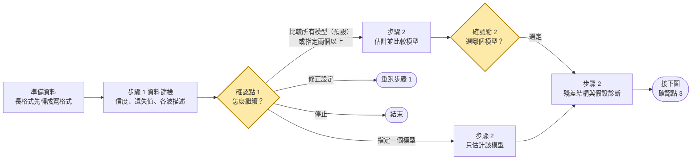
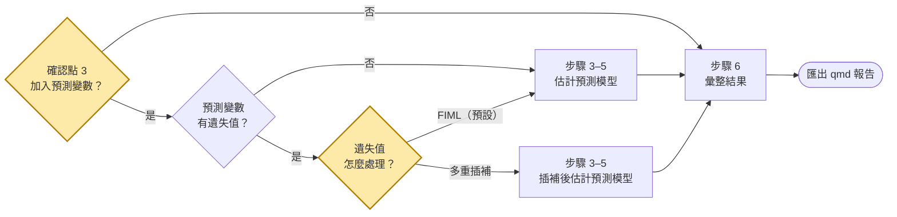

# 潛在成長模型（SEM 架構)

以 R 的 lavaan 建立潛在成長模型。流程依 Grimm, Ram, & Estabrook (2017) *Growth Modeling*；分析由 `scripts/` 的步驟腳本執行，方法與判讀細節放在 `references/`，需要時才讀。每個決策點都有流程圖（`references/00-flowcharts.md`）。

若使用者的問題不是單一變數的成長軌跡，而是交叉延宕、RI-CLPM、潛在改變分數、成長混合、因子曲線或平行歷程，見 `references/06-extensions.md`（有安裝 `sem-longitudinal` skill 時改用它）。

## 檔案

| 位置 | 內容 | 何時讀 |
|---|---|---|
| `references/00-flowcharts.md` | 整體流程、路徑圖、各步驟決策樹、問題排除 | 每個決策點 |
| `references/01-workflow-assumptions.md` | 假設總表、模型的統計假設 | 開始前 |
| `references/02`–`05` | 各步驟的方法與判讀 | 執行該步驟時 |
| `references/06-extensions.md` | 延伸模型與分工 | 需求超出單一變數 LGM 時 |
| `references/07-reporting-troubleshooting.md` | 報告清單、常見問題、解讀提醒 | 報告、出錯時 |
| `references/08-lavaan-growth-syntax.md` | lavaan 語法速查與陷阱 | 手寫語法時 |
| `references/09-fit-criteria.md` | 選模指標與門檻（整體配適門檻、模型比較門檻）與出處；腳本的數值集中在 `lgm_helpers.R` 的 `FIT_RULES` | 判讀配適、比較模型、說明建議理由時 |
| `scripts/step1`–`step6_*.R` | 各步驟分析 | 依流程 |
| `scripts/run_pipeline.R` | 用自己的資料跑完整流程：分三段（`--stage screen／model／predictors`，每段之後是確認點）或一次跑完（`--auto`），最後匯出 qmd | 分析使用者的資料時 |
| `scripts/record_decision.R` | 把確認點的建議與選擇寫進分析決定紀錄（`decisions.csv`） | 選擇不需要執行分析（例如停止）或要補理由時 |
| `scripts/export_qmd.R` | 把結果匯出成 qmd（一段程式碼、一段輸出） | 使用者要 qmd／HTML 報告時 |
| `scripts/sensitivity_mi.R` | 預測模型的多重插補（主結果）與 FIML 對照（Rubin 規則、FMI；插補下做不到的比較註明「插補下未提供」） | 確認點 3 加入的預測變數有遺失、使用者選多重插補時（`run_pipeline.R --missing mi`）；使用者主動要求時也可對無條件模型做插補對照 |
| `scripts/make_demo_data.R` | 產生三份為示範而模擬的資料（遺失、題目、預測變數遺失） | 重新產生示範資料時 |
| `scripts/run_all_demos.R` | 用範例資料跑完整流程 | 示範時 |
| `scripts/reshape_wave.R` | 長格式 ↔ 寬格式 | 資料是長格式時 |
| `assets/data/demo_growth.csv` | lavaan 的 `Demo.growth` 加上 `id` | 示範時 |
| `assets/data/demo_growth_missing.csv`、`demo_items.csv`、`demo_growth_missing_x.csv` | **為示範而模擬，不是真實資料**：MAR 流失＋輔助變數；每波 4 題；再加上預測變數 x1、x2 的遺失（說明見 `assets/data/README.md`） | 示範遺失機制、信度、預測變數有遺失時的 FIML 與多重插補時 |
| `docs/sem-lgm-guide.qmd` | 給使用者看的介紹與使用手冊 | 使用者問怎麼用時 |

## 環境

腳本用 `Rscript` 執行。Windows 上它常不在 PATH，請到 `C:\Program Files\R\R-*\bin\Rscript.exe` 找最新版本。第一次使用時先檢查套件：

```bash
Rscript <skill_dir>/scripts/check_env.R
```

缺套件時先徵求使用者同意，再加 `--install`（必要套件）或 `--install-optional`（再加上選用套件 mice、semPlot、psych）。選用套件缺少時只略過對應的功能（例如多重插補、自動路徑圖），其他步驟照常執行。輸出放在使用者的工作資料夾（例如 `lgm_results/`），不要寫進 skill 資料夾。

**沒有 R 的環境**（例如雲端執行環境裡找不到 `Rscript`）：不要假裝執行，也不要編造結果。改為說明要跑的指令、讓使用者在自己的電腦執行，再請使用者把 `lgm_results/` 的 `*_report.md` 或 CSV 傳回來解讀。

## 開始前要確認的事

**先弄清楚每個變數是什麼，再建模**：

- **使用者附上資料說明**（codebook、變數說明表、問卷題本、資料字典等）：先讀資料說明，取得變數意義、量尺與計分方向、遺失值代碼、各波的實際測量時間，再對照資料檔確認欄位名稱與型態一致；有不一致或說明沒寫到的地方，列出來問使用者。
- **沒有資料說明**：先讀取資料檔，自行彙整並列出**資料型態表**給使用者確認，欄位包含：變數名稱、資料型態（連續／整數／二元／類別／文字／日期）、有效人數、遺失比例、範圍或類別、推測的角色（ID、重複測量系列、時不變預測、分組）。疑似遺失值代碼的極端值（如 −99、999）要特別標出。角色只能從名稱與數值推測，例如結尾有波次編號的一組欄位是重複測量，但它是結果還是時變共變數要由使用者決定，所以使用者確認前不要開始分析。

資料不清楚時先問，因為這些決定會改變模型：

1. 重複測量的欄位、波數，以及**實際的測量時間**（等距？單位是月、年還是年級？）。
2. 截距要放在哪裡（`--anchor`）：預設 first，截距代表起始水準；關心結束時的水準用 last。
3. 預測變數哪些不隨時間改變（時不變），哪些每波都有值（時變）。
4. 遺失值代碼；資料是寬格式（每人一列）還是長格式。長格式先用 `reshape_wave.R` 轉。
5. 是否有分組變數要比較。
6. 有沒有**題目層級資料**（各波每一題的分數）：有的話用 `--items` 計算各波信度；只有總分時信度無法計算，要在報告說明。
7. 有沒有**輔助變數**：不在分析模型裡、但可能與遺失或結果有關的變數（例如基線的動機、健康狀況），用 `--aux` 納入遺失值分析與多重插補。

## 分析流程

從資料到成長模型：



從預測變數到報告：



這是和使用手冊第 5 章相同的分析流程。黃色菱形是**確認點**與遺失值的追問（由使用者決定）：先呈現結果與建議，等使用者決定才往下（規則見下一節）；確認點 1 直接指定一個模型時略過確認點 2（不做形式比較）。步驟 2 一律用 FIML；只有加入的預測變數有遺失值時，才問要不要改用多重插補。確認點 3 依想回答的問題選預測模型，步驟 3、4、5 可以複選、同時做（決策樹見 `00-flowcharts.md` §1）。每一步讀步驟二的 `chosen.txt`（用 `--from` 指定），所以形式、殘差結構、時間與截距位置只要在步驟二決定一次。

### 確認點

**原則**：每個確認點都先呈現結果與系統的建議，再讓使用者決定；**使用者沒有回覆前不往下執行**。只有兩種情況略過確認點、直接採用系統建議：使用者一開始就說「不用問我、直接跑完」，或在排程等無人值守的情況下。這時用一次跑完的指令（不給 `--stage`，或加 `--auto`），分析決定紀錄會註明「自動（未詢問）」，回覆時仍要列出每個確認點的建議。

**提問方式**：能用選項式提問工具（例如 AskUserQuestion）時用它，把建議的選項放第一個並標「（建議）」；否則用文字條列選項，請使用者回覆。

**確認點 1：資料篩檢之後**（`run_pipeline.R ... --stage screen`）

- 呈現（讀 `step1/screen_report.md`，依報告的順序）：樣本數與波數 → 有 `--items` 時的各波信度 → 遺失情形（遺失型態、遺失比例、MCAR 檢定、流失者比較）→ 各波描述表與 `trajectories.png` → **從篩檢結果看成長形式**（一兩句描述各波平均的走勢像直線還是彎曲、標準差是否逐波擴大；只描述，不下結論）→ 「簡易判讀」中所有 ⚠ 項目，每個 ⚠ 用一兩句白話說明代表什麼、可以怎麼處理。
- 問：**a 繼續，比較所有模型（建議、預設）**｜**b 直接指定成長模型**（無成長、線性、二次，可選一個或多個）｜**c 先修正設定後重跑篩檢**（遺失值代碼、測量時間、欄位）｜**d 停止**。只有 3 波時 b 不列二次，並說明原因（自由參數會超過資料提供的資訊）。只回「繼續」或沒指定模型時視為 a。
- 之後：
  - a → `--stage model`，進入確認點 2（現行做法）。
  - b 指定一個 → `--stage model --forms <形式>`：只估計該模型，略過確認點 2，但回報整體配適、是否收斂、有無負變異數與假設診斷。`step2/form_check.txt` 有內容（CFI < .90 或 RMSEA ≥ .10（自由度 ≤ 3 時不因 RMSEA 提醒）、不收斂或負變異數、各波殘差平均有系統性偏離；門檻在 `FIT_RULES`）時，明確提醒並問是否改為比較所有模型（不帶 `--forms` 重跑 `--stage model`）；使用者堅持採用時照做。接著是確認點 3。
  - b 指定兩個以上 → `--stage model --forms <形式,形式>`：只估計並比較指定的模型，進入確認點 2 從中選一個。
  - c → 用新參數重跑 `--stage screen` 並再問一次；d → `record_decision.R --point 1 --choice 停止` 後結束。
  - 用了 `--forms` 時，`--stage predictors` 也要帶相同的 `--forms`。

**確認點 2：選擇成長模型**（`run_pipeline.R ... --stage model`；確認點 1 已指定單一模型時略過）

- 確認點 1 指定兩個以上時，只比較指定的模型，選項也只有這些。
- 步驟二估計無成長、線性、二次（只有 3 波時不估計二次，說明原因：自由參數會超過資料提供的資訊），並估計潛在基底作參考。
- 呈現一張比較表（`step2/comparison.csv`、`unconditional_report.md` 的 A 節）：χ²(df)、CFI、RMSEA、BIC、是否可採用（有無負變異數、是否收斂）、整體配適（依整體配適門檻：良好／可接受／不佳，可接受時列出未達良好的指標），以及相對於前一個模型的比較結論（依模型比較門檻：LRT、BIC 證據強度、ΔCFI）。潛在基底列在表格下方，說明它用來判斷線性是否足夠（負荷接近線性時間代表線性已足夠），**不列為選項**。
- 說明建議（`step2/recommendation.txt`）與理由，問：**無成長**｜**線性**｜**二次**。建議規則依模型比較門檻：無成長 → 線性看 LRT p < .05；線性 → 二次要二次可採用、LRT p < .05，且二次的 BIC 低至少 2（Raftery 的「有證據」）。理由要寫出用了哪個指標與門檻（腳本的理由已經寫好）。
- 使用者選了「可採用 = 否」的模型時，說明問題（負變異數、未收斂……）並請他再確認一次。使用者主動要求潛在基底時才用 `--choose basis`。
- 殘差結構仍依 LRT 自動決定（殘差變異相等或殘差變異自由估計），在回報中說明結果即可，不另外詢問。

**確認點 3：是否加入預測變數**

- 問要不要加入預測變數，可複選；**只列出資料中有對應變數的選項**，每個選項附一句它回答的問題：
  - 時不變預測變數（`--covs`）：誰的起點比較高、誰變得比較快？
  - 時變共變數（`--tvc`）：每一波的共變數和同一波的分數有關嗎？
  - 多群組（`--group`／`--split`）：不同組別的軌跡一樣嗎？
  - 預測之後的結果（`--distal`，在步驟三估計，需要同時有時不變預測變數）：變化速度能預測之後的結果嗎？
  - 不加入：直接進入報告。
- 使用者還沒指定變數時，接著問用哪些變數，以及連續的預測變數要不要中心化（`--center`）。
- 之後執行 `run_pipeline.R ... --stage predictors [--forms <確認點 1 指定的形式>] --choose <採用的形式> [預測變數參數]`：選擇和步驟二目前採用的不同時會自動重跑步驟二；接著跑選到的步驟三、四、五、步驟六，最後匯出 qmd（加 `--render` 渲染成 HTML）。
- **遺失值的追問**：加入的預測變數（含時變共變數、分組變數、遠端結果）都沒有遺失值時用 FIML，不詢問。有遺失值時，`--stage predictors` 會先列出哪些變數有遺失與比例並停下；這時問「遺失值怎麼處理？」：**FIML（預設、建議）**｜**多重插補**，再加 `--missing fiml` 或 `--missing mi` 重跑（選多重插補時可加 `--aux`，和預設不同時用 `--reason4` 記理由）。選多重插補時，插補模型包含各波結果變數、所選的預測變數與輔助變數；報告以插補結果為主，並列同一模型的 FIML 結果與差異，插補下做不到的模型比較註明「插補下未提供」。沒有加入預測變數時不插補（使用者主動要求時，可直接用 `sensitivity_mi.R` 對無條件模型做插補對照）。「不用問我，直接跑完」時採用 FIML，並在分析決定紀錄註明。

**分析決定紀錄**：`run_pipeline.R` 自動把每個確認點的建議與選擇寫進 `<out>/decisions.csv`（確認點 1 記下 a／b 與指定的模型；直接指定單一模型時，確認點 2 註明「使用者於確認點 1 直接指定，未做形式比較」，提醒過配適問題而仍採用時一併記下提醒內容；另有一列「遺失值的處理」，記下 FIML 或多重插補與有遺失的預測變數），`export_qmd.R` 把它放在報告開頭的「分析決定紀錄」。使用者的選擇和建議不同時，問一句理由，用 `--reason1`／`--reason2`／`--reason3`／`--reason4` 傳入（沒說明就寫「未說明」）。不必執行分析的選擇（例如停止）用 `record_decision.R` 記錄。報告只包含實際執行過的步驟。

| 步驟 | 腳本 | 做什麼 | 進入的條件 | 參考文件 |
|---|---|---|---|---|
| 1 篩檢 | `step1_screen.R` | 依序：各波信度（`--items`）→ 遺失機制檢驗（遺失比例、涵蓋率、MCAR 檢定、流失者比較，`--aux`）→ 各波描述、軌跡圖與成長形式的描述 → 穩定性、ICC → 簡易判讀 | 一律執行；**之後是確認點 1** | `02` |
| 2 無條件模型 | `step2_unconditional.R` | 依序：估計並比較無成長、線性、二次（潛在基底作參考）並給建議（確認點 1 指定時只估計指定的形式，`--forms`）→ 以潛在基底為基準的比較 → 殘差結構 → 採用模型 → 假設診斷 → 時間編碼敏感度；一律用 FIML | 一律執行；**估計形式後是確認點 2**；**之後是確認點 3** | `03`、`00` §3 |
| 3 時不變預測 | `step3_conditional.R` | 預測截距與斜率、解釋變異量、預測軌跡 | 有 `--covs` | `04`、`00` §4 |
| 4 時變共變數 | `step4_tvc.R` | 效果相等或自由、是否與成長因子相關 | 有 `--tvc` | `04`、`00` §5 |
| 5 多群組 | `step5_multigroup.R` | M1–M4 依序比較群組差異 | 有 `--group` 或 `--split` | `05`、`00` §6 |
| 3–5 的多重插補（選做） | `sensitivity_mi.R` | 對最終的預測模型做多重插補（mice、Rubin 規則）：插補結果為主，並列 FIML 的估計值、SE 與差異、FMI | 加入的預測變數有遺失值，且選擇多重插補（`run_pipeline.R --missing mi`） | `02` §6 |
| 6 報告 | `step6_report.R` | 各步驟結果、各模型的評估指標表（`fit_all.csv`）、最終模型摘要 | 一律執行 | `07` |
| 匯出 | `export_qmd.R` | 產生 `lgm_analysis.qmd`：各步驟摘要與圖、每個模型的 lavaan 程式碼與 `summary()` 輸出 | 一律執行（`run_pipeline.R` 自動做；`--render` 渲染成 HTML） | `07` |

各腳本開頭的註解列出所有參數。

## 典型指令

分三段，每段之後是一個確認點（三段的共同參數保持相同）：

```bash
Rscript scripts/run_pipeline.R --data d.csv --y "^score_t" --times 0,1,2,4 --baseline age,sex --out lgm_results --stage screen
Rscript scripts/run_pipeline.R --data d.csv --y "^score_t" --times 0,1,2,4 --baseline age,sex --out lgm_results --stage model
Rscript scripts/run_pipeline.R --data d.csv --y "^score_t" --times 0,1,2,4 --baseline age,sex --out lgm_results --stage predictors --choose linear --covs age,sex --center --tvc "^stress_t" --render
```

確認點 1 直接指定成長模型（只估計線性；指定兩個以上時寫成 `--forms linear,quad`，第三段的 `--choose` 是確認點 2 的選擇）：

```bash
Rscript scripts/run_pipeline.R --data d.csv --y "^score_t" --times 0,1,2,4 --out lgm_results --stage model --forms linear
Rscript scripts/run_pipeline.R --data d.csv --y "^score_t" --times 0,1,2,4 --out lgm_results --stage predictors --forms linear --choose linear --covs age,sex --center --render
```

使用者說「不用問我，直接跑完」（或無人值守）時，一次跑完，估計所有形式，確認點採用系統建議（不加 `--forms`）：

```bash
Rscript scripts/run_pipeline.R --data d.csv --y "^score_t" --times 0,1,2,4 --covs age,sex --center --tvc "^stress_t" --out lgm_results --auto --render
```

有題目資料、輔助變數，而且加入的預測變數有遺失值、使用者選多重插補時，每一段都加上相同的 `--items`、`--aux`，最後一段再加 `--missing mi`（選 FIML 時寫 `--missing fiml`）：

```bash
Rscript scripts/run_pipeline.R --data d.csv --y "^score_t[0-9]$" --items "^score_t[0-9]+_i" --aux motivation --times 0,1,2,4 --out lgm_results --stage screen
Rscript scripts/run_pipeline.R --data d.csv --y "^score_t[0-9]$" --items "^score_t[0-9]+_i" --aux motivation --times 0,1,2,4 --out lgm_results --stage model
Rscript scripts/run_pipeline.R --data d.csv --y "^score_t[0-9]$" --items "^score_t[0-9]+_i" --aux motivation --times 0,1,2,4 --out lgm_results --stage predictors --choose linear --covs age,sex --missing mi --render
```

記錄不必執行分析的選擇，或補上使用者的理由：

```bash
Rscript scripts/record_decision.R --results lgm_results --point 1 --choice 停止 --reason "樣本太少"
```

逐步：

```bash
Rscript scripts/step1_screen.R --data d.csv --y "^score_t" --baseline age,sex --out lgm_results/step1
Rscript scripts/step2_unconditional.R --data d.csv --y "^score_t" --times 0,1,2,4 [--anchor first] --out lgm_results/step2
Rscript scripts/step3_conditional.R --data d.csv --y "^score_t" --covs age,sex --center --from lgm_results/step2 --out lgm_results/step3
Rscript scripts/step4_tvc.R --data d.csv --y "^score_t" --tvc "^stress_t" --covs age,sex --from lgm_results/step2 --out lgm_results/step4
Rscript scripts/step6_report.R --results lgm_results
Rscript scripts/sensitivity_mi.R --final lgm_results/step3/conditional_fit.rds [--aux motivation] [--m 20] --out lgm_results/sensitivity_mi
Rscript scripts/export_qmd.R --results lgm_results [--title "標題"] [--render]
```

`--y "^score_t"` 會抓取符合的欄位並依結尾的波次編號排序；也可以給逗號清單。`--times` 給實際測量時間，`--anchor` 決定哪個時間是 0（first／last／mid／數值）。每一步都輸出繁中摘要（`*_report.md`）、CSV、圖，以及每個模型的 `diagnostics.txt`、`parameters.csv`、`summary.txt` 與語法檔（`model_*.lav`）。先讀摘要。

**匯出 qmd**：`export_qmd.R` 在輸出資料夾寫出 `lgm_analysis.qmd`，每個模型都是「一段程式碼、一段輸出」：

- 程式碼預設摺疊；`summary()` 輸出包在「顯示 summary 輸出」的可展開區塊裡；模型比較（配適指標表、LRT）直接顯示。
- 程式碼用的語法、估計設定（每個模型資料夾的 `call.txt`）與資料（`analysis_data.rds`）都和腳本實際使用的相同，所以數值與摘要一致。
- `--render` 會找 Quarto（PATH 或 RStudio 內建）渲染成 `lgm_analysis.html`；找不到時請使用者用 RStudio 開啟 qmd 按 Render。
- 使用者要報告、qmd 或 HTML 時，把這兩個檔案交給使用者；qmd 要和 `step*/`、`report/` 資料夾放在一起才能重新渲染。

## 判讀原則

這些是成長模型最常出錯的地方，解讀時要主動處理：

- **時間編碼要用實際間隔。** 不等距時一定要給 `--times`。斜率是「每單位時間」的變化，要寫明單位。
- **截距的意義取決於時間 0 的位置。** 截距平均、截距變異、截距–斜率相關都會隨 `--anchor` 改變，整體配適不變；步驟二的時間編碼敏感度會列出差異，報告時要寫明時間 0 在哪裡。
- **不要只看配適選形式。** 依 `00-flowcharts.md` §3：先排除不可採用的模型（負變異數），再看巢套 LRT、BIC、潛在基底的負荷、殘差圖與理論；改善很小（ΔBIC < 2、ΔCFI ≤ .01）時選較簡約的形式。步驟二的 B 節以潛在基底為基準再確認一次：較簡單的模型 LRT 不顯著、ΔBIC 為負，代表加上限制沒有變差。
- **選模指標與門檻見 `references/09-fit-criteria.md`**（整體配適門檻：RMSEA < .05 良好、.05–.08 可接受、.08–.10 勉強、≥ .10 不佳；CFI、TLI > .95 良好、.90–.95 可接受、< .90 不佳；SRMR ≤ .08；自由度 ≤ 3 時 RMSEA 只供參考。模型比較門檻：LRT、BIC、AIC、ΔCFI 的門檻與出處）。都是經驗法則，不是硬性標準；CFI、TLI 取決於基準模型。AIC、BIC 只能在同一步驟的模型之間比較。
- **先看假設診斷。** 殘差平均有規律的趨勢代表未建模的非線性；殘差 SD 差異大代表殘差變異不等；因子分數極端代表可能的離群個案。
- **斜率平均不顯著不等於沒人改變。** 要同時看斜率變異。變異的檢定在邊界上，偏保守（LRT 的 p 可除以 2 作近似）。
- **加入預測變數後，截距與斜率平均的意義改變**：變成預測變數都等於 0 時的值。0 沒有意義時用 `--center`。
- **加入時不變預測變數通常不會改變 CFI、RMSEA**；預測變數是否有用看階層式 LRT 與個別路徑。
- **時變共變數的效果跨波相等是假設，不是事實。** 步驟四會檢定；LRT 與 BIC 結論不同時，兩個都報告。
- **時變效果是同一波的關聯**，不代表因果方向。
- **無法檢驗測量恆等性時要說明。** 只有單一分數時，成長可能包含量尺的變化（Grimm, 2017）。
- **信度要每一波分別評估，不能用重測信度**（研究的目的就是改變）。有題目資料時看各波 α、ω 與題目–總分相關；只有總分時無法計算，報告時說明。某一波信度偏低時，該波殘差變大、估計較不精確；若把殘差變異設為相等，還會造成偏誤。各波信度差距大時，變異的改變可能部分來自誤差變異的改變，也可能是測量恆等性的警訊。
- **MCAR 檢定的限制**：顯著只代表遺失不是完全隨機；樣本大時很小的差異也會顯著；不顯著不代表 MCAR 成立；任何檢定都無法分辨 MAR 與 MNAR。
- **遺失預設以 FIML 處理**，前提是 MAR。不要刪除未完成所有波次的人。預測變數有遺失時腳本會自動改用 `fixed.x = FALSE`。有與遺失或結果相關的變數時用 `--aux` 納入。
- **多重插補只在預測模型階段使用。** 步驟 2 一律用 FIML；加入的預測變數有遺失值、使用者選多重插補時，以插補結果為主並列 FIML 對照；差異超過 FIML 的 1 個 SE 時，兩種結果都報告。兩者都假設 MAR。
- **不要用平均數插補或 LOCF（最後一次觀察值延續）**：前者壓縮變異、扭曲相關，後者假設流失後不再改變，都會讓成長參數偏誤。
- **觀察性資料不能推論因果**，寫「預測」、「與……有關」。
- **不要捏造結果。** 報告的數字都要來自腳本輸出；失敗就說失敗並附錯誤訊息（見 `stepN.log`）。

## 模型限制

- **每人測量時間都不同**（例如每個人在不同的年齡或日期受測）：本 skill 的潛在成長模型假設所有人共用同一組時間負荷，不適用這種資料，也不要硬轉成寬格式。要改用多層次成長模型，或以定義變數（definition variables）設定每個人的時間負荷；這兩種作法本 skill 都沒有實作，需要時先告知使用者，並參考 `references/06-extensions.md`。
- 其他超出單一變數潛在成長模型的情況（成長混合、平行歷程、因子曲線、類別結果、潛在改變分數、RI-CLPM、非線性參數模型、分段模型）同樣沒有實作，見 `references/06-extensions.md`。

## 回覆使用者時

1. 先講結論：變化的形式、平均變化量與單位、是否有個別差異、預測變數的效果。
2. 附配適指標與關鍵參數（估計值、95% CI）。
3. 指出假設診斷、時間編碼敏感度與限制。
4. 結果用簡短的條列與表格呈現，不寫成論文段落。
5. 使用者問「為什麼選這個模型」時，對照 `00-flowcharts.md` 的決策樹逐步說明。

使用者用中文時以繁體中文回覆，術語附英文（例如潛在基底模型 latent basis model）。

## 範例資料

`assets/data/demo_growth.csv` 是 lavaan 內建的 `Demo.growth`（模擬資料，加上 `id` 欄）：`t1`–`t4` 重複測量、`x1`、`x2` 時不變預測、`c1`–`c4` 時變共變數。跑完整流程：

```bash
cd <skill_dir>
Rscript scripts/run_all_demos.R --out <輸出資料夾>
```

使用者說「用範例資料示範」時，直接用這份資料，並說明它是模擬資料、變數沒有實質意義、真實參數未公開。
