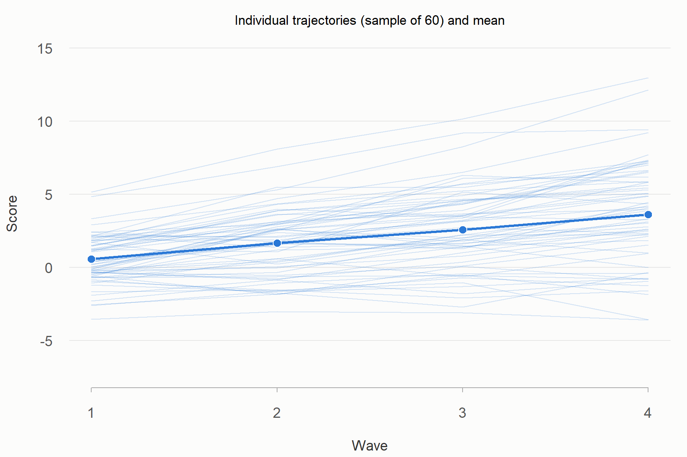
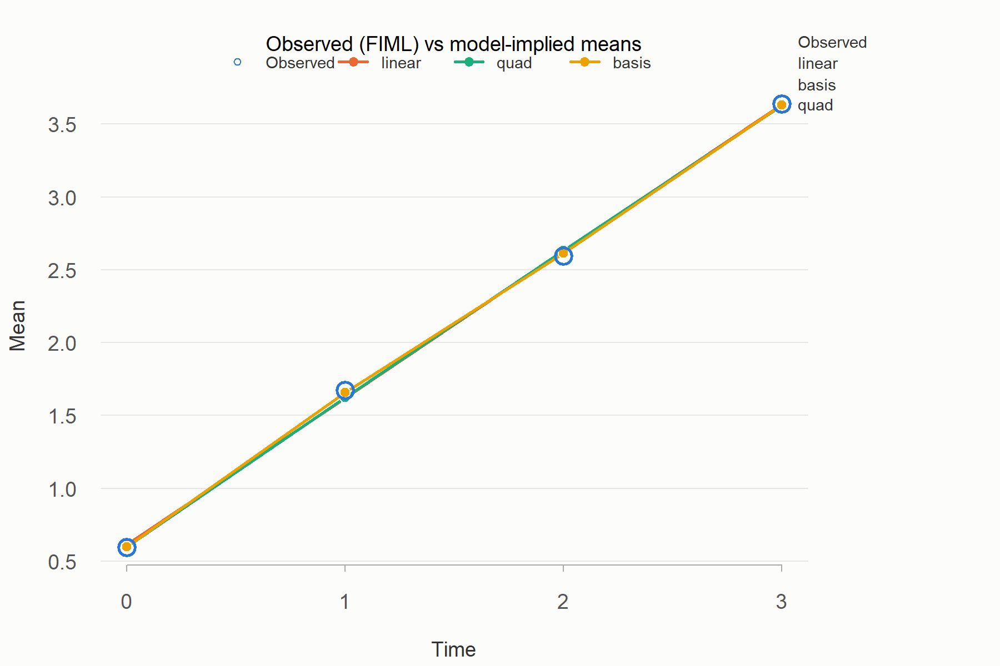
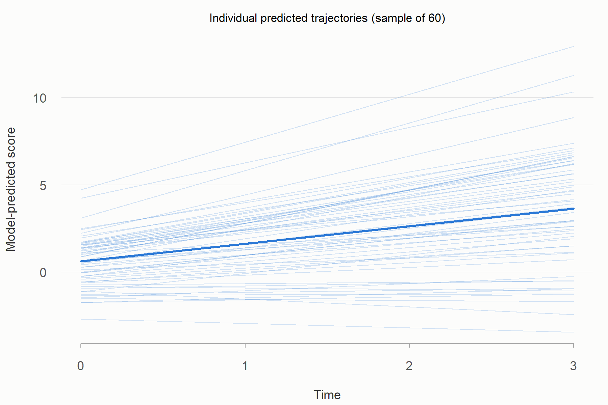
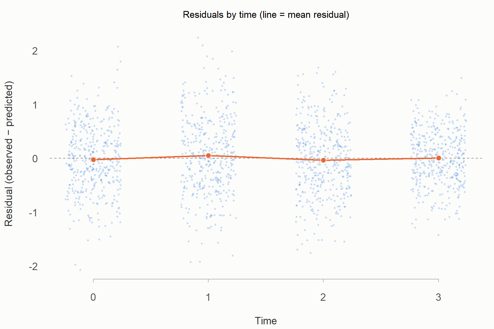
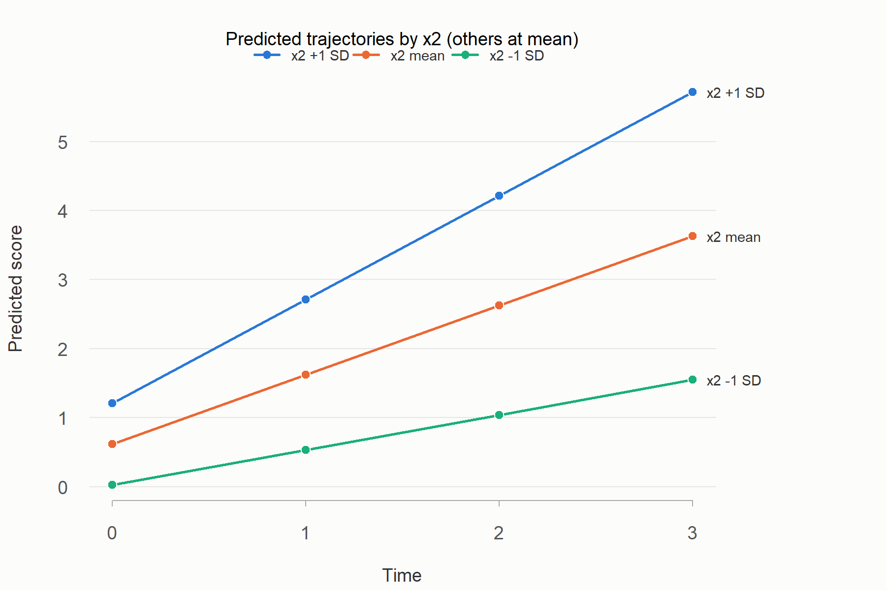
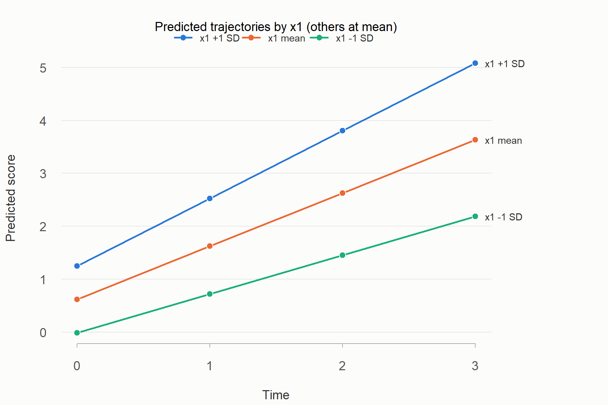

```{r}
#| label: setup
#| include: false
# summary() 的輸出包在可展開的 <details> 裡（區塊選項 fold_output: true）
local({
  default_output <- knitr::knit_hooks$get("output")
  knitr::knit_hooks$set(output = function(x, options) {
    o <- default_output(x, options)
    if (isTRUE(options$fold_output)) paste0("\n\n<details class=\"output-fold\"><summary>顯示 summary 輸出</summary>\n\n", o, "\n\n</details>\n\n") else o
  })
})
# 讀入腳本產生的摘要（*_report.md）
show_report <- function(path, from = NULL) {
  if (!file.exists(path)) { cat("\n> 找不到 `", path, "`：該步驟可能執行失敗，請看對應的 .log。\n\n", sep = ""); return(invisible()) }
  x <- readLines(path, encoding = "UTF-8", warn = FALSE)
  if (!is.null(from)) { i <- grep(from, x); x <- if (length(i)) x[i[1]:length(x)] else character() }
  x <- x[!grepl("^# ", x)]
  x <- sub("^## (.*)$", "**\\1**", x)
  cat("\n::: {.report}\n\n", paste(x, collapse = "\n"), "\n\n:::\n\n", sep = "")
}
```

# 分析設定

- 每個模型都用和分析腳本相同的語法、估計設定與資料重新估計，所以數值與藍色摘要一致。
- 點「顯示程式碼」展開程式碼，點「顯示 summary 輸出」展開 `summary()` 的完整輸出；右上角的「程式碼」選單可以一次展開或摺疊全部程式碼。
- 藍色區塊是分析腳本產生的摘要。

```{r}
#| label: functions
#| code-summary: "顯示共用函式"
library(lavaan)
show_summary <- function(fit) summary(fit, fit.measures = TRUE, standardized = TRUE, rsquare = TRUE)
# 配適指標表：有穩健版本（MLR）時用穩健值
fit_compare <- function(fits) {
  rob <- c(chisq = "chisq.scaled", df = "df.scaled", pvalue = "pvalue.scaled", cfi = "cfi.robust", tli = "tli.robust", rmsea = "rmsea.robust")
  keys <- c("chisq", "df", "pvalue", "cfi", "tli", "rmsea", "srmr", "aic", "bic")
  tab <- t(sapply(fits, function(f) {
    fm <- tryCatch(fitMeasures(f), error = function(e) NULL)
    sapply(keys, function(k) { r <- rob[k]
      if (is.null(fm)) NA else if (!is.na(r) && r %in% names(fm) && !is.na(fm[[r]])) fm[[r]] else if (k %in% names(fm)) fm[[k]] else NA })
  }))
  knitr::kable(tab, digits = 3, col.names = c("χ²", "df", "p", "CFI", "TLI", "RMSEA", "SRMR", "AIC", "BIC"))
}
```

# 步驟一：資料篩檢

## 各波描述統計

```{r}
d <- readRDS("step2/analysis_data.rds")
y <- c("t1", "t2", "t3", "t4")
data.frame(波次 = y, N = colSums(!is.na(d[y])), 平均 = colMeans(d[y], na.rm = TRUE),
           SD = sapply(d[y], sd, na.rm = TRUE), `遺失 %` = 100 * colMeans(is.na(d[y])), check.names = FALSE) |>
  knitr::kable(digits = 2, row.names = FALSE)
round(cor(d[y], use = "pairwise.complete.obs"), 2)
```

## 結果摘要

```{r}
#| echo: false
#| results: asis
show_report("step1/screen_report.md")
```

## 圖

{width=80%}

# 步驟二：無條件成長模型

## 結果摘要

```{r}
#| echo: false
#| results: asis
show_report("step2/unconditional_report.md")
```

## 圖

{width=80%}

{width=80%}

{width=80%}

## lavaan 程式碼與結果

讀入這一步實際使用的資料（已處理遺失值代碼、中心化、交互作用項或分組）：

```{r}
d2 <- readRDS("step2/analysis_data.rds")
```

### 無成長模型（殘差變異自由估計）

```{r}
#| fold_output: true
m2_none <- '
  i =~ 1*t1 + 1*t2 + 1*t3 + 1*t4
'
f2_none <- growth(m2_none,
       data = d2, estimator = "MLR", missing = "fiml", fixed.x = TRUE)
show_summary(f2_none)
```

### 線性模型（殘差變異自由估計）

```{r}
#| fold_output: true
m2_linear <- '
  i =~ 1*t1 + 1*t2 + 1*t3 + 1*t4
  s =~ 0*t1 + 1*t2 + 2*t3 + 3*t4
'
f2_linear <- growth(m2_linear,
       data = d2, estimator = "MLR", missing = "fiml", fixed.x = TRUE)
show_summary(f2_linear)
```

### 二次模型（殘差變異自由估計）

```{r}
#| fold_output: true
m2_quad <- '
  i =~ 1*t1 + 1*t2 + 1*t3 + 1*t4
  s =~ 0*t1 + 1*t2 + 2*t3 + 3*t4
  q =~ 0*t1 + 1*t2 + 4*t3 + 9*t4
'
f2_quad <- growth(m2_quad,
       data = d2, estimator = "MLR", missing = "fiml", fixed.x = TRUE)
show_summary(f2_quad)
```

### 潛在基底模型（殘差變異自由估計）

```{r}
#| fold_output: true
m2_basis <- '
  i =~ 1*t1 + 1*t2 + 1*t3 + 1*t4
  s =~ 0*t1 + NA*t2 + NA*t3 + 3*t4
'
f2_basis <- growth(m2_basis,
       data = d2, estimator = "MLR", missing = "fiml", fixed.x = TRUE)
show_summary(f2_basis)
```

### 線性模型（殘差變異相等）

```{r}
#| fold_output: true
m2_linear_equal_resid <- '
  i =~ 1*t1 + 1*t2 + 1*t3 + 1*t4
  s =~ 0*t1 + 1*t2 + 2*t3 + 3*t4
  t1 ~~ theta*t1
  t2 ~~ theta*t2
  t3 ~~ theta*t3
  t4 ~~ theta*t4
'
f2_linear_equal_resid <- growth(m2_linear_equal_resid,
       data = d2, estimator = "MLR", missing = "fiml", fixed.x = TRUE)
show_summary(f2_linear_equal_resid)
```

### 模型比較

```{r}
# 配適指標
fit_compare(list(`無成長模型（殘差變異自由估計）` = f2_none, `線性模型（殘差變異自由估計）` = f2_linear, `二次模型（殘差變異自由估計）` = f2_quad, `潛在基底模型（殘差變異自由估計）` = f2_basis, `線性模型（殘差變異相等）` = f2_linear_equal_resid))

# 巢套比較（MLR 時自動使用尺度校正的差異檢定；看 Chisq diff 與 Pr(>Chisq)）
lavTestLRT(f2_none, f2_linear)   # 無成長模型（殘差變異自由估計） → 線性模型（殘差變異自由估計）
lavTestLRT(f2_linear, f2_quad)   # 線性模型（殘差變異自由估計） → 二次模型（殘差變異自由估計）
lavTestLRT(f2_linear, f2_basis)   # 線性模型（殘差變異自由估計） → 潛在基底模型（殘差變異自由估計）
lavTestLRT(f2_linear_equal_resid, f2_linear)   # 線性模型（殘差變異相等） → 線性模型（殘差變異自由估計）
```

# 步驟三：時不變預測變數

## 結果摘要

```{r}
#| echo: false
#| results: asis
show_report("step3/conditional_report.md")
```

## 圖

{width=80%}

## lavaan 程式碼與結果

讀入這一步實際使用的資料（已處理遺失值代碼、中心化、交互作用項或分組）：

```{r}
d3 <- readRDS("step3/analysis_data.rds")
```

### 基準模型（預測路徑固定為 0）

```{r}
#| fold_output: true
m3_baseline_zero <- '
  i =~ 1*t1 + 1*t2 + 1*t3 + 1*t4
  s =~ 0*t1 + 1*t2 + 2*t3 + 3*t4
  t1 ~~ theta*t1
  t2 ~~ theta*t2
  t3 ~~ theta*t3
  t4 ~~ theta*t4
  i ~ 0*x1 + 0*x2
  s ~ 0*x1 + 0*x2
'
f3_baseline_zero <- growth(m3_baseline_zero,
       data = d3, estimator = "MLR", missing = "fiml", fixed.x = TRUE)
show_summary(f3_baseline_zero)
```

### 條件模型

```{r}
#| fold_output: true
m3_conditional <- '
  i =~ 1*t1 + 1*t2 + 1*t3 + 1*t4
  s =~ 0*t1 + 1*t2 + 2*t3 + 3*t4
  t1 ~~ theta*t1
  t2 ~~ theta*t2
  t3 ~~ theta*t3
  t4 ~~ theta*t4
  i ~ x1 + x2
  s ~ x1 + x2
'
f3_conditional <- growth(m3_conditional,
       data = d3, estimator = "MLR", missing = "fiml", fixed.x = TRUE)
show_summary(f3_conditional)
```

### 模型比較

```{r}
# 配適指標
fit_compare(list(`基準模型（預測路徑固定為 0）` = f3_baseline_zero, `條件模型` = f3_conditional))

# 巢套比較（MLR 時自動使用尺度校正的差異檢定；看 Chisq diff 與 Pr(>Chisq)）
lavTestLRT(f3_baseline_zero, f3_conditional)   # 基準模型（預測路徑固定為 0） → 條件模型

# 解釋變異量（R²）
round(lavInspect(f3_conditional, "r2"), 3)
```

# 步驟三：時不變預測變數（交互作用）

## 結果摘要

```{r}
#| echo: false
#| results: asis
show_report("step3_interaction/conditional_report.md")
```

## 圖

{width=80%}

## lavaan 程式碼與結果

讀入這一步實際使用的資料（已處理遺失值代碼、中心化、交互作用項或分組）：

```{r}
d3_interaction <- readRDS("step3_interaction/analysis_data.rds")
```

### 基準模型（預測路徑固定為 0）

```{r}
#| fold_output: true
m3i_baseline_zero <- '
  i =~ 1*t1 + 1*t2 + 1*t3 + 1*t4
  s =~ 0*t1 + 1*t2 + 2*t3 + 3*t4
  t1 ~~ theta*t1
  t2 ~~ theta*t2
  t3 ~~ theta*t3
  t4 ~~ theta*t4
  i ~ 0*x1 + 0*x2 + 0*x1_x_x2
  s ~ 0*x1 + 0*x2 + 0*x1_x_x2
'
f3i_baseline_zero <- growth(m3i_baseline_zero,
       data = d3_interaction, estimator = "MLR", missing = "fiml", fixed.x = TRUE)
show_summary(f3i_baseline_zero)
```

### 條件模型

```{r}
#| fold_output: true
m3i_conditional <- '
  i =~ 1*t1 + 1*t2 + 1*t3 + 1*t4
  s =~ 0*t1 + 1*t2 + 2*t3 + 3*t4
  t1 ~~ theta*t1
  t2 ~~ theta*t2
  t3 ~~ theta*t3
  t4 ~~ theta*t4
  i ~ x1 + x2 + x1_x_x2
  s ~ x1 + x2 + x1_x_x2
'
f3i_conditional <- growth(m3i_conditional,
       data = d3_interaction, estimator = "MLR", missing = "fiml", fixed.x = TRUE)
show_summary(f3i_conditional)
```

### 模型比較

```{r}
# 配適指標
fit_compare(list(`基準模型（預測路徑固定為 0）` = f3i_baseline_zero, `條件模型` = f3i_conditional))

# 巢套比較（MLR 時自動使用尺度校正的差異檢定；看 Chisq diff 與 Pr(>Chisq)）
lavTestLRT(f3i_baseline_zero, f3i_conditional)   # 基準模型（預測路徑固定為 0） → 條件模型

# 解釋變異量（R²）
round(lavInspect(f3i_conditional, "r2"), 3)
```

# 步驟四：時變共變數

## 結果摘要

```{r}
#| echo: false
#| results: asis
show_report("step4/tvc_report.md")
```

## lavaan 程式碼與結果

讀入這一步實際使用的資料（已處理遺失值代碼、中心化、交互作用項或分組）：

```{r}
d4 <- readRDS("step4/analysis_data.rds")
```

### 時變共變數模型：相等、不相關

```{r}
#| fold_output: true
m4_m1 <- '
  i =~ 1*t1 + 1*t2 + 1*t3 + 1*t4
  s =~ 0*t1 + 1*t2 + 2*t3 + 3*t4
  t1 ~~ theta*t1
  t2 ~~ theta*t2
  t3 ~~ theta*t3
  t4 ~~ theta*t4
  i ~ x1 + x2
  s ~ x1 + x2
  t1 ~ btvc*c1
  t2 ~ btvc*c2
  t3 ~ btvc*c3
  t4 ~ btvc*c4
  x1 ~ 1
  x2 ~ 1
  c1 ~ 1
  c2 ~ 1
  c3 ~ 1
  c4 ~ 1
  x1 ~~ x2
  x1 ~~ c1
  x1 ~~ c2
  x1 ~~ c3
  x1 ~~ c4
  x2 ~~ c1
  x2 ~~ c2
  x2 ~~ c3
  x2 ~~ c4
  c1 ~~ c2
  c1 ~~ c3
  c1 ~~ c4
  c2 ~~ c3
  c2 ~~ c4
  c3 ~~ c4
'
f4_m1 <- growth(m4_m1,
       data = d4, estimator = "MLR", missing = "fiml", fixed.x = FALSE)
show_summary(f4_m1)
```

### 時變共變數模型：自由、不相關

```{r}
#| fold_output: true
m4_m2 <- '
  i =~ 1*t1 + 1*t2 + 1*t3 + 1*t4
  s =~ 0*t1 + 1*t2 + 2*t3 + 3*t4
  t1 ~~ theta*t1
  t2 ~~ theta*t2
  t3 ~~ theta*t3
  t4 ~~ theta*t4
  i ~ x1 + x2
  s ~ x1 + x2
  t1 ~ btvc1*c1
  t2 ~ btvc2*c2
  t3 ~ btvc3*c3
  t4 ~ btvc4*c4
  x1 ~ 1
  x2 ~ 1
  c1 ~ 1
  c2 ~ 1
  c3 ~ 1
  c4 ~ 1
  x1 ~~ x2
  x1 ~~ c1
  x1 ~~ c2
  x1 ~~ c3
  x1 ~~ c4
  x2 ~~ c1
  x2 ~~ c2
  x2 ~~ c3
  x2 ~~ c4
  c1 ~~ c2
  c1 ~~ c3
  c1 ~~ c4
  c2 ~~ c3
  c2 ~~ c4
  c3 ~~ c4
'
f4_m2 <- growth(m4_m2,
       data = d4, estimator = "MLR", missing = "fiml", fixed.x = FALSE)
show_summary(f4_m2)
```

### 時變共變數模型：自由、相關

```{r}
#| fold_output: true
m4_m3 <- '
  i =~ 1*t1 + 1*t2 + 1*t3 + 1*t4
  s =~ 0*t1 + 1*t2 + 2*t3 + 3*t4
  t1 ~~ theta*t1
  t2 ~~ theta*t2
  t3 ~~ theta*t3
  t4 ~~ theta*t4
  i ~ x1 + x2
  s ~ x1 + x2
  t1 ~ btvc1*c1
  t2 ~ btvc2*c2
  t3 ~ btvc3*c3
  t4 ~ btvc4*c4
  i ~~ c1
  s ~~ c1
  i ~~ c2
  s ~~ c2
  i ~~ c3
  s ~~ c3
  i ~~ c4
  s ~~ c4
  x1 ~ 1
  x2 ~ 1
  c1 ~ 1
  c2 ~ 1
  c3 ~ 1
  c4 ~ 1
  x1 ~~ x2
  x1 ~~ c1
  x1 ~~ c2
  x1 ~~ c3
  x1 ~~ c4
  x2 ~~ c1
  x2 ~~ c2
  x2 ~~ c3
  x2 ~~ c4
  c1 ~~ c2
  c1 ~~ c3
  c1 ~~ c4
  c2 ~~ c3
  c2 ~~ c4
  c3 ~~ c4
'
f4_m3 <- growth(m4_m3,
       data = d4, estimator = "MLR", missing = "fiml", fixed.x = FALSE)
show_summary(f4_m3)
```

### 模型比較

```{r}
# 配適指標
fit_compare(list(`時變共變數模型：相等、不相關` = f4_m1, `時變共變數模型：自由、不相關` = f4_m2, `時變共變數模型：自由、相關` = f4_m3))

# 巢套比較（MLR 時自動使用尺度校正的差異檢定；看 Chisq diff 與 Pr(>Chisq)）
lavTestLRT(f4_m1, f4_m2)   # 時變共變數模型：相等、不相關 → 時變共變數模型：自由、不相關
lavTestLRT(f4_m2, f4_m3)   # 時變共變數模型：自由、不相關 → 時變共變數模型：自由、相關
```

# 步驟五：多群組成長模型

## 結果摘要

```{r}
#| echo: false
#| results: asis
show_report("step5/multigroup_report.md")
```

## lavaan 程式碼與結果

讀入這一步實際使用的資料（已處理遺失值代碼、中心化、交互作用項或分組）：

```{r}
d5 <- readRDS("step5/analysis_data.rds")
```

### M1 全部相等

```{r}
#| fold_output: true
m5_M1 <- '
  i =~ 1*t1 + 1*t2 + 1*t3 + 1*t4
  s =~ 0*t1 + 1*t2 + 2*t3 + 3*t4
'
f5_M1 <- growth(m5_M1,
       data = d5, estimator = "MLR", missing = "fiml", fixed.x = TRUE, group = ".grp", group.equal = c("means", "lv.variances", "lv.covariances", "residuals"))
show_summary(f5_M1)
```

### M2 平均不同

```{r}
#| fold_output: true
m5_M2 <- '
  i =~ 1*t1 + 1*t2 + 1*t3 + 1*t4
  s =~ 0*t1 + 1*t2 + 2*t3 + 3*t4
'
f5_M2 <- growth(m5_M2,
       data = d5, estimator = "MLR", missing = "fiml", fixed.x = TRUE, group = ".grp", group.equal = c("lv.variances", "lv.covariances", "residuals"))
show_summary(f5_M2)
```

### M3 ＋變異共變不同

```{r}
#| fold_output: true
m5_M3 <- '
  i =~ 1*t1 + 1*t2 + 1*t3 + 1*t4
  s =~ 0*t1 + 1*t2 + 2*t3 + 3*t4
'
f5_M3 <- growth(m5_M3,
       data = d5, estimator = "MLR", missing = "fiml", fixed.x = TRUE, group = ".grp", group.equal = "residuals")
show_summary(f5_M3)
```

### M4 ＋殘差不同

```{r}
#| fold_output: true
m5_M4 <- '
  i =~ 1*t1 + 1*t2 + 1*t3 + 1*t4
  s =~ 0*t1 + 1*t2 + 2*t3 + 3*t4
'
f5_M4 <- growth(m5_M4,
       data = d5, estimator = "MLR", missing = "fiml", fixed.x = TRUE, group = ".grp")
show_summary(f5_M4)
```

### 模型比較

```{r}
# 配適指標
fit_compare(list(`M1 全部相等` = f5_M1, `M2 平均不同` = f5_M2, `M3 ＋變異共變不同` = f5_M3, `M4 ＋殘差不同` = f5_M4))

# 巢套比較（MLR 時自動使用尺度校正的差異檢定；看 Chisq diff 與 Pr(>Chisq)）
lavTestLRT(f5_M1, f5_M2)   # M1 全部相等 → M2 平均不同
lavTestLRT(f5_M2, f5_M3)   # M2 平均不同 → M3 ＋變異共變不同
lavTestLRT(f5_M3, f5_M4)   # M3 ＋變異共變不同 → M4 ＋殘差不同
```

# 各模型的評估指標

```{r}
fa <- read.csv("report/fit_all.csv", fileEncoding = "UTF-8", check.names = FALSE)
knitr::kable(fa, digits = 3, row.names = FALSE)
```

- 整體配適門檻：RMSEA < .05 良好、.05–.08 可接受、.08–.10 勉強、≥ .10 不佳；CFI、TLI > .95 良好、.90–.95 可接受、< .90 不佳；SRMR ≤ .08。自由度 ≤ 3 時 RMSEA 只供參考，不納入判定（Grimm et al., 2017；Browne & Cudeck, 1993；MacCallum et al., 1996；Hu & Bentler, 1999；Kenny et al., 2015）。這些是經驗法則，不是硬性標準。
- AIC、BIC 只能在同一步驟的模型之間比較。

# 最終模型摘要

```{r}
#| echo: false
#| results: asis
show_report("report/analysis_report.md", from = "^## 最終模型摘要")
```

