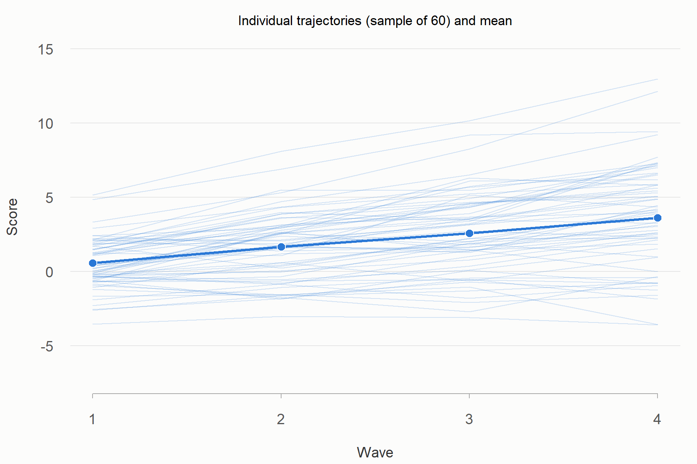
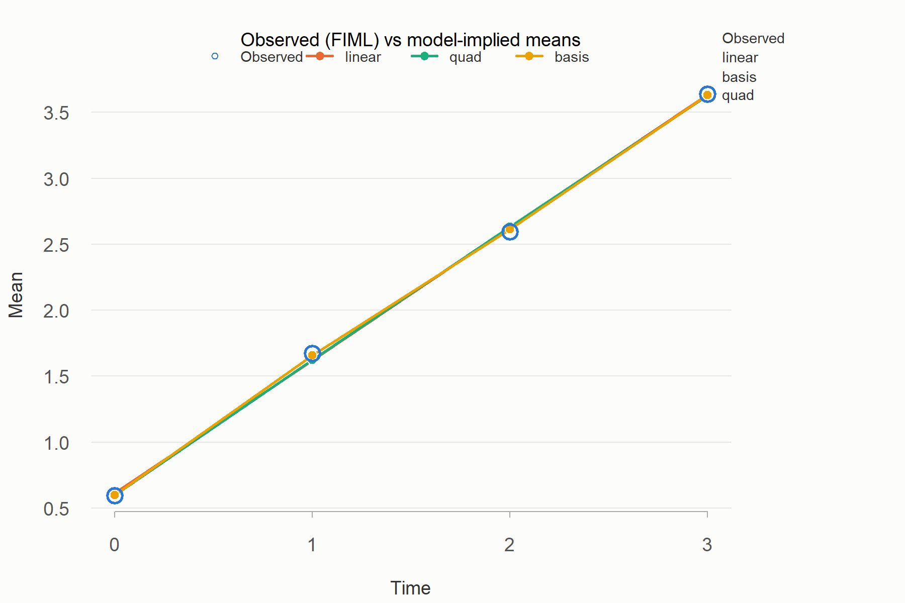
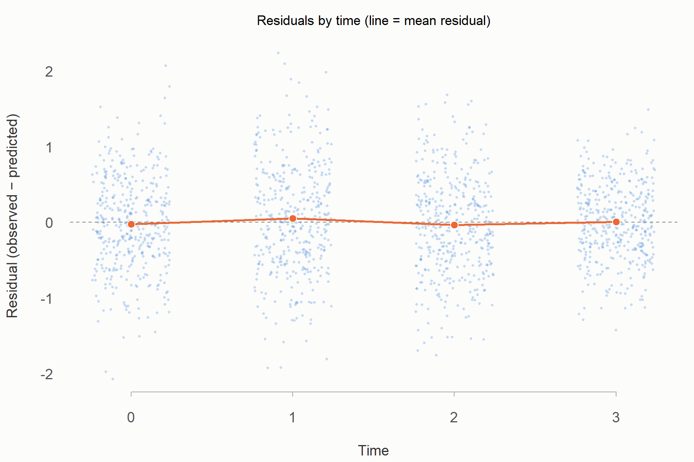
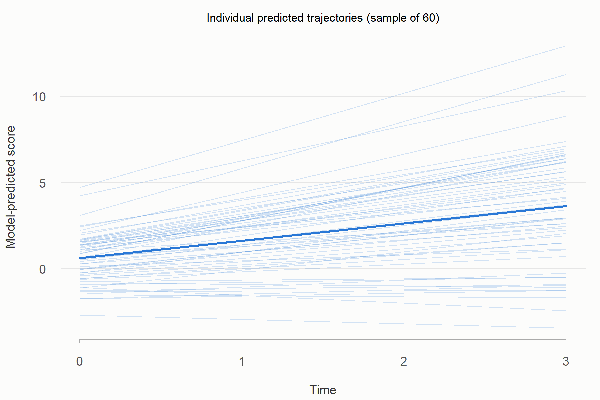
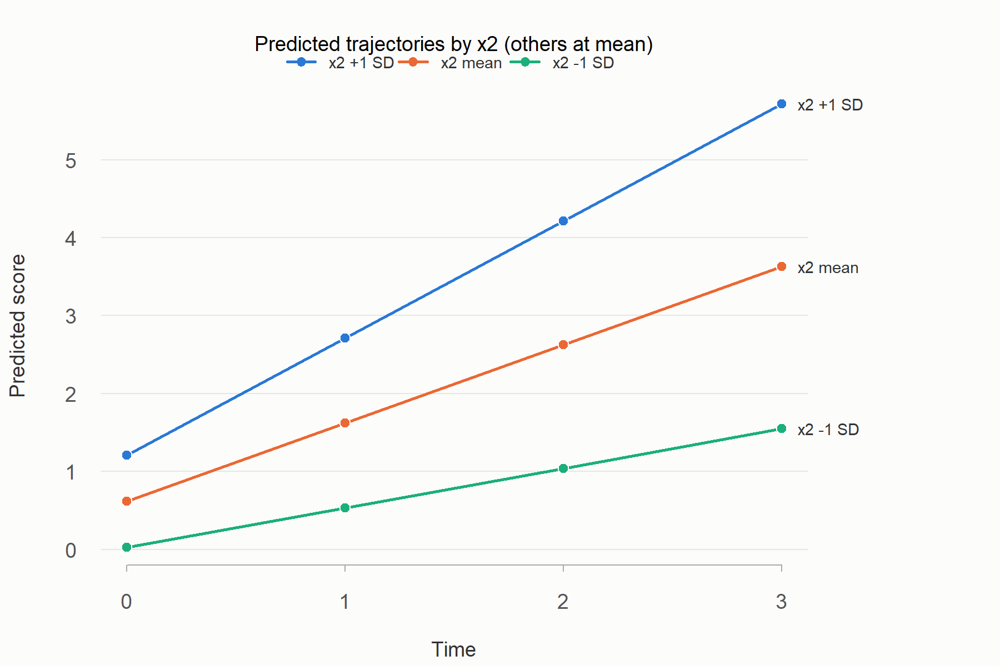

```{r}
#| label: setup
# 本檔位於 sem-lgm/docs/；腳本在 ../scripts/，範例資料在 ../assets/data/
skill <- normalizePath("..")
res   <- normalizePath("lgm_demo_results", mustWork = FALSE)   # 範例結果放在 docs/lgm_demo_results/
if (!file.exists(file.path(res, "demo_run_status.csv"))) {
  old <- setwd(skill)
  system2(file.path(R.home("bin"), "Rscript"), c("scripts/run_all_demos.R", "--out", shQuote(res)))
  setwd(old)
}
show_report <- function(path, drop = NULL, only = NULL, drop_col = NULL) {
  f <- file.path(res, path)
  if (!file.exists(f)) { cat("\n> （找不到 `", path, "`：該步驟可能執行失敗，請看 `lgm_demo_results/*.log`）\n\n", sep = ""); return(invisible()) }
  x <- readLines(f, encoding = "UTF-8", warn = FALSE)
  x <- x[!grepl("^# ", x)]
  if (length(only)) x <- x[grepl(only, x)]
  if (length(drop)) x <- x[!grepl(drop, x)]
  x <- sub("^## (.*)$", "**\\1**", x)
  x <- gsub(",\\s*p\\.\\s*[0-9]+([–-][0-9]+)?", "", x)   # 不顯示課本頁碼
  if (!is.null(drop_col)) x <- drop_table_col(x, drop_col)   # 不顯示表格中這個名稱的欄位
  cat("\n::: {.report}\n\n", paste(x, collapse = "\n"), "\n\n:::\n\n", sep = "")
}
img <- function(path) file.path("lgm_demo_results", path)
# 只顯示報告中的某一段：from 那一行到 to 那一行之前（to 不給時到結尾）
# drop_col：不顯示表格中這個名稱的欄位（例如「比較結論」）
drop_table_col <- function(x, col) {
  hdr <- which(startsWith(x, "|") & grepl(paste0("| ", col, " |"), x, fixed = TRUE))
  for (h in hdr) {
    k <- match(col, trimws(strsplit(x[h], "|", fixed = TRUE)[[1]]))
    r <- h; while (r <= length(x) && startsWith(x[r], "|")) {
      cells <- strsplit(x[r], "|", fixed = TRUE)[[1]]; x[r] <- paste0(paste(cells[-k], collapse = "|"), "|"); r <- r + 1
    }
  }
  x
}
show_section <- function(path, from, to = NULL, drop_col = NULL) {
  x <- readLines(file.path(res, path), encoding = "UTF-8", warn = FALSE)
  i <- grep(from, x)[1]; j <- if (is.null(to)) length(x) + 1 else { k <- grep(to, x); k <- k[k > i]; if (length(k)) k[1] else length(x) + 1 }
  if (is.na(i)) { cat("\n> （找不到這一段：", from, "）\n\n", sep = ""); return(invisible()) }
  x <- sub("^## (.*)$", "**\\1**", x[i:(j - 1)])
  if (!is.null(drop_col)) { x <- drop_table_col(x, drop_col); x <- gsub(paste0("、「", drop_col, "」依模型比較門檻"), "", x, fixed = TRUE) }
  cat("\n::: {.report}\n\n", paste(x, collapse = "\n"), "\n\n:::\n\n", sep = "")
}
status <- if (file.exists(file.path(res, "demo_run_status.csv"))) read.csv(file.path(res, "demo_run_status.csv")) else data.frame(case = character(), status = character())

# 互動式使用函式庫：先告訴 lgm_core.R 腳本資料夾在哪裡
LGM_SCRIPTS_DIR <- file.path(skill, "scripts")
assign("LGM_SCRIPTS_DIR", LGM_SCRIPTS_DIR, envir = globalenv())
source(file.path(LGM_SCRIPTS_DIR, "lgm_core.R"), encoding = "UTF-8", local = TRUE)

# 區塊選項 fold_output: true → 把文字輸出（summary）包在可展開的 <details> 裡；圖不受影響
local({
  default_output <- knitr::knit_hooks$get("output")
  knitr::knit_hooks$set(output = function(x, options) {
    out <- default_output(x, options)
    if (isTRUE(options$fold_output))
      paste0("\n\n<details class=\"output-fold\"><summary>顯示 summary 輸出</summary>\n\n", out, "\n\n</details>\n\n")
    else out
  })
})
```

# 這個 Skill 是什麼

`sem-lgm` 讓 Claude 能用結構方程模型建立**潛在成長模型**（latent growth model, LGM），分析長期追蹤資料「怎麼變」以及「為什麼每個人變得不一樣」。你用自然語言描述研究問題，Claude 就會依固定流程執行內建的 R 腳本、在每個決策點對照流程圖、檢查假設，並回報分析結果。

LGM 回答四個核心問題：

1. 群體**平均**而言，變項如何隨時間變化？（成長因子平均）
2. **個體之間**的起點與變化速度是否不同？（成長因子變異）
3. 起點與變化速度是否相關？（截距–斜率共變）
4. 哪些因素可以**解釋**這些個別差異？（條件模型）

分析流程依照 Grimm, Ram, & Estabrook (2017) *Growth Modeling: Structural Equation and Multilevel Modeling Approaches*，SEM 的基本觀念參考 Hair et al. (2019) 第 9–10 章。範例資料是 lavaan 內建的 `Demo.growth`。

腳本都是 **R**（lavaan）；在 Claude Code 中使用時不需要自己寫程式。

::: {.callout-note collapse="true"}
## 檔案結構

```
sem-lgm/
├── SKILL.md                         # Claude 讀取的主要指示
├── references/
│   ├── 00-flowcharts.md             # 流程圖、路徑圖、決策樹
│   ├── 01-workflow-assumptions.md   # 流程與假設總表
│   ├── 02-preliminaries.md          # 步驟一：資料準備
│   ├── 03-unconditional.md          # 步驟二：形式、殘差、時間編碼、診斷
│   ├── 04-predictors.md             # 步驟三、四：預測變數
│   ├── 05-multigroup.md             # 步驟五：多群組
│   ├── 06-extensions.md             # 延伸模型
│   ├── 07-reporting-troubleshooting.md
│   ├── 08-lavaan-growth-syntax.md   # 語法速查
│   └── 09-fit-criteria.md           # 選模指標與門檻
├── scripts/
│   ├── lgm_helpers.R, lgm_core.R    # 共用函式
│   ├── step1_screen.R … step6_report.R
│   ├── run_pipeline.R               # 自己的資料一鍵執行
│   ├── export_qmd.R                 # 匯出 qmd 報告
│   ├── sensitivity_mi.R             # 預測變數有遺失時的多重插補（選用）
│   ├── run_all_demos.R              # 範例資料一鍵執行
│   ├── make_demo_data.R             # 產生示範用的模擬資料
│   ├── reshape_wave.R               # 長寬格式轉換
│   ├── describe_vars.R              # 資料型態表
│   └── check_env.R
├── assets/data/                     # demo_growth.csv（Demo.growth）與三份示範用模擬資料
└── docs/sem-lgm-guide.qmd           # 本手冊
```
:::

## 全貌：一張圖看懂這個 skill

::: {.column-page-right}
```{mermaid}
%%| label: fig-skill-map
%%| fig-cap: "sem-lgm 的運作方式"
%%{init: {"themeVariables": {"fontSize": "18px"}, "flowchart": {"nodeSpacing": 30, "rankSpacing": 40}}}%%
flowchart LR
  U["你<br/>資料與研究問題"] --> G
  subgraph G [" "]
    direction TB
    CL["Claude<br/>規劃分析"]
    CL -. 判讀依據 .- REF["判讀文件<br/>方法、假設、決策樹"]
  end
  G --> SC["腳本<br/>執行分析"]
  SC --> OUT["結果<br/>報告與圖表"]
  OUT --> ANS["回覆<br/>結論與限制"]
  style G fill:transparent,stroke:transparent
```
:::

- **Claude**：依 `SKILL.md` 決定要跑哪些步驟、需要先問你什麼。
- **分析腳本**：`scripts/` 裡的 R 程式，用 lavaan 估計模型。
- **結果**：存在 `lgm_results/`，包含摘要報告、CSV、圖與語法檔。
- **判讀文件**：`references/` 裡的方法、假設與決策樹。
- **回覆**：結論、關鍵參數、假設診斷與限制。

# 快速上手

不需要自己寫程式，在 Claude Code 中用一般的中文描述資料和問題即可。完整說明見第 [-@sec-usage] 章「使用方式」。

## 五個步驟

先到放資料的資料夾啟動 Claude Code。

1. **準備資料**：最好是每人一列的寬格式（CSV、SPSS、Stata、Excel 都可以）。長格式也可以，Claude 會先轉換。告訴 Claude 重複測量的欄位、每一波的實際測量時間、截距要代表起點還是終點、遺失值代碼，以及有哪些可能的預測變數。
2. **確認篩檢結果**：Claude 先做資料篩檢，依序呈現各波信度（有題目資料時）、遺失情形、各波描述與軌跡（並描述平均的走勢像直線還是彎曲）與要注意的項目，問你要繼續並比較所有模型（預設）、直接指定成長模型、先修正設定後重跑，還是停止。
3. **選成長模型**：Claude 比較無成長、線性、二次三個模型，說明建議採用哪一個與理由，由你選。在步驟 2 已指定單一模型時略過這一步，只回報該模型的配適與診斷，有問題時會先提醒你。
4. **決定預測變數**：Claude 列出資料中可用的預測模型（時不變預測變數、時變共變數、多群組、遠端結果），問你要不要加入、用哪些變數；也可以不加入。加入的預測變數有遺失值時，Claude 會再問遺失值要用 FIML（預設）還是多重插補。
5. **讀報告**：Claude 執行你選的分析，回報軌跡形式、平均變化量、個別差異、預測效果與假設診斷。輸出檔案都在 `lgm_results/` 資料夾，其中 `lgm_analysis.qmd`（與渲染後的 HTML）是一段程式碼、一段輸出的完整分析報告，開頭的「分析決定紀錄」列出每一步的建議與你的選擇。

每一步 Claude 都會等你回覆才往下做。不想被問時，在一開始說「不用問我，直接跑完」，Claude 會直接採用建議，並在報告中註明。

## 使用指令 {#sec-commands}

在 Claude Code 中使用。先到放資料的資料夾啟動 Claude Code，再把下面的指令貼上，［ ］換成自己的內容。

- 指令以 `/sem-lgm` 開頭，而且要放在訊息的最前面，Claude 才會直接使用這個 skill。
- 檔案用 `@檔名` 指定。
- 第一次執行 R 時，Claude Code 會問你是否允許，選允許即可。
- 輸入 `/skills` 可以確認 sem-lgm 已經載入。

::: {.panel-tabset}

## 開始分析

第一次使用，先確認環境並看範例：

```default
/sem-lgm 檢查 R 環境與需要的套件，然後用範例資料示範一次完整流程，每個確認點都停下來讓我選。
```

分析自己的資料：

```default
/sem-lgm 分析 @［data.csv］
- 資料說明：［@codebook.xlsx；沒有就寫「無」，請先列出各變數的資料型態讓我確認］
- 重複測量：［dep_t1、dep_t2、dep_t3、dep_t4］
- 測量時間：［0、6、12、24 個月］
- 截距放在：［第一波／最後一波］
- 遺失值代碼：［-99；沒有就寫「無」］
- 可能的預測變數：［age、sex、stress_t1–stress_t4、group；沒有就寫「無」］
- 各波題目欄位：［dep_t1_i1–dep_t4_i4；只有總分就寫「無」］
- 輔助變數：［motivation；沒有就寫「無」］
我想知道：［憂鬱是否隨時間下降，以及年齡和性別能不能預測起點與下降速度］
```

資料是長格式：

```default
/sem-lgm 我的資料 @［long.csv］是長格式（欄位：id、wave、［結果變數］、［其他變數］），請先轉成寬格式再分析。測量時間是［0、6、12、24 個月］。
```

不想被問：在指令最後加一句「不用問我，直接跑完」。

## 回覆確認點

流程最多會停下來三次，用一般的句子回覆即可。

| 確認點 | 可以這樣回 |
|---|---|
| 1 篩檢之後 | 「繼續」（比較所有模型）<br>「直接用線性」<br>「只比較線性和二次」<br>「遺失值代碼是 999，修正後重跑篩檢」<br>「先停在這裡」 |
| 2 選成長模型（在確認點 1 已指定單一模型時略過） | 「採用線性」<br>「為什麼建議線性而不是二次？」<br>「我要用二次，理論上是先快後慢」 |
| 3 預測變數 | 「加入 age、sex 預測截距和斜率，預測變數要中心化」<br>「加入每波的 stress 當時變共變數」<br>「依 group 做多群組比較」<br>「加入 age、sex，並用截距和斜率預測 adjust」<br>「不加入」<br>預測變數有遺失值時：「用 FIML」或「改用多重插補，輔助變數是 motivation」 |

不確定時直接說「不確定」，Claude 會說明各選項的差別再請你決定。

## 追加分析

沿用已經選好的模型，再多做一件事：

```default
加入 ［age］ 和 ［sex］ 的交互作用，看它對截距和斜率的效果。
```

```default
把截距改放在最後一波重跑，告訴我哪些結論改變、哪些不變。
```

```default
加入的預測變數有遺失值，改用多重插補估計預測模型，輔助變數是［motivation、health］，並和 FIML 的結果比較。
```

```default
各波的題目欄位是［dep_t1_i1–dep_t4_i4］，補做各波信度。
```

## 報告與提問

```default
重新匯出報告，標題用「［報告標題］」，並渲染成 HTML。
```

```default
依 lgm_results 裡的結果，寫出論文的分析方法與結果段落，數字都要來自實際輸出。
```

```default
線性和二次模型的配適差不多，要選哪一個？請照 sem-lgm 的決策樹說明。
```

```default
斜率變異的估計值是負的，這代表什麼？要怎麼處理？
```

:::

# 方法介紹

這一章說明潛在成長模型背後的統計觀念，讓你看得懂腳本輸出的每個數字。實際操作見第 [-@sec-usage] 章「使用方式」與第 [-@sec-demo] 章「實作」。以下各節依實際分析的順序排列，對應第 [-@sec-flow] 章的流程圖。

## 從 SEM 到長期追蹤資料 {#sec-sem-longitudinal}

SEM 用在長期追蹤資料時，估計方法、配適指標與模型比較都和一般 SEM 一樣。改變的只有三件事：

| | 一般 SEM（例如 CFA） | 長期追蹤資料（潛在成長模型） |
|---|---|---|
| 分析的資料 | 通常只看共變數 | 共變數加上平均 |
| 因素負荷 | 由資料估計 | 固定為時間編碼 |
| 指標 | 同一時間的不同題目 | 同一變數在不同時間的測量 |

所以潛在成長模型就是一個**負荷固定的 CFA**：截距與斜率是潛在因子，截距對每一波的負荷都是 1，斜率的負荷是時間編碼（0, 1, 2, 3）；要估計的是這些因子的平均（平均軌跡）與變異共變（個別差異）。

::: {#fig-path-linear}

```{=html}
<div class="pathfig">
<svg viewBox="0 0 720 490" xmlns="http://www.w3.org/2000/svg" role="img" aria-label="線性潛在成長模型路徑圖">
  <defs>
    <marker id="p1k" viewBox="0 0 10 10" refX="9" refY="5" markerWidth="7" markerHeight="7" orient="auto-start-reverse"><path d="M0,0 L10,5 L0,10 z" fill="#000"/></marker>
    <marker id="p1b" viewBox="0 0 10 10" refX="9" refY="5" markerWidth="7" markerHeight="7" orient="auto-start-reverse"><path d="M0,0 L10,5 L0,10 z" fill="#1f4e79"/></marker>
    <marker id="p1o" viewBox="0 0 10 10" refX="9" refY="5" markerWidth="7" markerHeight="7" orient="auto-start-reverse"><path d="M0,0 L10,5 L0,10 z" fill="#a14a00"/></marker>
  </defs>
  <rect x="0" y="0" width="720" height="490" fill="#fff"/>

  <!-- 平均結構：常數 1 → 成長因子 -->
  <polygon points="360,16 336,58 384,58" fill="#fff" stroke="#000" stroke-width="1.5"/>
  <text x="360" y="51" text-anchor="middle">1</text>
  <line x1="350" y1="58" x2="261.6" y2="142.9" stroke="#000" stroke-width="1.4" marker-end="url(#p1k)"/>
  <line x1="370" y1="58" x2="458.4" y2="142.9" stroke="#000" stroke-width="1.4" marker-end="url(#p1k)"/>
  <text x="296" y="96" text-anchor="end" class="halo">α<tspan class="sm" dy="4">i</tspan></text>
  <text x="424" y="96" text-anchor="start" class="halo">α<tspan class="sm" dy="4">s</tspan></text>

  <!-- 成長因子的共變與變異 -->
  <path d="M 268 152 Q 360 98 452 152" fill="none" stroke="#000" stroke-width="1.4" marker-start="url(#p1k)" marker-end="url(#p1k)"/>
  <text x="360" y="146" text-anchor="middle" class="halo">ψ<tspan class="sm" dy="4">is</tspan></text>
  <path d="M 192 152 C 140 125, 140 225, 192 198" fill="none" stroke="#000" stroke-width="1.4" marker-start="url(#p1k)" marker-end="url(#p1k)"/>
  <text x="138" y="180" text-anchor="end">ψ<tspan class="sm" dy="4">ii</tspan></text>
  <path d="M 528 152 C 580 125, 580 225, 528 198" fill="none" stroke="#000" stroke-width="1.4" marker-start="url(#p1k)" marker-end="url(#p1k)"/>
  <text x="582" y="180" text-anchor="start">ψ<tspan class="sm" dy="4">ss</tspan></text>

  <!-- 潛在因子 -->
  <circle cx="230" cy="175" r="45" fill="#e8f0fa" stroke="#1f4e79" stroke-width="2"/>
  <text x="230" y="171" text-anchor="middle">截距</text>
  <text x="230" y="192" text-anchor="middle" font-style="italic">i</text>
  <circle cx="490" cy="175" r="45" fill="#fdf0e4" stroke="#a14a00" stroke-width="2"/>
  <text x="490" y="171" text-anchor="middle">斜率</text>
  <text x="490" y="192" text-anchor="middle" font-style="italic">s</text>

  <!-- 因子負荷：截距 = 1 -->
  <g stroke="#1f4e79" stroke-width="1.6" marker-end="url(#p1b)">
    <line x1="202.8" y1="210.9" x2="120" y2="320"/>
    <line x1="244.7" y1="217.5" x2="280" y2="320"/>
    <line x1="267.0" y1="200.6" x2="440" y2="320"/>
    <line x1="271.9" y1="191.4" x2="600" y2="320"/>
  </g>
  <!-- 因子負荷：斜率 = 0, 1, 2, 3 -->
  <g stroke="#a14a00" stroke-width="1.6" marker-end="url(#p1o)">
    <line x1="448.1" y1="191.4" x2="120" y2="320"/>
    <line x1="453.0" y1="200.6" x2="280" y2="320"/>
    <line x1="475.3" y1="217.5" x2="440" y2="320"/>
    <line x1="517.2" y1="210.9" x2="600" y2="320"/>
  </g>
  <g class="sm" text-anchor="middle">
    <circle cx="140.7" cy="292.7" r="10" fill="#fff" stroke="#1f4e79"/><text x="140.7" y="297.2">1</text>
    <circle cx="271.2" cy="294.4" r="10" fill="#fff" stroke="#1f4e79"/><text x="271.2" y="298.9">1</text>
    <circle cx="396.8" cy="290.2" r="10" fill="#fff" stroke="#1f4e79"/><text x="396.8" y="294.7">1</text>
    <circle cx="518.0" cy="287.9" r="10" fill="#fff" stroke="#1f4e79"/><text x="518.0" y="292.4">1</text>
    <circle cx="202.0" cy="287.9" r="10" fill="#fff" stroke="#a14a00"/><text x="202.0" y="292.4">0</text>
    <circle cx="323.3" cy="290.2" r="10" fill="#fff" stroke="#a14a00"/><text x="323.3" y="294.7">1</text>
    <circle cx="448.8" cy="294.4" r="10" fill="#fff" stroke="#a14a00"/><text x="448.8" y="298.9">2</text>
    <circle cx="579.3" cy="292.7" r="10" fill="#fff" stroke="#a14a00"/><text x="579.3" y="297.2">3</text>
  </g>

  <!-- 觀察變項 -->
  <g fill="#fff" stroke="#000" stroke-width="1.6">
    <rect x="85" y="320" width="70" height="50"/>
    <rect x="245" y="320" width="70" height="50"/>
    <rect x="405" y="320" width="70" height="50"/>
    <rect x="565" y="320" width="70" height="50"/>
  </g>
  <text x="120" y="351" text-anchor="middle">t<tspan class="sm" dy="4">1</tspan></text>
  <text x="280" y="351" text-anchor="middle">t<tspan class="sm" dy="4">2</tspan></text>
  <text x="440" y="351" text-anchor="middle">t<tspan class="sm" dy="4">3</tspan></text>
  <text x="600" y="351" text-anchor="middle">t<tspan class="sm" dy="4">4</tspan></text>

  <!-- 殘差 -->
  <g fill="#fff" stroke="#000" stroke-width="1.4">
    <circle cx="120" cy="425" r="18"/><circle cx="280" cy="425" r="18"/>
    <circle cx="440" cy="425" r="18"/><circle cx="600" cy="425" r="18"/>
  </g>
  <g stroke="#000" stroke-width="1.4" marker-end="url(#p1k)">
    <line x1="120" y1="407" x2="120" y2="372"/><line x1="280" y1="407" x2="280" y2="372"/>
    <line x1="440" y1="407" x2="440" y2="372"/><line x1="600" y1="407" x2="600" y2="372"/>
  </g>
  <g fill="none" stroke="#000" stroke-width="1.2" marker-start="url(#p1k)" marker-end="url(#p1k)">
    <path d="M 107 438 C 92 482, 148 482, 133 438"/><path d="M 267 438 C 252 482, 308 482, 293 438"/>
    <path d="M 427 438 C 412 482, 468 482, 453 438"/><path d="M 587 438 C 572 482, 628 482, 613 438"/>
  </g>
  <text x="120" y="430" text-anchor="middle">ε<tspan class="sm" dy="4">1</tspan></text>
  <text x="280" y="430" text-anchor="middle">ε<tspan class="sm" dy="4">2</tspan></text>
  <text x="440" y="430" text-anchor="middle">ε<tspan class="sm" dy="4">3</tspan></text>
  <text x="600" y="430" text-anchor="middle">ε<tspan class="sm" dy="4">4</tspan></text>
  <text x="148" y="472" class="sm">θ<tspan dy="3">1</tspan></text>
  <text x="308" y="472" class="sm">θ<tspan dy="3">2</tspan></text>
  <text x="468" y="472" class="sm">θ<tspan dy="3">3</tspan></text>
  <text x="628" y="472" class="sm">θ<tspan dy="3">4</tspan></text>
</svg>
</div>
```

無條件線性潛在成長模型。藍線是截距 *i*（第 [-@sec-params] 節方程式中的 η₀）的負荷，全部固定為 1；橘線是斜率 *s*（η₁）的負荷，固定為時間編碼 0, 1, 2, 3；要估計的是成長因子的平均 α、變異共變 ψ 與殘差變異 θ。

:::

三角形代表常數，指向變項的箭頭表示該變項的平均。各參數的意義與對應的方程式見第 [-@sec-params] 節。

以 `Demo.growth` 為例，t1–t4 是同一個變數測了 4 次。@tbl-sem-rows 是前 5 個人的資料：

```{r}
#| label: tbl-sem-rows
#| tbl-cap: "Demo.growth 的前 5 列（每人一列，t1–t4 是四次測量）"
d_sem <- read.csv(file.path(skill, "assets", "data", "demo_growth.csv"))[c("id", "t1", "t2", "t3", "t4")]
knitr::kable(head(d_sem, 5), digits = 2, row.names = FALSE)
```

這是**寬格式**：每個人一列，每一波一欄。潛在成長模型把同一列的 t1–t4 當成同一個人的四個指標，從中估計每個人的起點（截距）與變化速度（斜率）。

```{r}
#| label: fig-sem-scatter
#| fig-cap: "每個人在四次測量的分數。灰點是全部的人（左右略微錯開以免重疊）；彩色線是 @tbl-sem-rows 的 5 個人。"
#| fig-width: 7
#| fig-height: 4.2
#| out-width: "75%"
set.seed(1)
long_sem <- data.frame(波次 = rep(1:4, each = nrow(d_sem)), 分數 = unlist(d_sem[c("t1", "t2", "t3", "t4")]))
op <- par(mar = c(4.2, 4.2, 1, 1), las = 1, bty = "n", col.axis = "#555555", col.lab = "#333333", family = "sans")
plot(jitter(long_sem$波次, amount = 0.12), long_sem$分數, pch = 16, cex = 0.5, col = "#9a9a9a66",
     xaxt = "n", xlab = "測量波次", ylab = "分數", xlim = c(0.7, 4.3))
axis(1, at = 1:4, labels = c("t1", "t2", "t3", "t4"))
cols5 <- c("#2a6fdb", "#e07b1f", "#2e9e5b", "#c23b6a", "#7a4fc9")
for (k in 1:5) lines(1:4, unlist(d_sem[k, c("t1", "t2", "t3", "t4")]), type = "b", pch = 16, lwd = 2, col = cols5[k])
par(op)
```

每個人的起點不同，變化的快慢也不同；潛在成長模型同時描述整體的平均軌跡和這些個別差異。

## SEM 還是混合效果模型 {#sec-sem-vs-mixed}

和重複量數變異數分析只檢定各波平均是否不同相比，SEM 與混合效果模型（多層次模型）都能同時描述平均軌跡與個別差異，也能保留有遺失的人。線性成長、殘差變異相等時，兩者是同一個模型，估計值相同；差別在資料格式，以及各自做得到的模型（Grimm et al., 2017）。

| 你的情況 | 較適合 |
|---|---|
| 所有人在相同的時間點測量 | SEM |
| 要整體配適指標，或要比較軌跡形式 | SEM |
| 每波有多個題目，要處理測量誤差 | SEM |
| 每個人的測量時間都不同 | 混合效果模型 |
| 測量次數很多或每人次數不同 | 混合效果模型 |
| 個人巢套在團體內（學生在學校內） | 混合效果模型 |

SEM 用寬格式（每人一列），混合效果模型用長格式（每人每波一列）。

::: {.callout-note}
## 本 skill 的適用範圍

本 skill 用 SEM；資料屬於表中後三種情況時，建議改用混合效果模型。
:::

## 資料品質：信度與遺失資料 {#sec-data-quality}

建模前要先確認兩件事：各波的分數是否可靠（信度），以及遺失是否會讓估計偏誤（遺失機制）。步驟一會先檢查這兩項，再看各波描述與軌跡。

**信度**：

- **每一波分別評估**（各波的 α、ω），不能用重測信度：研究的目的就是改變。
- **比較各波信度**：某一波偏低時，該波殘差變大、估計較不精確（殘差變異設為相等時還會造成偏誤）；各波差距大時，變異的改變可能部分來自誤差變異，也可能是測量恆等性的警訊。
- 需要**題目層級資料**；只有總分時無法計算，報告時要說明。

參考值一般取 .70，以不需要「各題負荷相等」假設的 ω 為主（McDonald, 1999）。

**遺失機制**（Rubin 的分類）：

| 機制 | 意思 | 例子 | FIML、多重插補 |
|---|---|---|---|
| MCAR（完全隨機） | 遺失與任何變數都無關 | 問卷寄丟 | 不偏；列刪除也不偏，但浪費資料 |
| MAR（隨機） | 遺失只與**已觀察到**的變數有關 | 前一波分數低的人較常流失 | 不偏（模型或插補要納入相關變數） |
| MNAR（非隨機） | 遺失與**沒觀察到**的值本身有關 | 這一波變差的人沒有來 | 可能偏誤；無法由資料檢驗 |

**Little 的 MCAR 檢定**（Little, 1988）顯著只代表遺失**不是完全隨機**；樣本大時容易顯著，也**無法分辨 MAR 與 MNAR**。步驟一另外比較有遺失者與完成者、檢查前一波分數是否預測遺失，這些是 MAR 的直接證據。與遺失或結果有關、但不在模型裡的**輔助變數**要一併納入（Collins et al., 2001）。

::: {.callout-note collapse="true"}
## 公式

$$
\alpha = \frac{k}{k-1}\left(1 - \frac{\sum_j \sigma^2_j}{\sigma^2_X}\right)
$$

$k$：題數；$\sigma^2_j$：第 $j$ 題的變異；$\sigma^2_X$：總分的變異。

$$
\omega = \frac{(\sum_j \lambda_j)^2}{(\sum_j \lambda_j)^2 + \sum_j \theta_j}
$$

$\lambda_j$：第 $j$ 題在單因子模型的負荷（因子變異固定為 1）；$\theta_j$：第 $j$ 題的殘差變異。

$$
d^2 = \sum_j n_j (\bar{\mathbf{y}}_j - \hat{\boldsymbol{\mu}}_j)^\top \hat{\boldsymbol{\Sigma}}_j^{-1} (\bar{\mathbf{y}}_j - \hat{\boldsymbol{\mu}}_j)
$$

$$
d^2 \;\approx\; \chi^2\!\left(\sum_j p_j - p\right)
$$

$j$：遺失型態；$n_j$：該型態的人數；$\bar{\mathbf{y}}_j$：該型態觀察到的變數的平均；$\hat{\boldsymbol{\mu}}_j$、$\hat{\boldsymbol{\Sigma}}_j$：ML 估計的平均與共變數中對應這些變數的部分；$p_j$：該型態觀察到的變數數；$p$：變數總數。
:::

## 模型與參數 {#sec-params}

第 [-@sec-sem-longitudinal] 節 @fig-path-linear 中每一條箭頭就是下面方程式的一項，以線性模型為例，第 *i* 個人在第 *t* 波的分數：

$$
y_{ti} = \eta_{0i} + \lambda_t\,\eta_{1i} + e_{ti}
$$

$$
\eta_{0i} = \alpha_0 + \zeta_{0i},\qquad \eta_{1i} = \alpha_1 + \zeta_{1i}
$$

各參數回答的研究問題：

| 參數 | 符號 | 回答的問題 | 輸出中的名稱 |
|---|---|---|---|
| 截距平均 | $\alpha_0$ | 時間 0 時平均在哪裡？ | `i ~1` |
| 斜率平均 | $\alpha_1$ | 平均每單位時間變多少？ | `s ~1` |
| 截距變異 | $\psi_{00}$ | 起點有沒有個別差異？ | `i ~~ i` |
| 斜率變異 | $\psi_{11}$ | 變化速度有沒有個別差異？ | `s ~~ s` |
| 截距–斜率共變 | $\psi_{01}$ | 起點高的人變得比較快還是比較慢？ | `i ~~ s` |
| 殘差變異 | $\theta_t$ | 每波偏離個人軌跡多少？ | `t1 ~~ t1`… |

::: {.callout-note collapse="true"}
## 矩陣形式（SEM 的寫法）

$$
\mathbf{y}_i = \boldsymbol{\Lambda}\boldsymbol{\eta}_i + \mathbf{e}_i,\qquad
\boldsymbol{\mu}(\theta) = \boldsymbol{\Lambda}\boldsymbol{\alpha},\qquad
\boldsymbol{\Sigma}(\theta) = \boldsymbol{\Lambda}\boldsymbol{\Psi}\boldsymbol{\Lambda}^\top + \boldsymbol{\Theta}
$$

4 波等距、截距在第一波時：

$$
\boldsymbol{\Lambda} = \begin{bmatrix} 1 & 0 \\ 1 & 1 \\ 1 & 2 \\ 1 & 3 \end{bmatrix}
$$

模型估計的目標是讓模型隱含的平均 $\boldsymbol{\mu}(\theta)$ 與共變數 $\boldsymbol{\Sigma}(\theta)$ 盡量接近樣本的平均與共變數。
:::

## 軌跡形式與自由度

軌跡形式決定斜率因子的時間負荷 $\lambda_t$，也就是平均軌跡的形狀。步驟二會估計下面四種形式，再挑出最適合的一種。

| 形式 | 方程式 | 時間負荷（4 波等距） | 至少幾波 | df（4 波，殘差變異自由估計） | 何時用 |
|---|---|---|---|---|---|
| 無成長 | $y_{ti} = \eta_{0i} + e_{ti}$ | — | 2 | 8 | 比較基準：平均有沒有變化 |
| 線性 | $y_{ti} = \eta_{0i} + \lambda_t\eta_{1i} + e_{ti}$ | 0, 1, 2, 3 | 3 | 5 | 每單位時間的變化固定；預設起點 |
| 二次 | $y_{ti} = \eta_{0i} + \lambda_t\eta_{1i} + \lambda_t^2\eta_{2i} + e_{ti}$ | 0, 1, 2, 3 與 0, 1, 4, 9 | 4 | 1 | 變化加速或減速 |
| 潛在基底 | $y_{ti} = \eta_{0i} + \lambda_t\eta_{1i} + e_{ti}$，中間的 $\lambda_t$ 自由估計 | 0, \*, \*, 3 | 4 | 3 | 不預設形狀，讓資料決定 |

df = 動差數 − 自由參數，動差數是 $p + p(p+1)/2$（*p* 為波數，4 波時是 4 個平均＋10 個變異共變 = 14）；殘差變異相等時 df 多 3。

- **二次**：$\eta_{1i}$ 是時間 0 那一刻的變化速度，$\eta_{2i}$ 決定彎曲的方向與程度（正值：越來越往上彎）。二次項的個別差異常常很小，容易出現負變異數。
- **潛在基底**：第一波與最後一波的負荷固定，中間由資料估計。中間負荷 ÷ 最後一波負荷 = 到該波為止完成的變化比例；和線性的預期比例（例如 1/3、2/3）接近，代表線性已經足夠。只描述測量過的時間點，不能外推。

```{mermaid}
%%| label: fig-forms
%%| fig-cap: "選擇軌跡形式的決策樹（步驟二的建議規則）"
%%{init: {"themeVariables": {"fontSize": "18px"}, "flowchart": {"nodeSpacing": 30, "rankSpacing": 50}}}%%
flowchart LR
  Q1{"線性比無成長<br/>顯著改善？"} -- 否 --> N(["無成長"])
  Q1 -- 是 --> Q2{"二次可採用、LRT 顯著<br/>且 BIC 低至少 2？"}
  Q2 -- 否 --> L(["線性"])
  Q2 -- 是 --> Q(["二次"])
```

潛在基底只作參考，用來判斷線性是否足夠；只有 3 波時不估計二次。無成長 → 線性 → 二次、線性 → 潛在基底是巢套關係，用 LRT 比較；二次與潛在基底不是巢套，只能比 AIC、BIC（規則見第 [-@sec-estimation] 節）。


## 估計與模型比較 {#sec-estimation}

- **估計法**：預設 MLR（穩健最大概似），對非常態資料提供校正後的標準誤與 χ²。
- **遺失資料**：預設以 FIML 使用每個人所有可得的資料（前提是 MAR），遺失機制見第 [-@sec-data-quality] 節，多重插補見第 [-@sec-missing-pred] 節。
- **預測變數有遺失**時，腳本自動改用 `fixed.x = FALSE`，讓預測變數也納入概似函數，避免整筆刪除。

判斷單一模型是否可接受用 @tbl-fit-single，比較模型用 @tbl-fit-compare。腳本的比較表會依這兩張表標出「整體配適」與「比較結論」；門檻集中定義在 `scripts/lgm_helpers.R` 的 `FIT_RULES`，說明見 `references/09-fit-criteria.md`。

| 指標 | 門檻 | 出處 |
|---|---|---|
| χ² | 不顯著代表完美配適；樣本大時通常不切實際，只作參考 | Grimm et al. (2017) |
| RMSEA | < .05 良好；.05–.08 可接受；.08–.10 勉強；≥ .10 不佳 | Grimm et al. (2017)；Browne & Cudeck (1993)；MacCallum et al. (1996) |
| CFI、TLI | > .95 良好；.90–.95 可接受；< .90 不佳 | Grimm et al. (2017)；Hu & Bentler (1999) |
| SRMR | ≤ .08 | Hu & Bentler (1999) |

: 單一模型是否可接受 {#tbl-fit-single}

自由度 ≤ 3 時，RMSEA 不納入整體配適的判定，只供參考（Kenny et al., 2015）。整體配適的總判定：所有指標都良好才是「良好」；任一指標不佳就是「不佳」；其餘為「可接受」，括號中列出未達良好的指標。

| 指標 | 門檻 | 適用 | 出處 |
|---|---|---|---|
| LRT（Δχ²） | p < .05 表示較複雜的模型顯著較好 | 巢套模型 | Grimm et al. (2017) |
| BIC 差距 | < 2 微弱；2–6 有證據；6–10 強；> 10 非常強 | 巢套與非巢套 | Raftery (1995) |
| AIC 差距 | ≤ 2 無法區分；> 10 幾乎不支持較差的模型 | 巢套與非巢套 | Burnham & Anderson (2002) |
| CFI 差距 | ≤ .01 視為沒有實質差異 | 輔助判斷 | Cheung & Rensvold (2002) |

: 比較模型 {#tbl-fit-compare}

- 這些是經驗法則，不是硬性標準，要和參數是否合理、理論能否解釋一起判斷。
- CFI 與 TLI 取決於基準模型；追蹤資料應使用合適的基準模型（Widaman & Thompson, 2003；Grimm et al., 2017），例如第 [-@sec-step2] 節「以潛在基底模型為基準的比較」。
- **邊界值問題**：檢定變異 = 0 時，變異不能小於 0，LRT 的分配是卡方的混合分配，一般 p 值偏保守；常用近似是 p 除以 2（Stoel et al., 2006）。

LRT 用 MLR 時是尺度校正差異檢定（`lavTestLRT()` 自動處理），不要手動相減 scaled χ²；非巢套模型只能比 AIC、BIC。

## 殘差結構

**殘差結構**：殘差變異可以設定為自由估計（SEM 預設，假設最少）或相等（較簡約），兩者巢套，用 LRT 比較。殘差結構會影響成長因子變異的估計，所以要在加入預測變數**之前**決定。

## 時間編碼與截距位置

$\lambda_t = \text{實際時間}_t - \text{anchor}$。移動 anchor 只是重新參數化：

| 會改變 | 不會改變 |
|---|---|
| 截距平均、截距變異、截距–斜率相關、預測變數對截距的效果 | 整體配適、斜率平均與變異、殘差 |

因此「起點高的人變得比較快」這種結論**依賴時間 0 的位置**。步驟二會自動把截距移到另一端重估（時間編碼敏感度），讓你看到哪些結論穩定、哪些不穩定。

## 預測模型

| 模型 | 設定 | 回答的問題 | 要注意 |
|---|---|---|---|
| 時不變預測變數（TIC） | $\eta_{0i} = \alpha_0 + \gamma_{0}\,x_i + \zeta_{0i}$<br>$\eta_{1i} = \alpha_1 + \gamma_{1}\,x_i + \zeta_{1i}$ | *x* 每增加 1 單位，起點高多少（$\gamma_0$）、變化速度快多少（$\gamma_1$）？ | $\alpha_0,\ \alpha_1$ 變成 *x* = 0 時的值，0 沒有意義時要中心化（`--center`）；CFI、RMSEA 通常不變，要看階層式 LRT 與個別路徑 |
| 時變共變數（TVC） | $y_{ti} = \eta_{0i} + \lambda_t\,\eta_{1i} + \beta_t\,c_{ti} + e_{ti}$ | 控制成長趨勢後，同一波的 *c* 與 *y* 有關嗎？ | 兩個假設要用 LRT 檢定：效果跨波相等（$\beta_1 = \beta_2 = \dots$）、*c* 與成長因子不相關；截距與斜率變成控制 *c* 之後的成長 |
| 多群組 | 各組有自己的參數，依序放寬：M1 全部相等 → M2 平均不同 → M3 ＋變異共變不同 → M4 ＋殘差不同 | 不同組別的軌跡一樣嗎？ | 比把組別當成 TIC 多檢驗了個別差異與殘差是否也不同 |
| 遠端結果 | $z_i = \beta_0 + \beta_1\eta_{0i} + \beta_2\eta_{1i} + \varepsilon_i$ | 控制起點後，變化速度能不能預測之後的結果？ | 用 `--distal z` 指定 |

TIC 的**解釋變異量** = (無條件變異 − 條件殘差變異) / 無條件變異。

加入預測變數後，成長因子從外生變項變成內生變項，原本的變異共變變成**干擾項 ζ** 的變異共變（控制預測變數後剩下的個別差異）：

::: {#fig-path-cond}

```{=html}
<div class="pathfig">
<svg viewBox="0 0 770 480" xmlns="http://www.w3.org/2000/svg" role="img" aria-label="條件潛在成長模型路徑圖">
  <defs>
    <marker id="p2k" viewBox="0 0 10 10" refX="9" refY="5" markerWidth="7" markerHeight="7" orient="auto-start-reverse"><path d="M0,0 L10,5 L0,10 z" fill="#000"/></marker>
    <marker id="p2b" viewBox="0 0 10 10" refX="9" refY="5" markerWidth="7" markerHeight="7" orient="auto-start-reverse"><path d="M0,0 L10,5 L0,10 z" fill="#1f4e79"/></marker>
    <marker id="p2o" viewBox="0 0 10 10" refX="9" refY="5" markerWidth="7" markerHeight="7" orient="auto-start-reverse"><path d="M0,0 L10,5 L0,10 z" fill="#a14a00"/></marker>
  </defs>
  <rect x="0" y="0" width="770" height="480" fill="#fff"/>

  <!-- 時不變預測變數 -->
  <g fill="#fff" stroke="#000" stroke-width="1.6">
    <rect x="150" y="175" width="70" height="40"/><rect x="150" y="265" width="70" height="40"/>
  </g>
  <text x="185" y="200" text-anchor="middle">x<tspan class="sm" dy="4">1</tspan></text>
  <text x="185" y="290" text-anchor="middle">x<tspan class="sm" dy="4">2</tspan></text>
  <path d="M 150 190 Q 118 240 150 290" fill="none" stroke="#000" stroke-width="1.2" marker-start="url(#p2k)" marker-end="url(#p2k)"/>

  <!-- γ 路徑 -->
  <g stroke="#000" stroke-width="1.5" marker-end="url(#p2k)">
    <line x1="220" y1="195" x2="292.4" y2="158.8"/>
    <line x1="220" y1="195" x2="304.6" y2="306.5"/>
    <line x1="220" y1="285" x2="304.6" y2="173.5"/>
    <line x1="220" y1="285" x2="292.4" y2="321.2"/>
  </g>
  <g class="sm halo" text-anchor="middle">
    <text x="252" y="170">γ<tspan dy="3">i1</tspan></text>
    <text x="284" y="266">γ<tspan dy="3">s1</tspan></text>
    <text x="284" y="218">γ<tspan dy="3">i2</tspan></text>
    <text x="252" y="320">γ<tspan dy="3">s2</tspan></text>
  </g>

  <!-- 干擾項與其共變 -->
  <path d="M 314 46 C 30 30, 30 450, 314 434" fill="none" stroke="#000" stroke-width="1.2" marker-start="url(#p2k)" marker-end="url(#p2k)"/>
  <text x="92" y="244" text-anchor="end">ψ<tspan class="sm" dy="4">is</tspan></text>
  <g fill="#fff" stroke="#000" stroke-width="1.4">
    <circle cx="330" cy="48" r="16"/><circle cx="330" cy="432" r="16"/>
  </g>
  <text x="330" y="52" text-anchor="middle">ζ<tspan class="sm" dy="4">i</tspan></text>
  <text x="330" y="436" text-anchor="middle">ζ<tspan class="sm" dy="4">s</tspan></text>
  <g stroke="#000" stroke-width="1.4" marker-end="url(#p2k)">
    <line x1="330" y1="64" x2="330" y2="96"/><line x1="330" y1="416" x2="330" y2="384"/>
  </g>

  <!-- 成長因子 -->
  <circle cx="330" cy="140" r="42" fill="#e8f0fa" stroke="#1f4e79" stroke-width="2"/>
  <text x="330" y="136" text-anchor="middle">截距</text>
  <text x="330" y="156" text-anchor="middle" font-style="italic">i</text>
  <circle cx="330" cy="340" r="42" fill="#fdf0e4" stroke="#a14a00" stroke-width="2"/>
  <text x="330" y="336" text-anchor="middle">斜率</text>
  <text x="330" y="356" text-anchor="middle" font-style="italic">s</text>

  <!-- 因子負荷 -->
  <g stroke="#1f4e79" stroke-width="1.4" marker-end="url(#p2b)">
    <line x1="370.1" y1="127.4" x2="520" y2="80"/>
    <line x1="370.9" y1="149.7" x2="520" y2="185"/>
    <line x1="363.0" y1="166.0" x2="520" y2="290"/>
    <line x1="355.1" y1="173.7" x2="520" y2="395"/>
  </g>
  <g stroke="#a14a00" stroke-width="1.4" marker-end="url(#p2o)">
    <line x1="354.8" y1="306.1" x2="520" y2="80"/>
    <line x1="362.6" y1="313.5" x2="520" y2="185"/>
    <line x1="370.6" y1="329.3" x2="520" y2="290"/>
    <line x1="370.4" y1="351.7" x2="520" y2="395"/>
  </g>

  <!-- 觀察變項 -->
  <g fill="#fff" stroke="#000" stroke-width="1.6">
    <rect x="520" y="60" width="70" height="40"/><rect x="520" y="165" width="70" height="40"/>
    <rect x="520" y="270" width="70" height="40"/><rect x="520" y="375" width="70" height="40"/>
  </g>
  <text x="555" y="85" text-anchor="middle">t<tspan class="sm" dy="4">1</tspan></text>
  <text x="555" y="190" text-anchor="middle">t<tspan class="sm" dy="4">2</tspan></text>
  <text x="555" y="295" text-anchor="middle">t<tspan class="sm" dy="4">3</tspan></text>
  <text x="555" y="400" text-anchor="middle">t<tspan class="sm" dy="4">4</tspan></text>

  <!-- 殘差 -->
  <g fill="#fff" stroke="#000" stroke-width="1.3">
    <circle cx="625" cy="42" r="13"/><circle cx="625" cy="147" r="13"/>
    <circle cx="625" cy="252" r="13"/><circle cx="625" cy="357" r="13"/>
  </g>
  <g class="sm" text-anchor="middle">
    <text x="625" y="46">ε<tspan dy="3">1</tspan></text><text x="625" y="151">ε<tspan dy="3">2</tspan></text>
    <text x="625" y="256">ε<tspan dy="3">3</tspan></text><text x="625" y="361">ε<tspan dy="3">4</tspan></text>
  </g>
  <g stroke="#000" stroke-width="1.2" marker-end="url(#p2k)">
    <line x1="613.4" y1="47.9" x2="592" y2="59"/><line x1="613.4" y1="152.9" x2="592" y2="164"/>
    <line x1="613.4" y1="257.9" x2="592" y2="269"/><line x1="613.4" y1="362.9" x2="592" y2="374"/>
  </g>

  <!-- 時變共變數 -->
  <g fill="#fff" stroke="#000" stroke-width="1.6">
    <rect x="690" y="66" width="60" height="40"/><rect x="690" y="171" width="60" height="40"/>
    <rect x="690" y="276" width="60" height="40"/><rect x="690" y="381" width="60" height="40"/>
  </g>
  <text x="720" y="91" text-anchor="middle">c<tspan class="sm" dy="4">1</tspan></text>
  <text x="720" y="196" text-anchor="middle">c<tspan class="sm" dy="4">2</tspan></text>
  <text x="720" y="301" text-anchor="middle">c<tspan class="sm" dy="4">3</tspan></text>
  <text x="720" y="406" text-anchor="middle">c<tspan class="sm" dy="4">4</tspan></text>
  <g stroke="#000" stroke-width="1.5" marker-end="url(#p2k)">
    <line x1="690" y1="92" x2="592" y2="92"/><line x1="690" y1="197" x2="592" y2="197"/>
    <line x1="690" y1="302" x2="592" y2="302"/><line x1="690" y1="407" x2="592" y2="407"/>
  </g>
  <g class="sm halo" text-anchor="middle">
    <text x="641" y="112">β<tspan dy="3">1</tspan></text><text x="641" y="217">β<tspan dy="3">2</tspan></text>
    <text x="641" y="322">β<tspan dy="3">3</tspan></text><text x="641" y="427">β<tspan dy="3">4</tspan></text>
  </g>
</svg>
</div>
```

條件潛在成長模型。時不變預測變數 x 經由 γ 預測截距與斜率（步驟三）；時變共變數 c 經由 β 影響同一波的分數（步驟四）。負荷與 @fig-path-linear 相同（藍 = 截距、橘 = 斜率）；為了清楚，省略了平均結構與殘差變異。

:::

| 路徑 | lavaan 語法 | 對應步驟 |
|---|---|---|
| 截距、斜率 → t（固定負荷） | `i =~ 1*t1 + 1*t2 + 1*t3 + 1*t4`、`s =~ 0*t1 + 1*t2 + 2*t3 + 3*t4` | 2 |
| ψ（變異共變） | `i ~~ i`、`s ~~ s`、`i ~~ s` | 2 |
| γ（時不變預測） | `i + s ~ x1 + x2` | 3 |
| β（時變共變數） | `t1 ~ b*c1`、`t2 ~ b*c2`……（同標籤 = 效果相等） | 4 |

## 預測變數有遺失值時：FIML 與多重插補 {#sec-missing-pred}

選成長模型時一律用 FIML；加入的預測變數有遺失值時，才需要決定用 FIML 或多重插補。

**FIML 與多重插補**：FIML（預設）直接用每個人所有可得的資料估計；多重插補先產生 $m$ 組補好的資料分別估計，再以 Rubin (1987) 規則合併，**缺失資訊比例**（FMI）表示因遺失而損失的資訊（實作見第 [-@sec-mi-demo] 節）。兩者都假設 MAR，結果應該接近（Enders, 2022）；本 skill 在步驟 2 一律用 FIML；加入的預測變數有遺失值、選擇多重插補時，以插補結果為主並列 FIML 對照，差異超過 FIML 的 1 個 SE 時，代表結論依賴遺失的處理方式。不要用平均數插補或 LOCF（最後一次觀察值延續）；MNAR 無法由資料檢驗，只能在限制中說明。

::: {.callout-note collapse="true"}
## 公式

$$
\bar{Q} = \frac{1}{m}\sum_{k=1}^{m} \hat{Q}_k
$$

$$
T = \bar{U} + (1 + 1/m)B
$$

$\hat{Q}_k$：第 $k$ 組插補資料的估計值；$\bar{U}$：組內變異（各組 SE²）的平均；$B$：估計值的組間變異；$m$：插補組數。
:::

## 模型的前提假設 {.unnumbered}

潛在成長模型的假設分成兩類：**資料與測量的前提**，例如時間編碼要反映實際的測量間隔；以及**模型的統計假設**，例如所有人都遵循同一種軌跡形式、只是截距與斜率的值不同。每個假設怎麼檢查、違反時怎麼處理，見第 [-@sec-assumptions] 章「模型假設與對應方法」。

::: {.callout-note}
- 常模化分數（如 IQ）不適用：它們已經移除了平均與變異的改變。
:::

# 使用方式 {#sec-usage}

在 Claude Code 中，用第 [-@sec-commands] 節的指令開始分析、回覆確認點或追加分析，把 `［ ］` 換成自己的內容即可；本章說明這些指令背後需要的資訊與資料格式。

## 開始前要準備的資訊

**一定要提供**

| 資訊 | 例子 | 為什麼重要 |
|---|---|---|
| 重複測量欄位 | `read_g1`…`read_g5` | 決定結果變數與波次順序 |
| 實際測量時間 | 1、2、3、5 年級 | 不等距時斜率會算錯 |
| 截距位置 | 起點／終點／中點 | 決定截距代表哪個時間點的水準 |
| 遺失值代碼 | −99 | 避免 −99 被當成分數 |

**選填：給了才會做對應的步驟（步驟 1、2、6 一律執行）**

| 資訊 | 例子 | 步驟與回答的問題 |
|---|---|---|
| 時不變預測變數 | 性別、社經地位 | 步驟 3：誰的起點高、誰變得快？ |
| 時變共變數 | 每波的壓力 | 步驟 4：每一波的共變數和同一波的分數有關嗎？ |
| 分組變數 | 介入組／對照組 | 步驟 5：不同組別的軌跡一樣嗎？ |
| 各波題目欄位 | 每波 4 題的憂鬱量表 | 步驟 1：每一波的分數可信嗎？（各波信度） |
| 輔助變數 | 基線的動機、健康狀況 | 步驟 1 與預測模型的多重插補：遺失和什麼有關？預測變數有遺失時改用多重插補，結論會變嗎？ |

每個人的測量時間都不同時（例如各自在不同年齡受測），本 skill 不適用，建議改用混合效果模型（見第 [-@sec-sem-vs-mixed] 節與第 [-@sec-limits] 章）。

::: {.callout-note collapse="true"}
## 自己執行腳本時的參數對照

| 資訊 | 參數 |
|---|---|
| 重複測量欄位 | `--y "^read_g"` |
| 實際測量時間 | `--times 1,2,3,5` |
| 截距位置 | `--anchor first`（或 `last`、`mid`、數值） |
| 遺失值代碼 | `--na -99` |
| 時不變預測變數 | `--covs ses,female` |
| 預測變數中心化 | `--center` |
| 交互作用 | `--interaction ses:female` |
| 遠端結果 | `--distal z` |
| 時變共變數 | `--tvc "^stress_t"` |
| 分組變數 | `--group arm` |
| 依連續變數切分組別 | `--split age` |
| 各波題目欄位 | `--items "^dep_t[0-9]+_i"`（比對到的那一段裡的第一個數字是波次） |
| 輔助變數 | `--aux motivation,health` |
| 預測變數有遺失值時的處理 | `--missing fiml` 或 `--missing mi`（多重插補；可加 `--m 20` 指定插補組數、`--seed` 指定亂數種子） |
:::

## 資料格式（長格式與寬格式）

以 3 個人、每人測 3 次憂鬱分數（dep）為例，性別（sex）不隨時間改變：

::: {layout-ncol=2}

| id | sex | dep_t1 | dep_t2 | dep_t3 |
|---|---|---|---|---|
| 1 | F | 12 | 10 | 9 |
| 2 | M | 8 | 8 | 7 |
| 3 | F | 15 | 13 | 遺失 |

: 寬格式：每人一列

| id | wave | sex | dep |
|---|---|---|---|
| 1 | 1 | F | 12 |
| 1 | 2 | F | 10 |
| 1 | 3 | F | 9 |
| 3 | 1 | F | 15 |
| 3 | 2 | F | 13 |

: 長格式：每人每波一列（只列第 1 和第 3 個人）

:::

- **SEM 需要寬格式**：每一波是一個觀察變數（`dep_t1`、`dep_t2`、`dep_t3`）。
- **長格式時 Claude 會先轉換**：產生 `dep_t1`、`dep_t2`……；時變共變數（例如每波的壓力 `stress`）會變成 `stress_t1`、`stress_t2`……。

## 沒有資料說明時

Claude 會依變數名稱與數值彙整出資料型態表給你確認。以範例資料為例：

```{r}
#| echo: false
source(file.path(skill, "scripts", "describe_vars.R"), encoding = "UTF-8")
knitr::kable(describe_vars(read.csv(file.path(skill, "assets", "data", "demo_growth.csv"))), caption = "範例資料的資料型態表")
```

哪一組是結果變數、哪一組是時變共變數，要由你確認；出現 −99、999 這類極端值時，Claude 會列出來請你確認。

## 匯出 qmd 報告

`run_pipeline.R` 跑完後會在輸出資料夾寫出 `lgm_analysis.qmd`，加 `--render` 會同時渲染成 HTML。已經有結果資料夾時，也可以單獨匯出：

```bash
Rscript scripts/export_qmd.R --results lgm_results --title "憂鬱追蹤分析" --render
```

- **報告包含**：開頭的「分析決定紀錄」（每個確認點的系統建議、你的選擇，兩者不同時附上理由）、各步驟的結果摘要與圖、每個模型一段 lavaan 程式碼與一段 `summary()` 輸出（都可以摺疊）、配適指標表與 LRT、最終模型摘要。只包含實際執行過的步驟。
- **檔案位置**：qmd 要和 `step*/`、`report/` 資料夾放在一起，才能重新渲染。

# 分析流程 {#sec-flow}

下面兩張圖是從資料到報告的分析順序，三個確認點的選項見下方的表。

::: {.column-page-right}
```{mermaid}
%%| label: fig-flow-1
%%| fig-cap: "分析流程（一）：從資料到成長模型"
%%{init: {"themeVariables": {"fontSize": "21px"}, "flowchart": {"nodeSpacing": 20, "rankSpacing": 16, "padding": 6}}}%%
flowchart LR
  P["準備資料<br/>長格式先轉成寬格式"] --> S1["步驟 1 資料篩檢<br/>信度、遺失值、各波描述"]
  S1 --> K1{"確認點 1<br/>怎麼繼續？"}
  K1 -- "比較所有模型（預設）<br/>或指定兩個以上" --> S2a["步驟 2<br/>估計並比較模型"]
  S2a --> K2{"確認點 2<br/>選哪個模型？"}
  K2 -- "選定" --> R["步驟 2<br/>殘差結構與假設診斷"]
  K1 -- "指定一個模型" --> S2b["步驟 2<br/>只估計該模型"]
  S2b --> R
  K1 -- "修正設定" --> X1(["重跑步驟 1"])
  K1 -- "停止" --> X2(["結束"])
  R --> N(["接下圖<br/>確認點 3"])
  classDef check fill:#fde9a8,stroke:#b07d00,stroke-width:2px
  class K1,K2 check
```
:::

::: {.column-page-right}
```{mermaid}
%%| label: fig-flow-2
%%| fig-cap: "分析流程（二）：從預測變數到報告"
%%{init: {"themeVariables": {"fontSize": "17px"}, "flowchart": {"nodeSpacing": 20, "rankSpacing": 16, "padding": 6}}}%%
flowchart LR
  K3{"確認點 3<br/>加入預測變數？"}
  K3 -- "否" --> S6["步驟 6<br/>彙整結果"]
  K3 -- "是" --> M{"預測變數<br/>有遺失值？"}
  M -- "否" --> S35["步驟 3–5<br/>估計預測模型"]
  M -- "是" --> K4{"遺失值<br/>怎麼處理？"}
  K4 -- "FIML（預設）" --> S35
  K4 -- "多重插補" --> MI["步驟 3–5<br/>插補後估計預測模型"]
  S35 --> S6
  MI --> S6
  S6 --> Q(["匯出 qmd 報告"])
  classDef check fill:#fde9a8,stroke:#b07d00,stroke-width:2px
  class K3,K4 check
```
:::

黃色菱形由你決定；方塊是 Claude 執行的步驟，白色菱形依資料判斷，圓角方塊是流程的出口。步驟 2 有遺失值時一律用 FIML；只有加入的預測變數有遺失值時，才會問要不要改用多重插補。

| 確認點 | Claude 呈現什麼 | 你要決定什麼 |
|---|---|---|
| 1 篩檢之後 | 依序：各波信度（有題目資料時）、遺失機制檢驗、各波描述與軌跡、從篩檢結果看成長形式（平均的走勢像直線還是彎曲、標準差是否逐波擴大）、跨波穩定性與 ICC、簡易判讀中標為 ⚠ 的項目 | 繼續並比較所有模型（預設）；直接指定成長模型（一個或多個；只指定一個時只估計該模型、略過確認點 2，配適有問題時 Claude 會先提醒）；先修正設定（遺失值代碼、測量時間、欄位）後重跑篩檢；或停止 |
| 2 成長模型之後（確認點 1 已指定單一模型時略過） | 估計的模型的比較表（χ²、CFI、RMSEA、BIC、是否可採用、整體配適、相對於前一個模型的比較結論），潛在基底列在下方作參考；建議與理由（寫出用了哪個指標與門檻） | 從估計的模型中選一個（殘差結構接著依 LRT 自動決定） |
| 3 殘差與診斷之後 | 資料中有對應變數的預測模型，各附一句它回答的問題（@fig-flow-predictors） | 要不要加入預測變數、加入哪些（可複選）、用哪些變數、連續變數是否中心化；加入的預測變數有遺失值時，Claude 會列出哪些變數有遺失與比例，追問遺失值怎麼處理：FIML（預設）｜多重插補 |

: 三個確認點 {#tbl-checkpoints}

一開始說「不用問我，直接跑完」時，估計所有模型，三個確認點都直接採用建議（預測變數有遺失值時採用 FIML），報告的「分析決定紀錄」會註明。各步驟的細節見第 [-@sec-demo] 章。

```{mermaid}
%%| label: fig-flow-predictors
%%| fig-cap: "確認點 3：依想回答的問題選預測模型（可以複選）"
%%{init: {"themeVariables": {"fontSize": "17px"}, "flowchart": {"nodeSpacing": 24, "rankSpacing": 60}}}%%
flowchart TD
  R{"想回答<br/>什麼問題？"}
  R -- "誰的起點高、<br/>變得快？" --> A(["時不變預測變數<br/>步驟 3"])
  R -- "同一波的共變數<br/>有關嗎？" --> B(["時變共變數<br/>步驟 4"])
  R -- "各組的軌跡<br/>一樣嗎？" --> C(["多群組<br/>步驟 5"])
  R -- "變化速度能預測<br/>之後的結果嗎？" --> D(["遠端結果<br/>步驟 3"])
  R -- "都不需要" --> E(["不加入<br/>直接到步驟 6"])
  classDef check fill:#fde9a8,stroke:#b07d00,stroke-width:2px
  class R check
```

| 步驟 | 做什麼 | 腳本 | 進入的條件 |
|---|---|---|---|
| 準備資料 | 讀取資料；長格式先轉成寬格式 | `reshape_wave.R` | 資料是長格式時 |
| 1 資料篩檢 | 各波信度、遺失機制、各波描述與軌跡 | `step1_screen.R` | 一律執行 |
| 2 無條件模型 | 估計並比較無成長、線性、二次（或只估計指定的模型）→ 殘差結構 → 假設診斷 → 時間編碼敏感度；一律用 FIML | `step2_unconditional.R` | 一律執行 |
| 3 時不變預測 | 預測截距與斜率、解釋變異量；遠端結果 | `step3_conditional.R` | 有 `--covs` |
| 4 時變共變數 | 效果相等或自由、是否與成長因子相關 | `step4_tvc.R` | 有 `--tvc` |
| 5 多群組 | M1–M4 依序比較群組差異 | `step5_multigroup.R` | 有 `--group` 或 `--split` |
| 3–5 的多重插補 | 插補後估計預測模型，並列 FIML 對照 | `sensitivity_mi.R` | 加入的預測變數有遺失值，且選擇多重插補 |
| 6 彙整結果 | 彙整結果並匯出 qmd 報告 | `step6_report.R`、`export_qmd.R` | 一律執行 |

: 步驟與腳本 {#tbl-flow-steps}

# 實作：以 Demo.growth 走完整流程 {#sec-demo}

## 範例資料

`demo_growth.csv` 是 lavaan 內建的 `Demo.growth`，只加上 `id` 欄。

| 變數 | 內容 | 角色 |
|---|---|---|
| `t1`–`t4` | 4 波重複測量 | 結果變數 |
| `x1`、`x2` | 不隨時間改變的連續變數 | 時不變預測變數 |
| `c1`–`c4` | 每波各有一個值 | 時變共變數 |

N = 400，沒有遺失值。這是**模擬資料**，變數沒有實質意義，真實參數也沒有公開，所以以下結果只示範方法。範例假設 4 波等距，時間編碼為 0、1、2、3。

`Demo.growth` 沒有遺失值，也沒有題目資料，所以信度、遺失機制檢驗與多重插補另外用三份**為示範而模擬、不是真實資料**的檔案（由 `scripts/make_demo_data.R` 以固定種子產生，說明見 `assets/data/README.md`）：

- `demo_growth_missing.csv`：在 `Demo.growth` 上製造 MAR 流失（前一波分數越低，下一波越可能流失，且流失後不再回來），並加一個模擬的輔助變數 `aux`。
- `demo_items.csv`：每波 4 題的題目資料，只用來示範信度。
- `demo_growth_missing_x.csv`：在 `demo_growth_missing.csv` 上再讓預測變數 x1、x2 有遺失，用來示範預測變數有遺失時的 FIML 與多重插補。

## 閱讀說明

藍色區塊是腳本產生的原始摘要（渲染時從 `lgm_demo_results/` 讀取）；「怎麼讀」是對範例結果的解讀。

步驟二到五的最後各有一節「lavaan 程式碼與結果」：每個模型一個分頁，分頁內是可以直接執行的 lavaan 程式碼、渲染時實際執行的 `summary()` 輸出與說明。設定與腳本相同（MLR、FIML），所以數值與藍色區塊一致。讀 `summary()` 時，成長模型特有的地方只有三點：

- **Intercepts** 是成長因子的平均；有預測變數時是條件平均。
- 名稱前有點（如 `.i`、`.t1`）代表殘差變異。
- 用 MLR 時 lavaan 仍顯示 `Estimator ML`，由 `Yuan-Bentler correction` 與 `Sandwich` 標準誤表示已做穩健校正。

## 步驟一：資料篩檢

篩檢報告依序呈現：各波信度（有題目資料時）→ 遺失機制檢驗 → 各波描述與軌跡 → 跨波穩定性與 ICC → 簡易判讀。`Demo.growth` 沒有題目資料，也沒有遺失值，所以前兩項先用兩份模擬資料示範，再看 `Demo.growth` 本身的篩檢結果。

### 示範：各波信度（`demo_items.csv`）

::: {.callout-warning}
`demo_items.csv` 是**為示範而模擬的資料，不是真實資料**。第 4 波第 4 題刻意設定為鑑別度很低。
:::

```bash
Rscript scripts/step1_screen.R --data assets/data/demo_items.csv --y "^s_t[0-9]$" --items "^s_t[0-9]+_i" --out results/step1
```

```{r}
#| results: asis
show_section("items_demo/step1/screen_report.md", "^\\*\\*各波信度\\*\\*", "^\\*\\*遺失型態")
show_section("items_demo/step1/screen_report.md", "^- ⚠", "^\\*\\*結論")
rel <- read.csv(file.path(res, "items_demo/step1/reliability.csv"), fileEncoding = "UTF-8")
```

**怎麼讀**：

- 第 1–3 波的 α 介於 `r fmt2(min(rel$alpha[1:3]))`–`r fmt2(max(rel$alpha[1:3]))`、ω 介於 `r fmt2(min(rel$omega[1:3]))`–`r fmt2(max(rel$omega[1:3]))`，信度足夠。
- 第 4 波 α = `r fmt2(rel$alpha[4])`（95% CI [`r fmt2(rel$alpha_lo[4])`, `r fmt2(rel$alpha_hi[4])`]）、ω = `r fmt2(rel$omega[4])`，低於 .70；最低的校正後題目–總分相關是 `r rel$min_citc_item[4]`（`r fmt2(rel$min_citc[4])`），問題出在這一題。
- 第 4 波的 ω 比 α 高，因為這一題的負荷和其他題差很多，α 的「各題負荷相等」假設不成立，所以以 ω 為準。
- 處理方式：確認這一題在第 4 波是否改了題目或意義；刪修後重算，或改用二階成長模型。只有總分時這些都看不到，所以報告要寫明「只有總分，無法計算內部一致性」。

### 示範：遺失機制檢驗（`demo_growth_missing.csv`）

::: {.callout-warning}
`demo_growth_missing.csv` 是**為示範而模擬的資料，不是真實資料**：流失只由前一波（已觀察到的）分數決定，所以我們知道它是 MAR。真實資料無法確認這一點。
:::

```bash
Rscript scripts/step1_screen.R --data assets/data/demo_growth_missing.csv --y "^t[0-9]$" --baseline x1,x2 --aux aux --out results/step1
```

```{r}
#| results: asis
show_section("missing_demo/step1/screen_report.md", "^\\*\\*遺失型態", "^\\*\\*各波描述")
show_section("missing_demo/step1/screen_report.md", "^- ⚠", "^\\*\\*結論")
mc <- read.csv(file.path(res, "missing_demo/step1/mcar_test.csv"), fileEncoding = "UTF-8")
mv <- read.csv(file.path(res, "missing_demo/step1/missing_by_variable.csv"), fileEncoding = "UTF-8")
at <- read.csv(file.path(res, "missing_demo/step1/attrition_comparison.csv"), fileEncoding = "UTF-8")
tr <- read.csv(file.path(res, "missing_demo/step1/dropout_by_prior_score.csv"), fileEncoding = "UTF-8")
```

**怎麼讀**：

- 遺失集中在後期，最後一波遺失 `r sprintf("%.1f", mv$missing_pct[mv$variable == "t4"])`%，而且全部是單調流失。共變數涵蓋率最低的是 t1 與 t4，仍有 `r sprintf("%.1f", 100 - mv$missing_pct[mv$variable == "t4"])`%，每一對變數都有足夠的資料。
- Little 的 MCAR 檢定 χ²(`r mc$df`) = `r sprintf("%.2f", mc$chisq)`，*p* `r fmt_p(mc$p)`：遺失**不是完全隨機**。這個檢定無法告訴我們是 MAR 還是 MNAR。
- 有遺失者第一波分數較低（d = `r sprintf("%.2f", at$d[at$variable == "t1"])`），輔助變數 `aux` 也較低（d = `r sprintf("%.2f", at$d[at$variable == "aux"])`）；前一波分數每高 1 SD，下一波遺失的勝算是原本的 `r sprintf("%.2f", min(tr$OR_per_SD))`–`r sprintf("%.2f", max(tr$OR_per_SD))` 倍。這些是遺失與已觀察到的資料有關（MAR）的直接證據，正是我們模擬時設定的機制。
- 這時 Claude 會建議：成長模型用 FIML（MAR 下不偏），把 `aux` 當輔助變數；之後加入的預測變數也有遺失值時，會再問要用 FIML 還是多重插補（見第 [-@sec-mi-demo] 節）。

### Demo.growth 的篩檢結果

```{r}
#| results: asis
show_report("step1/screen_report.md")
```

{width=70%}

**怎麼讀**：

- 只有總分、沒有遺失，所以信度無法計算，也不需要遺失值分析。
- **從篩檢結果看成長形式**：平均每波增加約 1 分、各段的增加量相近，看起來接近直線；SD 逐波擴大。這只是描述，形式要在步驟二決定。
- **SD 逐波增加、相鄰波相關逐波提高**：這是斜率有個別差異的典型訊號。
- 只有單一分數，**無法檢驗測量恆等性**，報告時要說明這是假設（Grimm, 2017）。
- **簡易判讀**全部是 ✔，所以這時 Claude 會告訴你資料沒有明顯問題，問你要怎麼繼續進行步驟二。

```{r}
wd1 <- read.csv(file.path(res, "step1/wave_descriptives.csv"))
n_warn1 <- sum(grepl("^- ⚠", readLines(file.path(res, "step1/screen_report.md"), encoding = "UTF-8")))
```

::: {.callout-note icon=false}
## 確認點 1：Claude 會呈現什麼、問什麼

- **呈現**：N = `r max(wd1$n)`、`r nrow(wd1)` 波；只有總分（無法計算信度）；沒有遺失值；平均從 `r sprintf("%.2f", wd1$mean[1])` 升到 `r sprintf("%.2f", wd1$mean[nrow(wd1)])`，走勢接近直線，SD 逐波變大；簡易判讀中標為注意的項目：`r if (n_warn1) n_warn1 else "沒有"`。
- **問**：要怎麼繼續？　**a 繼續，比較所有模型（建議）**｜b 直接指定成長模型（無成長、線性、二次，可選一個或多個）｜c 先修正設定後重跑篩檢（遺失值代碼、測量時間、欄位）｜d 停止
- **範例中的選擇**：a，繼續並比較所有模型。
:::

確認點 1 之後有兩條路：選 a 時估計無成長、線性、二次（潛在基底作參考），在確認點 2 由你選；選 b 直接指定一個模型時，只估計該模型、略過確認點 2（指定兩個以上時，只比較指定的模型）。範例走預設的 a，也就是下面的步驟二；直接指定線性時的回報見下面的摺疊區塊。

```{r}
dl_rep <- "direct_linear/step2/unconditional_report.md"
dl_fit <- readRDS(file.path(res, "direct_linear/step2/chosen_fit.rds")); main_fit <- readRDS(file.path(res, "step2/chosen_fit.rds"))
dl_diff <- max(abs(lavaan::parameterEstimates(dl_fit)$est - lavaan::parameterEstimates(main_fit)$est))
dl_free <- read.csv(file.path(res, "direct_linear/step2/linear/fit_indices.csv")); dl_adopt <- fit_table(dl_fit)
```

::: {.callout-note collapse="true"}
## 示範：在確認點 1 直接指定線性

```bash
Rscript scripts/run_pipeline.R --data assets/data/demo_growth.csv --y "^t[0-9]$" --times 0,1,2,3 --out results --stage model --forms linear
```

```{r}
#| results: asis
show_section(dl_rep, "^## A\\.", "^## B\\.")
show_section(dl_rep, "^## 指定模型的檢查", "^## E\\.")
```

- 只估計線性，沒有比較表、LRT 與潛在基底的參考比較，報告註明「未做形式比較」。
- 兩組配適數字屬於不同的模型：A 節的 CFI = `r fmt2(dl_free$cfi)`、RMSEA = `r fmt2(dl_free$rmsea)` 是**線性（殘差變異自由估計）**；「指定模型的檢查」中的 CFI = `r fmt2(dl_adopt$cfi)`、RMSEA = `r fmt2(dl_adopt$rmsea)` 是**採用的模型：線性＋殘差變異相等**（殘差結構依 LRT 決定）。
- 殘差結構、假設診斷與時間編碼敏感度照常；採用的模型（線性＋殘差變異相等）和下面步驟二選線性時相同，所有估計值的最大差異是 `r format(dl_diff, digits = 3)`。
- 配適與診斷都沒有問題，所以沒有提醒，直接進入確認點 3。若指定的是無成長，CFI、RMSEA 不佳、有負變異數、各波殘差平均有系統性偏離，Claude 會先提醒，並問你要不要改為比較所有模型；你堅持採用時照做，分析決定紀錄會記下提醒內容。
:::

## 步驟二：無條件成長模型 {#sec-step2}

這一步決定「怎麼變」：比較軌跡形式 → 以潛在基底為基準的比較 → 確認點 2 → 殘差結構 → 採用模型 → 假設診斷 → 時間編碼敏感度 → 確認點 3。

```{r}
#| include: false
# 先估計各形式（和下面「lavaan 程式碼與結果」的語法相同），供比較表與確認點 2 使用
library(lavaan)
demo <- read.csv(file.path(skill, "assets", "data", "demo_growth.csv"))
show_summary <- function(fit) summary(fit, fit.measures = TRUE, standardized = TRUE)
f_none <- growth('i =~ 1*t1 + 1*t2 + 1*t3 + 1*t4', data = demo, estimator = "MLR", missing = "fiml")
f_lin <- growth('i =~ 1*t1 + 1*t2 + 1*t3 + 1*t4
  s =~ 0*t1 + 1*t2 + 2*t3 + 3*t4', data = demo, estimator = "MLR", missing = "fiml")
f_quad <- growth('i =~ 1*t1 + 1*t2 + 1*t3 + 1*t4
  s =~ 0*t1 + 1*t2 + 2*t3 + 3*t4
  q =~ 0*t1 + 1*t2 + 4*t3 + 9*t4', data = demo, estimator = "MLR", missing = "fiml")
f_basis <- growth('i =~ 1*t1 + 1*t2 + 1*t3 + 1*t4
  s =~ 0*t1 + NA*t2 + NA*t3 + 3*t4', data = demo, estimator = "MLR", missing = "fiml")
f_lin_eq <- growth('i =~ 1*t1 + 1*t2 + 1*t3 + 1*t4
  s =~ 0*t1 + 1*t2 + 2*t3 + 3*t4
  t1 ~~ theta*t1
  t2 ~~ theta*t2
  t3 ~~ theta*t3
  t4 ~~ theta*t4', data = demo, estimator = "MLR", missing = "fiml")
```

### 軌跡形式比較

```{r}
#| results: asis
show_section("step2/unconditional_report.md", "^## A\\.", "^## C\\.", drop_col = "比較結論")
```

{width=80%}

**怎麼讀**（建議規則見 @fig-forms；比較表的「整體配適」依 @tbl-fit-single，模型比較的門檻見 @tbl-fit-compare）：

- **無成長模型不可採用**：出現負變異數，整體配適不佳，代表模型與資料嚴重不符（資料明顯在增加）。
- **形式選線性**：整體配適良好，BIC 最低；二次與潛在基底的整體配適也良好（自由度只有 1 和 3，RMSEA 僅供參考），但和線性比都沒有顯著改善（LRT 不顯著，BIC 支持線性的證據非常強）；潛在基底的負荷幾乎等於線性時間。

::: {.callout-note collapse="true"}
## 以潛在基底模型為基準的比較

潛在基底模型不預設軌跡的形狀，只要求所有人共用同一組時間負荷，所以很適合當作**比較的基準**：先讓資料自己決定形狀，再檢查較簡單、有特定形狀的模型會不會明顯變差。這裡用另一種常見的設定：首尾負荷固定為 0 和 1，斜率因子代表**整個追蹤期間（t1 到 t4）的總變化量**，中間的負荷是「到該波為止完成的變化比例」。

```{r}
#| echo: true
#| code-fold: true
#| code-summary: "顯示程式碼"
#| fold_output: true
m_base <- '
  i =~ 1*t1 + 1*t2 + 1*t3 + 1*t4
  s =~ 0*t1 + NA*t2 + NA*t3 + 1*t4  # 首尾固定為 0、1；s = t1 到 t4 的總變化量
'
f_base <- growth(m_base, data = demo, estimator = "MLR", missing = "fiml")
show_summary(f_base)
```

**說明**：

- **配適**：χ²~scaled~(3) = 6.28，*p* = .099；robust CFI = .998；robust RMSEA = .053，90% CI [.000, .112]；SRMR = .006。配適指標與前面首尾固定為 0、3 的潛在基底模型完全相同，因為兩者只是斜率因子的單位不同。
- **時間負荷**（Latent Variables 中的 `s =~`）：t2 = 0.349（SE = 0.013，95% CI [.323, .376]）、t3 = 0.665（SE = 0.013，約 [.639, .691]）。也就是到第二波完成了總變化的 35%，到第三波完成 67%。線性成長預期的比例是 1/3 與 2/3（.333、.667），**兩者都落在信賴區間內**。
- **斜率平均** 3.034：t1 到 t4 平均共增加 3.03 分，換算成每波約 1.01 分，與線性模型一致。
- **斜率變異** 5.333、截距–斜率共變 1.829：數值變大是因為斜率的單位從「每波」變成「整段期間」；標準化後的相關（.57）與線性模型相近。

```{r}
#| echo: true
#| code-fold: true
#| code-summary: "顯示程式碼"
# 以潛在基底模型 f_base 為基準，比較其他模型
fm <- function(f) fitMeasures(f, c("chisq.scaled", "df", "aic", "bic"))
base_fit <- fm(f_base)
others <- list(無成長 = f_none, 線性 = f_lin, `線性＋殘差變異相等` = f_lin_eq, 二次 = f_quad)
cmp_base <- do.call(rbind, lapply(names(others), function(n) {
  f <- others[[n]]; m <- fm(f)
  nested <- n != "二次"                          # 二次模型與潛在基底不是巢套關係
  lrt <- if (nested) lavTestLRT(f, f_base) else NULL
  data.frame(模型 = n, df = m[["df"]],
             `Δχ²` = if (nested) lrt[2, "Chisq diff"] else NA,
             Δdf = if (nested) lrt[2, "Df diff"] else NA,
             p = if (nested) lrt[2, "Pr(>Chisq)"] else NA,
             ΔAIC = m[["aic"]] - base_fit[["aic"]],
             ΔBIC = m[["bic"]] - base_fit[["bic"]], check.names = FALSE)
}))
knitr::kable(cmp_base, digits = 3, row.names = FALSE,
             caption = "與潛在基底模型（基準）的比較：ΔAIC、ΔBIC 為負代表比基準好")
```

**說明**：

- **Δχ²、Δdf、*p***：該模型與潛在基底模型的尺度校正 LRT。*p* 不顯著代表加上該模型的限制後，配適沒有顯著變差。
- **ΔAIC、ΔBIC** = 該模型減去基準模型；**負值代表比基準好**（兼顧配適與簡約）。
- **無成長**：Δχ²(5) = 1157.90，*p* < .001，ΔBIC = +1242.9，遠差於基準：資料明顯在變化。
- **線性**：Δχ²(2) = 1.72，*p* = .423，ΔBIC = −10.4：把兩個中間負荷固定為線性時間，配適沒有變差，而且 BIC 更好。
- **線性＋殘差變異相等**：Δχ²(5) = 3.22，*p* = .667，ΔBIC = −26.7：再加上殘差變異相等的限制仍不會變差，是**相對基準最好的模型**，與前面依序比較的結論相同。
- **二次**：與潛在基底不是巢套關係，不能做 LRT，只能看資訊準則：ΔAIC = +0.3、ΔBIC = +8.3，沒有比基準好。
- 結論：以潛在基底模型為基準，資料支持**線性成長、殘差變異相等**。
:::

### 確認點 2

分段執行時，步驟二估計完各種形式後會先停下來（確認點 2），你選好成長模型，Claude 再決定殘差結構。以下是範例中 Claude 會呈現的內容。

```{r}
#| label: tbl-checkpoint2
#| tbl-cap: "確認點 2 呈現的比較表（MLR；殘差變異自由估計）"
cmp2 <- read.csv(file.path(res, "step2/comparison.csv"))
rec2 <- strsplit(readLines(file.path(res, "step2/recommendation.txt"), encoding = "UTF-8"), "=", fixed = TRUE)
rec2 <- setNames(vapply(rec2, function(z) paste(z[-1], collapse = "="), ""), vapply(rec2, `[`, "", 1))
lab2 <- c(none = "無成長", linear = "線性", quad = "二次", basis = "潛在基底（參考，不列為選項）")
lrt2 <- function(a, b) { l <- lavTestLRT(a, b); sprintf("Δχ²(%d) = %.2f, p %s", as.integer(l[2, "Df diff"]), l[2, "Chisq diff"], fmt_p(l[2, "Pr(>Chisq)"])) }
knitr::kable(data.frame(模型 = lab2[cmp2$model],
                        `χ²(df)` = sprintf("%.2f (%d)", cmp2$chisq, as.integer(cmp2$df)),
                        CFI = sprintf("%.3f", cmp2$cfi), RMSEA = sprintf("%.3f", cmp2$rmsea), BIC = sprintf("%.1f", cmp2$bic),
                        可採用 = ifelse(cmp2$admissible, "是", "否"),
                        `和上一個模型比（LRT）` = c("—", lrt2(f_none, f_lin), lrt2(f_lin, f_quad), paste("相對線性：", lrt2(f_lin, f_base))),
                        check.names = FALSE), row.names = FALSE)
```

::: {.callout-note icon=false}
## 確認點 2：Claude 會呈現什麼、問什麼

- **呈現**：@tbl-checkpoint2；潛在基底的負荷是否接近線性時間（用來判斷線性是否足夠）。
- **建議**：`r c(none = "無成長", linear = "線性", quad = "二次")[[rec2[["form"]]]]`，理由是`r rec2[["reason"]]`。
- **問**：要採用哪一個成長模型？　無成長｜**線性（建議）**｜二次
- **範例中的選擇**：線性。殘差結構接著依 LRT 自動決定為殘差變異相等，回報時說明即可，不另外詢問。
:::

### 殘差結構、採用模型與假設診斷

```{r}
#| results: asis
show_section("step2/unconditional_report.md", "^## C\\.", "^## F\\.", drop_col = "比較結論")
```

{width=75%}

{width=75%}

**怎麼讀**：

- **殘差變異採相等**：等同限制的 LRT 不顯著，BIC 也較低。
- 平均起點約 0.62，每波增加約 1.0；起點與斜率都有顯著的個別差異，起點較高的人增加得較快。
- **假設診斷沒有問題**：殘差平均都接近 0、沒有趨勢；各波殘差 SD 相近；因子分數接近常態、沒有離群個案。

### 時間編碼與截距位置

```{r}
#| results: asis
show_section("step2/unconditional_report.md", "^## F\\.")
```


| `--anchor` | 時間負荷 | 截距代表 |
|---|---|---|
| `first`（預設） | 0, 1, 2, 3 | 起始水準 |
| `last` | −3, −2, −1, 0 | 結束時的水準 |
| `mid` | −1.5, −0.5, 0.5, 1.5 | 追蹤期中點 |

```{r}
#| label: tbl-sensitivity
#| tbl-cap: "時間編碼敏感度（time_coding_sensitivity.csv）"
f <- file.path(res, "step2", "time_coding_sensitivity.csv")
if (file.exists(f)) knitr::kable(read.csv(f), digits = 3,
  col.names = c("參數", "主要分析", "截距移到另一端", "標準化（主要）", "標準化（另一端）"))
```

- **時間編碼敏感度**（F 節）：把截距移到最後一波後，χ² 完全相同，斜率平均不變，但截距平均、截距變異與截距–斜率相關都改變。這說明「起點與斜率相關」這個結論依賴時間 0 的位置。

### 確認點 3

殘差結構、假設診斷與時間編碼敏感度之後，Claude 接著問要不要加入預測變數（確認點 3）。

```{r}
x_mean <- colMeans(read.csv(file.path(skill, "assets", "data", "demo_growth.csv"))[c("x1", "x2")])
```

::: {.callout-note icon=false}
## 確認點 3：Claude 會呈現什麼、問什麼

- **問**：要加入預測變數嗎？（可複選；只列出資料中有對應變數的選項）
  - 時不變預測變數（x1、x2）：誰的起點比較高、誰變得比較快？
  - 時變共變數（c1–c4）：每一波的共變數和同一波的分數有關嗎？
  - 多群組（資料沒有分組變數，可以把 x2 依中位數切成兩組）：不同組別的軌跡一樣嗎？
  - 不加入：直接進入報告。
  - 資料中沒有之後才測量的結果變數，所以不列出「預測之後的結果」。
- **接著問**：用哪些變數？連續的預測變數要不要中心化？（x1、x2 的平均是 `r sprintf("%.2f", x_mean[1])`、`r sprintf("%.2f", x_mean[2])`，本來就接近 0）
- **遺失值**：加入的 x1、x2、c1–c4 都沒有遺失值，所以用 FIML，不另外詢問遺失值的處理（預測變數有遺失時的追問見第 [-@sec-mi-demo] 節）。
- **範例中的選擇**：加入時不變預測變數（x1、x2，不中心化）、時變共變數（c1–c4），以及以 x2 切分的多群組，也就是第 [-@sec-step3] 到 [-@sec-step5] 節。
:::

### lavaan 程式碼與結果

先讀入資料，並定義一個輸出摘要的小函式：

```{r}
#| echo: true
#| code-fold: true
#| code-summary: "顯示程式碼"
library(lavaan)
demo <- read.csv(file.path(skill, "assets", "data", "demo_growth.csv"))
show_summary <- function(fit) summary(fit, fit.measures = TRUE, standardized = TRUE)
```

::: {.panel-tabset}

## 無成長模型

```{r}
#| echo: true
#| code-fold: true
#| code-summary: "顯示程式碼"
#| fold_output: true
m_none <- '
  i =~ 1*t1 + 1*t2 + 1*t3 + 1*t4
'
f_none <- growth(m_none, data = demo, estimator = "MLR", missing = "fiml")
show_summary(f_none)
```

**說明**：

- 只有截距一個因子，假設每個人四波的期望分數都一樣，是比較的基準。
- **配適極差**：χ²~scaled~(8) = 1193.09，robust CFI = .283，robust RMSEA = .630，SRMR = .642。
- **t2 的殘差變異是負的**（−0.023，Variances 中的 `.t2`），lavaan 會發出負變異數警告。這個模型不可採用，代表資料明顯在變化。
- 截距平均 1.668 只是四波的整體平均，沒有實質意義。

## 線性模型（殘差變異自由估計）

```{r}
#| echo: true
#| code-fold: true
#| code-summary: "顯示程式碼"
#| fold_output: true
m_lin <- '
  i =~ 1*t1 + 1*t2 + 1*t3 + 1*t4    # 截距：負荷全部固定為 1
  s =~ 0*t1 + 1*t2 + 2*t3 + 3*t4    # 斜率：負荷固定為時間 0, 1, 2, 3
'
f_lin <- growth(m_lin, data = demo, estimator = "MLR", missing = "fiml")
show_summary(f_lin)
```

**說明**：

- **配適良好**：χ²~scaled~(5) = 8.12，*p* = .150；robust CFI = .998；robust RMSEA = .039，90% CI [.000, .087]；SRMR = .012。
- **Latent Variables**：負荷是我們固定的 1 與 0–3，所以沒有標準誤。`Std.all` 欄中斜率對 t4 的標準化負荷 .680 比對 t2 的 .364 大，表示越後面的波次，個別差異越多來自變化速度。
- **Intercepts**：截距平均 0.615 是第一波的平均水準；斜率平均 1.006（SE = 0.042）表示**平均每波增加約 1 分**。
- **Variances**：截距變異 1.932、斜率變異 0.587 都顯著，表示**起點和變化速度都有個別差異**。
- **Covariances**：截距與斜率共變 0.618，標準化相關 .58：起點較高的人，增加得也較快。
- 四波的殘差變異（`.t1`–`.t4`）在 0.51–0.68 之間，相當接近，所以下一步可以試著限制為相等。

## 二次模型

```{r}
#| echo: true
#| code-fold: true
#| code-summary: "顯示程式碼"
#| fold_output: true
m_quad <- '
  i =~ 1*t1 + 1*t2 + 1*t3 + 1*t4
  s =~ 0*t1 + 1*t2 + 2*t3 + 3*t4
  q =~ 0*t1 + 1*t2 + 4*t3 + 9*t4    # 二次項：負荷為時間的平方
'
f_quad <- growth(m_quad, data = demo, estimator = "MLR", missing = "fiml")
show_summary(f_quad)
```

**說明**：

- 二次項平均 −0.008（*p* = .705）：平均而言**沒有加速或減速**。
- 二次項變異 0.039（*p* = .173）不顯著，而且與斜率的相關高達 −.72（Covariances 中 `s ~~ q` 的 `Std.all`），代表二次項幾乎沒有獨立的個別差異。
- χ² 雖然較小，但只剩 1 個自由度；BIC = 5582.6，比線性模型（5564.0）**高 18.6**，懲罰了多出的 4 個參數。
- 結論：不需要二次項。

## 潛在基底模型

```{r}
#| echo: true
#| code-fold: true
#| code-summary: "顯示程式碼"
#| fold_output: true
m_basis <- '
  i =~ 1*t1 + 1*t2 + 1*t3 + 1*t4
  s =~ 0*t1 + NA*t2 + NA*t3 + 3*t4  # 中間兩波的負荷自由估計（NA）
'
f_basis <- growth(m_basis, data = demo, estimator = "MLR", missing = "fiml")
show_summary(f_basis)
```

**說明**：

- 這裡把首尾負荷固定為 0 和 3（而不是 0 和 1），讓斜率仍是「每波」的變化，負荷可以直接和 0, 1, 2, 3 比較。
- **估計出的中間負荷** t2 = 1.048、t3 = 1.995，**幾乎就是線性的 1 和 2**：資料自己「選出」的形狀就是一條直線。
- 斜率平均 1.011、變異 0.593，都與線性模型幾乎相同。
- BIC = 5574.4，比線性模型高 10.4；多估 2 個負荷不值得。

## 比較軌跡形式與殘差結構

```{r}
#| echo: true
#| code-fold: true
#| code-summary: "顯示程式碼"
# 各模型的配適指標
fits <- list(無成長 = f_none, 線性 = f_lin, 二次 = f_quad, 潛在基底 = f_basis)
round(sapply(fits, fitMeasures,
             c("chisq.scaled", "df", "cfi.robust", "rmsea.robust", "srmr", "bic")), 3)

# 巢套比較（MLR 時自動使用尺度校正的差異檢定）
lavTestLRT(f_lin, f_quad)
lavTestLRT(f_lin, f_basis)

# 採用的模型：線性＋殘差變異相等（同一個標籤 theta = 限制相等）
m_lin_eq <- '
  i =~ 1*t1 + 1*t2 + 1*t3 + 1*t4
  s =~ 0*t1 + 1*t2 + 2*t3 + 3*t4
  t1 ~~ theta*t1
  t2 ~~ theta*t2
  t3 ~~ theta*t3
  t4 ~~ theta*t4
'
f_lin_eq <- growth(m_lin_eq, data = demo, estimator = "MLR", missing = "fiml")
lavTestLRT(f_lin_eq, f_lin)
```

**說明**：

- **線性 vs 二次**：Δχ²(4) = 5.41，*p* = .248，不顯著。
- **線性 vs 潛在基底**：Δχ²(2) = 1.72，*p* = .423，不顯著。
- 線性模型的 BIC（5564.0）在四個形式中最低，所以**採用線性**。
- **殘差變異相等 vs 自由估計**：Δχ²(3) = 1.54，*p* = .673，不顯著，所以採用**較簡約的殘差變異相等**。
- `lavTestLRT()` 輸出的 `Chisq` 欄是未校正的 χ²，但 `Chisq diff` 與 *p* 值已經做了 Satorra–Bentler 尺度校正，報告時用後兩欄。

## 採用的模型：線性成長＋殘差變異相等

```{r}
#| echo: true
#| code-fold: true
#| code-summary: "顯示程式碼"
#| fold_output: true
show_summary(f_lin_eq)
```

**說明**：

- **配適**：χ²~scaled~(8) = 9.55，*p* = .298；robust CFI = .999；robust RMSEA = .022，90% CI [.000, .066]；SRMR = .015；BIC = 5547.7，是所有模型中最低的。
- **Variances** 中 `.t1`–`.t4` 都標示 `(thet)`，值都是 0.622：四波共用一個殘差變異。
- **成長參數**：
  - 截距平均 0.617（SE = 0.077）：第一波平均約 0.62 分。
  - 斜率平均 1.005（SE = 0.042）：**平均每波增加 1.01 分**。
  - 截距變異 1.928、斜率變異 0.576，都顯著（*p* < .001）。
  - 截距–斜率共變 0.627，相關 *r* = .59。
- 殘差的 `Std.all` 從 t1 的 .244 降到 t4 的 .054，表示成長因子解釋了各波分數變異的 75.6%（t1）到 94.6%（t4）。
- 這就是後續步驟沿用的模型（`chosen.txt`：form = linear、residuals = equal）。

:::

## 步驟三：時不變預測變數 {#sec-step3}

這一步問「誰的起點高、誰變得快」。

```{r}
#| results: asis
show_report("step3/conditional_report.md")
```

{width=75%}

**怎麼讀**：

- 整體配適幾乎不變，但**階層式 LRT 非常顯著**：加入預測變數的價值要看 LRT 與路徑，不是看 CFI（Grimm, 2017）。
- x1、x2 都能預測起點與斜率；兩個預測變數解釋了相當比例的截距與斜率變異。
- 起點與斜率的相關在加入預測變數後明顯下降：兩者的關聯大多可由 x1、x2 解釋。
- 注意：截距與斜率的平均現在是 **x1 = x2 = 0** 時的值。

**交互作用**：加入 `--interaction x1:x2 --center` 檢驗兩個預測變數是否有交互作用：

```{r}
#| results: asis
show_report("step3_interaction/conditional_report.md", only = "^\\| (路徑|[is] ← x1_x_x2) |^\\|---\\|---\\|---\\|---\\|---\\|---\\|$")
```

### lavaan 程式碼與結果

::: {.panel-tabset}

## 條件模型：x1、x2 預測截距與斜率

```{r}
#| echo: true
#| code-fold: true
#| code-summary: "顯示程式碼"
#| fold_output: true
m_cond <- '
  i =~ 1*t1 + 1*t2 + 1*t3 + 1*t4
  s =~ 0*t1 + 1*t2 + 2*t3 + 3*t4
  t1 ~~ theta*t1
  t2 ~~ theta*t2
  t3 ~~ theta*t3
  t4 ~~ theta*t4
  i ~ x1 + x2                        # 預測起點
  s ~ x1 + x2                        # 預測變化速度
'
f_cond <- growth(m_cond, data = demo, estimator = "MLR", missing = "fiml")
show_summary(f_cond)
```

**說明**：

- **配適**：χ²~scaled~(12) = 11.78，*p* = .463；robust CFI = 1.000；robust RMSEA = .000，90% CI [.000, .050]；SRMR = .012。配適本來就很好，加入預測變數後幾乎不變，所以判斷預測變數有沒有用要看下面的路徑與 LRT。
- **Regressions**（全部 *p* < .001）：

  | 路徑 | 估計值 | 標準化 β | 意思 |
  |---|---|---|---|
  | i ← x1 | 0.610 | .451 | x1 每高 1 單位，起點高 0.61 分 |
  | i ← x2 | 0.614 | .425 | x2 每高 1 單位，起點高 0.61 分 |
  | s ← x1 | 0.263 | .355 | x1 每高 1 單位，每波多增加 0.26 分 |
  | s ← x2 | 0.517 | .655 | x2 每高 1 單位，每波多增加 0.52 分 |

  x2 是**變化速度最強的預測變數**。
- **Intercepts** 前面多一個點（`.i`、`.s`），是 **x1 = x2 = 0 時**的截距 0.588 與斜率 0.958。範例沒有中心化，但 x1、x2 的平均接近 0，所以和無條件模型差不多。
- **Variances** 中 `.i` = 1.073、`.s` = 0.215 是控制預測變數後**剩下的**個別差異。和無條件模型（1.928、0.576）相比，x1、x2 解釋了截距變異的 44.3%、斜率變異的 62.7%（見「階層式 LRT 與解釋變異量」分頁的 R²）。
- **Covariances** 中截距與斜率的殘差相關從 .59 降到 .19：起點與速度的關聯大多可以由 x1、x2 解釋。

## 階層式 LRT 與解釋變異量

```{r}
#| echo: true
#| code-fold: true
#| code-summary: "顯示程式碼"
# 基準模型：包含 x1、x2，但路徑固定為 0
m_zero <- '
  i =~ 1*t1 + 1*t2 + 1*t3 + 1*t4
  s =~ 0*t1 + 1*t2 + 2*t3 + 3*t4
  t1 ~~ theta*t1
  t2 ~~ theta*t2
  t3 ~~ theta*t3
  t4 ~~ theta*t4
  i ~ 0*x1 + 0*x2
  s ~ 0*x1 + 0*x2
'
f_zero <- growth(m_zero, data = demo, estimator = "MLR", missing = "fiml")
lavTestLRT(f_zero, f_cond)
round(lavInspect(f_cond, "r2"), 3)
```

**說明**：

- 基準模型要**包含** x1、x2，只把路徑固定為 0，兩個模型才是巢套的。
- **階層式 LRT**：Δχ²(4) = 432.04，*p* < .001：x1、x2 整體顯著預測成長因子。
- **R²**：`i` = .443、`s` = .627，就是上面說的解釋變異量；`t1`–`t4` 的 R² 是各波分數被模型解釋的比例。

:::

## 步驟四：時變共變數

這一步問「同一波的 c 與 t 有沒有關聯」，並檢定兩個常被忽略的假設。

```{r}
#| results: asis
show_report("step4/tvc_report.md", drop_col = "比較結論")
```

**怎麼讀**：

- 範例中**效果跨波相等的假設被拒絕**：第 1 波的效果約為之後各波的一半。
- **時變共變數與成長因子相關的假設不需要放寬**，各相關都很小（Grimm, 2017）。
- **LRT 與 BIC 結論不同**：LRT 支持各波自由，BIC 偏好相等。兩者的成長參數幾乎相同，範例採自由模型，報告時把兩個結果都寫出來。
- 加入時變共變數後，截距與斜率是「控制 c 之後」的成長。

### lavaan 程式碼與結果

::: {.panel-tabset}

## 三個時變共變數模型的比較

```{r}
#| echo: true
#| code-fold: true
#| code-summary: "顯示程式碼"
# fixed.x = FALSE 時，growth() 不會自動估計外生變數的平均與共變，要明確寫出
exo <- c("x1", "x2", "c1", "c2", "c3", "c4")
exo_lines <- c(paste(exo, "~ 1"),                                   # 外生變數的平均
               combn(exo, 2, function(p) paste(p, collapse = " ~~ "))) # 外生變數之間的共變
m_tvc_base <- paste(m_cond, paste(exo_lines, collapse = "\n"), sep = "\n")

# (1) 效果跨波相等（同一個標籤 b）、c 與成長因子不相關
m_tvc_eq <- paste(m_tvc_base, '
  t1 ~ b*c1
  t2 ~ b*c2
  t3 ~ b*c3
  t4 ~ b*c4
')
# (2) 效果各波自由
m_tvc_free <- paste(m_tvc_base, '
  t1 ~ b1*c1
  t2 ~ b2*c2
  t3 ~ b3*c3
  t4 ~ b4*c4
')
# (3) 效果自由，且 c 可以與成長因子相關
m_tvc_cor <- paste(m_tvc_free, '
  i ~~ c1 + c2 + c3 + c4
  s ~~ c1 + c2 + c3 + c4
')

fit_tvc <- function(m) growth(m, data = demo, estimator = "MLR", missing = "fiml", fixed.x = FALSE)
f_tvc_eq <- fit_tvc(m_tvc_eq); f_tvc_free <- fit_tvc(m_tvc_free); f_tvc_cor <- fit_tvc(m_tvc_cor)

round(sapply(list(相等不相關 = f_tvc_eq, 自由不相關 = f_tvc_free, 自由相關 = f_tvc_cor), fitMeasures,
             c("chisq.scaled", "df", "cfi.robust", "rmsea.robust", "srmr", "bic")), 3)
lavTestLRT(f_tvc_eq, f_tvc_free)
lavTestLRT(f_tvc_free, f_tvc_cor)
```

**說明**：

- **為什麼要寫一長串 `exo_lines`**：模型 (3) 要讓 c 與成長因子相關，c 必須是隨機變數，所以三個模型都用 `fixed.x = FALSE` 才能互相比較。這時 `growth()` 不會自動估計外生變數的平均與共變，要明確寫出，否則模型會誤設（見第 [-@sec-trouble] 章的 lavaan 陷阱）。
- **效果相等 vs 自由**：Δχ²(3) = 9.81，*p* = .020，**拒絕效果相等**。
- **自由-不相關 vs 自由-相關**：Δχ²(8) = 8.13，*p* = .421，**不需要讓 c 與成長因子相關**。
- **BIC** 卻偏好效果相等（11789.9 < 11798.6），與 LRT 的結論不同，報告時兩個都要寫出來。範例依 LRT 採用自由-不相關模型。

## 採用的模型：效果各波自由、不相關

```{r}
#| echo: true
#| code-fold: true
#| code-summary: "顯示程式碼"
#| fold_output: true
show_summary(f_tvc_free)
```

**說明**：

- **配適**：χ²~scaled~(24) = 28.62，*p* = .235；robust CFI = .998；robust RMSEA = .022，90% CI [.000, .048]；SRMR = .015。
- **Regressions 的時變效果**：b1 = 0.142、b2 = 0.288、b3 = 0.328、b4 = 0.328（都 *p* ≤ .001）。**第一波的效果約為之後各波的一半**，這就是效果相等被拒絕的原因。
- **成長因子的預測**幾乎不變（例如 s ← x2 = 0.522，β = .652），表示 c 與 x 提供的是不同的資訊。
- **Intercepts** 中 `.i` = 0.582、`.s` = 0.958 是控制 x 與 c 之後的起點與每波增加量。
- 殘差變異 theta 從 0.622 降到 0.544：同一波的 c 解釋了一部分偏離個人軌跡的變動。
- 截距與斜率的殘差共變 0.065（*p* = .065）在控制 c 之後不再顯著。
- **Covariances** 中 x、c 之間的共變與 **Intercepts** 中 x、c 的平均，是因為 `fixed.x = FALSE` 才估計的外生變數參數，不需要解讀。

:::

## 步驟五：多群組成長模型 {#sec-step5}

`Demo.growth` 沒有類別變數，這裡以 x2 的中位數切成兩組，**只用來示範流程**，並檢查步驟三的假設。

```{r}
#| results: asis
show_report("step5/multigroup_report.md", drop_col = "比較結論")
```

**怎麼讀**：

- M1 → M2 顯著：兩組的平均軌跡不同，與步驟三的結果一致。
- M2 → M3、M3 → M4 不顯著：兩組的個別差異與殘差變異沒有差別，**支持步驟三的假設**（Grimm, 2017）。
- 真實研究中，請用實際的類別變數（如性別、介入組別）；切分連續變數會損失資訊。

### lavaan 程式碼與結果

::: {.panel-tabset}

## M1–M4 的比較

```{r}
#| echo: true
#| code-fold: true
#| code-summary: "顯示程式碼"
demo$grp <- ifelse(demo$x2 > median(demo$x2), "x2 高", "x2 低")   # 以中位數切成兩組

mg <- function(eq) growth(m_lin, data = demo, estimator = "MLR", missing = "fiml",
                          group = "grp", group.equal = eq)
M1 <- mg(c("means", "lv.variances", "lv.covariances", "residuals"))  # 全部相等
M2 <- mg(c("lv.variances", "lv.covariances", "residuals"))           # 平均不同
M3 <- mg("residuals")                                                # ＋變異共變不同
M4 <- mg(character())                                                # ＋殘差不同
lavTestLRT(M1, M2, M3, M4)
```

**說明**：

- `group.equal` 指定**哪些參數跨組相等**；從 M1 到 M4 逐步放寬。
- `lavTestLRT()` 依自由度由小到大排列（M4 在最上面），每一列和上一列比較：
  - **M1 → M2**：Δχ²(2) = 138.51，*p* < .001：兩組的**平均軌跡不同**。
  - **M2 → M3**：Δχ²(3) = 2.01，*p* = .570：個別差異（變異共變）沒有不同。
  - **M3 → M4**：Δχ²(4) = 0.43，*p* = .980：殘差變異沒有不同。
- 結論：採用 **M2**，而且 M2 的 BIC（5435.9）也是四個模型中最低的。

## 採用的模型：M2（只有平均不同）

```{r}
#| echo: true
#| code-fold: true
#| code-summary: "顯示程式碼"
#| fold_output: true
show_summary(M2)
```

**說明**：

- 兩組各 200 人。**配適**：χ²~scaled~(17) = 19.81，*p* = .284；robust CFI = .998；robust RMSEA = .029；SRMR = .068。
- 輸出分成 Group 1、Group 2 兩段。名稱後面有相同標籤（如 `(.p9.)`、`(.13.)`）的參數，表示**兩組限制為相等**。
- **兩組不同的只有平均**：

  | | x2 高 | x2 低 |
  |---|---|---|
  | 截距平均 | 1.189 | 0.041（*p* = .692，與 0 無差異） |
  | 斜率平均 | 1.424 | 0.588 |

  x2 高的那組不只起點較高，每波增加的量也是低組的 2.4 倍，與步驟三「x2 預測截距與斜率」的結果一致。
- **兩組共用**：截距變異 1.598、斜率變異 0.406、截距–斜率共變 0.383（*r* = .48），以及各波殘差變異（0.58–0.67）。這支持步驟三的假設：預測變數只改變平均，不改變個別差異與殘差（Grimm, 2017）。

:::

## 預測變數有遺失值時：FIML 與多重插補 {#sec-mi-demo}

::: {.callout-warning}
這一節用 `demo_growth_missing_x.csv` 與 `demo_growth_missing.csv`，都是**為示範而模擬的資料，不是真實資料**。
:::

`Demo.growth` 的預測變數沒有遺失值，所以這裡用 `demo_growth_missing_x.csv` 示範：它以 `demo_growth_missing.csv`（結果變數有 MAR 流失，另有輔助變數 `aux`）為基礎，再以固定亂數種子讓 x1（完全隨機）與 x2（`aux` 越低越容易遺失）有遺失。成長模型（步驟 2）一律用 FIML；加入 x1、x2 預測截距與斜率（確認點 3）時，Claude 發現預測變數有遺失，於是追問。

```{r}
mx <- read.csv(file.path(skill, "assets/data/demo_growth_missing_x.csv"))
mx_pct <- 100 * colMeans(is.na(mx[c("x1", "x2")]))
mi_x <- read.csv(file.path(res, "missing_x_demo/sensitivity_mi/mi_comparison.csv"), fileEncoding = "UTF-8")
```

::: {.callout-note icon=false}
## 遺失值的追問：Claude 會呈現什麼、問什麼

- **呈現**：加入的預測變數有遺失：x1 遺失 `r sprintf("%.1f", mx_pct[["x1"]])`%、x2 遺失 `r sprintf("%.1f", mx_pct[["x2"]])`%（結果變數的遺失在步驟 2 已用 FIML 處理）。
- **問**：遺失值怎麼處理？　**FIML（預設）**｜多重插補
- **之後**：選 FIML 時加 `--missing fiml`，報告就是步驟 3 的條件模型（FIML）；選多重插補時加 `--missing mi`（可再加 `--aux`），報告以插補結果為主，並列同一模型的 FIML 結果與差異。分析決定紀錄的「遺失值的處理」一列會記下選擇與有遺失的變數。
:::

**實作方式**：插補用 mice 套件（van Buuren & Groothuis-Oudshoorn, 2011），以寬格式插補，連續變數用 pmm、二元變數用 logreg，並固定亂數種子。插補組數至少 20 組（Graham et al., 2007）；遺失較多時取有遺失者的百分比（White et al., 2011），所以預設是 max(20, 有遺失者的百分比)，可用 `--m` 指定。

選多重插補時（插補模型包含各波結果變數、x1、x2 與輔助變數 `aux`）：

```bash
Rscript scripts/run_pipeline.R --data assets/data/demo_growth_missing_x.csv --y "^t[0-9]$" --times 0,1,2,3 --aux aux --out results --stage predictors --choose linear --covs x1,x2 --missing mi
```

```{r}
#| results: asis
show_report("missing_x_demo/sensitivity_mi/mi_report.md")
```

**怎麼讀**：

- 上表以多重插補為主結果，FIML 欄就是選 FIML 時的條件模型（步驟 3）。`r if (any(mi_x$flag)) sprintf("%s的差異超過 FIML 的 1 個 SE，結論在這%s個參數上依賴遺失的處理方式，報告時兩種結果都要列出並說明。", paste(mi_x$parameter[mi_x$flag], collapse = "、"), if (sum(mi_x$flag) > 1) "幾" else "一") else "所有參數的差異都在 FIML 的 1 個 SE 以內，結論對遺失處理方式不敏感。"`
- FMI 介於 `r sprintf("%.2f", min(mi_x$fmi))`–`r sprintf("%.2f", max(mi_x$fmi))`，`r mi_x$parameter[which.max(mi_x$fmi)]`最依賴遺失的處理。
- 多重插補只合併參數的估計值與 SE，所以配適指標、階層式 LRT 與解釋變異量都註明「插補下未提供」，以 FIML 的結果為準。
- 兩種方法都假設 MAR；這份資料是照 MAR 模擬的，真實資料無法確認這一點。

::: {.callout-note collapse="true"}
## 無條件模型的插補對照（使用者主動要求時）

沒有加入預測變數時，流程不做插補；使用者主動要求時，仍可直接用 `sensitivity_mi.R` 對無條件模型做插補對照。下面是原本的示範。

用 `demo_growth_missing.csv` 估計無條件線性模型（步驟二，殘差結構依 LRT 選為殘差變異相等，和 `Demo.growth` 相同），再把同一個模型用多重插補重估：

```bash
Rscript scripts/step2_unconditional.R --data assets/data/demo_growth_missing.csv --y "^t[0-9]$" --times 0,1,2,3 --choose linear --out results/step2
Rscript scripts/sensitivity_mi.R --final results/step2/chosen_fit.rds --aux aux --out results/sensitivity_mi
```

```{r}
#| results: asis
show_report("missing_demo/sensitivity_mi/mi_report.md")
```

和完整資料（`Demo.growth`，流失前的同一群人）並列，另加只用完成者的列刪除當對照：

```{r}
#| echo: true
#| code-fold: true
#| code-summary: "顯示程式碼"
mi  <- read.csv(file.path(res, "missing_demo/sensitivity_mi/mi_comparison.csv"), fileEncoding = "UTF-8")
key <- function(pe) paste(pe$lhs, pe$op, pe$rhs)
full <- readRDS(file.path(res, "step2/chosen_fit.rds"))              # 完整資料的同一個模型
pe_full <- parameterEstimates(full)
miss <- read.csv(file.path(skill, "assets/data/demo_growth_missing.csv"))
cc <- miss[complete.cases(miss[c("t1", "t2", "t3", "t4")]), ]         # 列刪除：只留四波都有的人
pe_cc <- parameterEstimates(growth(attr(full, "syntax"), cc, estimator = "MLR"))
cmp <- data.frame(參數 = mi$parameter,
                  完整資料 = pe_full$est[match(mi$lavaan, key(pe_full))],
                  FIML = mi$fiml_est, 多重插補 = mi$mi_est,
                  列刪除 = pe_cc$est[match(mi$lavaan, key(pe_cc))],
                  完整資料SE = pe_full$se[match(mi$lavaan, key(pe_full))])
cmp$`FIML − 完整` <- cmp$FIML - cmp$完整資料
cmp$`多重插補 − 完整` <- cmp$多重插補 - cmp$完整資料
cmp$`列刪除 − 完整` <- cmp$列刪除 - cmp$完整資料
knitr::kable(cmp, digits = 3, caption = sprintf("完整資料（N = 400）、FIML、多重插補與列刪除（N = %d）的估計值", nrow(cc)))
z <- function(col) abs(cmp[[col]]) / cmp$完整資料SE                     # 差距以完整資料的 SE 為單位
```

**怎麼讀**：

- **FIML 與多重插補幾乎一致**：每個參數的差異都在 FIML 的 1 個 SE 以內（最大 `r sprintf("%.2f", max(abs(mi$diff_in_fiml_se)))` 個 SE，在`r mi$parameter[which.max(abs(mi$diff_in_fiml_se))]`）。FMI 介於 `r sprintf("%.2f", min(mi$fmi))`–`r sprintf("%.2f", max(mi$fmi))`，`r mi$parameter[which.max(mi$fmi)]`最依賴遺失的處理。結論對遺失處理方式不敏感。
- **和完整資料比**：截距平均、斜率平均與截距變異，兩種方法都和完整資料相差不到 `r sprintf("%.2f", max(z("FIML − 完整")[cmp$參數 %in% c("截距平均", "斜率平均", "截距變異")], z("多重插補 − 完整")[cmp$參數 %in% c("截距平均", "斜率平均", "截距變異")]))` 個完整資料的 SE。差距最大的是`r cmp$參數[which.max(z("多重插補 − 完整"))]`：兩種方法都偏低，FIML 差 `r sprintf("%.2f", z("FIML − 完整")[which.max(z("多重插補 − 完整"))])` 個 SE、多重插補差 `r sprintf("%.2f", z("多重插補 − 完整")[which.max(z("多重插補 − 完整"))])` 個 SE。有 `r 400 - nrow(cc)` 人（`r sprintf("%.1f", 100 * (400 - nrow(cc)) / 400)`%）流失時，最後一波的個別差異資訊本來就少了一部分，所以這個參數最難還原。
- **列刪除偏誤明顯**：只用完成者時，截距平均是 `r sprintf("%.3f", cmp$列刪除[cmp$參數 == "截距平均"])`（完整資料 `r sprintf("%.3f", cmp$完整資料[cmp$參數 == "截距平均"])`，差 `r sprintf("%.1f", z("列刪除 − 完整")[cmp$參數 == "截距平均"])` 個 SE），因為留下來的人起點本來就比較高；變異也被低估。這就是遺失不是 MCAR 時不能只分析完成者的原因。
- 這份資料是照 MAR 模擬的，所以 FIML 與多重插補都能還原；真實資料若是 MNAR，兩者可能一起偏誤，兩者一致也無法排除這一點。
:::

## 步驟六：各模型的評估指標

```{r}
#| echo: true
#| code-fold: true
#| code-summary: "顯示程式碼"
all_fits <- list(
  `步驟二｜無成長` = f_none, `步驟二｜線性` = f_lin, `步驟二｜二次` = f_quad,
  `步驟二｜潛在基底` = f_base, `步驟二｜線性＋殘差變異相等（採用）` = f_lin_eq,
  `步驟三｜條件模型` = f_cond,
  `步驟四｜效果相等、不相關` = f_tvc_eq, `步驟四｜效果自由、不相關（採用）` = f_tvc_free,
  `步驟四｜效果自由、相關` = f_tvc_cor,
  `步驟五｜M1 全部相等` = M1, `步驟五｜M2 平均不同（採用）` = M2,
  `步驟五｜M3 ＋變異共變不同` = M3, `步驟五｜M4 ＋殘差不同` = M4)
idx <- c("chisq.scaled", "df.scaled", "pvalue.scaled", "cfi.robust", "tli.robust",
         "rmsea.robust", "srmr", "aic", "bic")
fit_tab <- as.data.frame(t(sapply(all_fits, fitMeasures, idx)))
knitr::kable(fit_tab, digits = c(2, 0, 3, 3, 3, 3, 3, 1, 1),
             col.names = c("χ²（scaled）", "df", "p", "CFI", "TLI", "RMSEA", "SRMR", "AIC", "BIC"),
             caption = "各模型的評估指標（MLR；CFI、TLI、RMSEA 為 robust 版本）")
```

AIC、BIC 只能在同一個步驟的模型之間比較：不同步驟加入的變數不同，數值不能互相比。

**簡短解讀**：

- **步驟二**：無成長模型整體配適不佳（CFI = .283 < .90、RMSEA = .630 ≥ .10）。線性、二次與潛在基底的整體配適都良好（二次與潛在基底的自由度只有 1 和 3，RMSEA 僅供參考，見 @tbl-fit-single 下方的說明）；線性＋殘差變異相等的 BIC 最低（5547.7），所以採用它。
- **步驟三**：加入 x1、x2 後配適仍然很好（CFI = 1.000、RMSEA = .000）；預測變數是否有用要看階層式 LRT，不是這些指標。
- **步驟四**：三個模型的整體配適都良好。效果自由、不相關的模型 RMSEA 最低（.022）；BIC 則偏好效果相等（11789.9），兩者結論不同，報告時都要寫出來。
- **步驟五**：M1 整體配適不佳（RMSEA = .193 ≥ .10，SRMR = .404 也遠高於 .08；CFI = .906），代表兩組的平均軌跡不同。M2 的 BIC 最低（5435.9）且整體配適良好，所以採用 M2。

# 模型假設與對應方法 {#sec-assumptions}

整理自 Grimm (2017) 與 Hair (2019)。完整版本見 `references/01-workflow-assumptions.md`。

| 假設 | 怎麼檢查 | 違反時的處理 | 步驟 |
|---|---|---|---|
| 每波分數可信 | 各波 α、ω、校正後題目–總分相關（`--items`） | 刪修題目；改用二階成長模型；或說明限制 | 1 |
| 分數對改變敏感 | 天花板與地板 | 換用適合的分數；說明限制 | 1 |
| 量尺跨時間相同 | 多題時做縱貫恆等性；單一分數無法檢驗 | 說明假設；多題時用因子曲線 | 1 |
| 時間等距、編碼反映實際間隔 | 確認測量時間 | `--times` 給實際時間、`--anchor` 設定截距位置 | 1、2 |
| 遺失為 MCAR／MAR | 遺失比例、Little 的 MCAR 檢定、流失者比較、前一波分數是否預測遺失 | FIML 加輔助變數（`--aux`）；預測變數有遺失時可選多重插補（`--missing mi`）；MNAR 時在限制中說明 | 1 |
| 個體之間相互獨立 | 確認抽樣設計：是否有同一家庭、同一班級等巢套 | 處理叢集結構（例如叢集穩健標準誤、多層次模型） | 1 |
| 模型可以識別 | df ≥ 0；有沒有不收斂或負變異數 | 減少自由參數；3 波只估線性 | 2 |
| 軌跡形式正確 | 形式比較、殘差平均有無趨勢 | 二次、潛在基底 | 2 |
| 殘差變異相等（若如此設定） | LRT | 殘差變異自由估計 | 2 |
| 殘差跨時間不相關 | 殘差圖；與加入相鄰波殘差相關的模型比較 | 有理論依據時加入相鄰波殘差相關 | 2 |
| 殘差與成長因子不相關 | 無法直接檢驗，屬於模型設定 | 確認軌跡形式正確；在報告中說明 | 2 |
| 殘差與成長因子常態 | 殘差圖、因子分數偏態峰度 | MLR；嚴重時考慮其他分配 | 2 |
| 所有人來自同一母體 | 多群組、因子分數分配 | 多群組；成長混合 | 2、5 |
| 預測變數不改變軌跡形式與變異 | 多群組 M2–M4 | 報告群組差異 | 3、5 |
| 時變效果跨波相等 | LRT | 各波自由 | 4 |
| 時變共變數與成長因子不相關 | LRT（SEM 可放寬） | 讓兩者相關；或改用平行歷程 | 4 |
| 要推論因果 | 共變、時序、非虛假、理論 | 改寫為關聯 | 6 |

# 問題排除 {#sec-trouble}

::: {.column-page-right}
::: {#fig-flow-trouble}

```{=html}
<div class="pathfig treefig">
<svg viewBox="0 0 1050 300" xmlns="http://www.w3.org/2000/svg" role="img" aria-label="估計問題排除的決策樹">
  <defs>
    <marker id="t0k" viewBox="0 0 10 10" refX="9" refY="5" markerWidth="7" markerHeight="7" orient="auto-start-reverse"><path d="M0,0 L10,5 L0,10 z" fill="#333"/></marker>
  </defs>
  <rect x="0" y="0" width="1050" height="300" fill="#fff"/>
  <g fill="#fff" stroke="#333" stroke-width="1.6">
    <polygon points="90,60 165,110 90,160 15,110"/>
    <polygon points="265,60 340,110 265,160 190,110"/>
    <polygon points="440,60 515,110 440,160 365,110"/>
    <polygon points="615,60 690,110 615,160 540,110"/>
    <polygon points="800,60 875,110 800,160 725,110"/>
  </g>
  <g text-anchor="middle" class="tt">
    <text x="90" y="115">收斂？</text>
    <text x="265" y="115">有負變異數？</text>
    <text x="440" y="106">潛在相關</text><text x="440" y="126">接近 ±1？</text>
    <text x="615" y="106">配適</text><text x="615" y="126">可接受？</text>
    <text x="800" y="106">隱含平均貼近</text><text x="800" y="126">樣本平均？</text>
  </g>
  <!-- 主列：由左到右 -->
  <g stroke="#333" stroke-width="1.5" marker-end="url(#t0k)" fill="none">
    <line x1="165" y1="110" x2="188" y2="110"/>
    <line x1="340" y1="110" x2="363" y2="110"/>
    <line x1="515" y1="110" x2="538" y2="110"/>
    <line x1="690" y1="110" x2="723" y2="110"/>
    <path d="M 615 60 C 615 18, 985 18, 985 83"/>
  </g>
  <g text-anchor="middle" class="tl halo">
    <text x="177" y="100">是</text><text x="352" y="100">否</text><text x="527" y="100">否</text><text x="707" y="100">否</text>
    <text x="800" y="31">是</text>
  </g>
  <!-- 進入解讀 -->
  <rect x="935" y="85" width="100" height="50" rx="14" fill="#e3f1e6" stroke="#2e7d4f" stroke-width="1.8"/>
  <text x="985" y="115" text-anchor="middle" class="tt">進入解讀</text>
  <!-- 掛在下方的處理方式 -->
  <g stroke="#333" stroke-width="1.5" marker-end="url(#t0k)" fill="none">
    <line x1="90" y1="160" x2="90" y2="213"/>
    <line x1="265" y1="160" x2="265" y2="213"/>
    <line x1="440" y1="160" x2="440" y2="213"/>
    <line x1="788" y1="152" x2="738" y2="213"/>
    <line x1="812" y1="152" x2="862" y2="213"/>
  </g>
  <g text-anchor="start" class="tl halo">
    <text x="98" y="192">否</text><text x="273" y="192">是</text><text x="448" y="192">是</text>
  </g>
  <g text-anchor="middle" class="tl halo">
    <text x="752" y="190">否</text><text x="850" y="190">是</text>
  </g>
  <g fill="#fdf0e4" stroke="#a14a00" stroke-width="1.5">
    <rect x="20" y="215" width="140" height="62" rx="12"/>
    <rect x="195" y="215" width="140" height="62" rx="12"/>
    <rect x="370" y="215" width="140" height="62" rx="12"/>
    <rect x="668" y="215" width="130" height="62" rx="12"/>
    <rect x="806" y="215" width="130" height="62" rx="12"/>
  </g>
  <g text-anchor="middle" class="ts">
    <text x="90" y="241">調整量尺</text><text x="90" y="262">或簡化形式</text>
    <text x="265" y="241">固定該變異為 0</text><text x="265" y="262">或換軌跡形式</text>
    <text x="440" y="241">移動截距位置</text><text x="440" y="262">檢查天花板效應</text>
    <text x="733" y="241">換軌跡形式</text><text x="733" y="262">（回步驟二）</text>
    <text x="871" y="241">調整殘差結構</text><text x="871" y="262">（見下表）</text>
  </g>
</svg>
</div>
```

估計問題排除的決策樹：由左到右依序判斷，橘色方塊是對應的處理方式。

:::
:::

每次修正後都重新估計，從最左邊再判斷一次；估計問題看每個模型的 `diagnostics.txt`。

| 症狀 | 常見原因 | 處置 |
|---|---|---|
| 不收斂、數值很大 | 量尺差異、模型過度參數化 | 把分數除以 10、時間單位改成年或月；改用較簡單的形式 |
| 負變異數（二次項、斜率或殘差） | 真實變異接近 0、軌跡誤設 | 殘差的 CI 含 0 時固定為 0；斜率或二次項的變異固定為 0 再比較，或換形式；無成長模型出現負變異數是正常的 |
| 截距與斜率相關接近 ±1 | 時間 0 的位置、天花板效應 | `--anchor mid` 或 `last` 移動截距位置；檢查分配 |
| 配適差，隱含平均偏離樣本平均 | 軌跡形式錯誤 | 回到步驟二換形式 |
| 配適差，但隱含平均貼近樣本平均 | 殘差結構錯誤 | 殘差變異改為自由估計；有理論時加入相鄰波殘差相關 |
| 加入預測變數後 N 變少 | 預測變數有遺失 | 腳本自動改用 fixed.x = FALSE 保留個案 |
| fixed.x = FALSE 後配適變差 | 外生變數的共變被固定為 0 | 腳本已自動列出；手寫語法時要自行加入 |
| LRT 與 BIC 結論不同 | 兩者懲罰不同 | 兩個都報告並說明理由 |
| 某一步失敗 | 參數、欄位名稱、套件 | 看 `stepN.log` 的錯誤訊息 |
| 某一波信度偏低（α 或 ω < .70） | 題目鑑別度低、題目在該波意義改變 | 看校正後題目–總分相關找出問題題目；刪修後重算，或改用二階成長模型；說明該波殘差變大、估計較不精確，若殘差變異設為相等還會造成偏誤 |
| FIML 與多重插補結果不同（差異 > 1 個 SE） | 多重插補多用了輔助變數；插補模型漏掉分析模型的變數；遺失比例高 | 確認插補模型包含所有分析變數；讓 FIML 也納入輔助變數；兩種結果都報告 |

::: {.callout-warning}
**lavaan 陷阱**：`growth()` 在 `fixed.x = FALSE` 時，不會自動估計外生變數的平均與彼此的共變，而是固定為 0。這會讓模型誤設、配適變差，且不會有任何警告。範例的步驟四原本因此得到 χ²(39) = 68.57、SRMR = .067，修正後是 χ²(24) = 28.62、SRMR = .015，與手寫語法的結果相同。本 skill 的 `fit_lgm()` 已自動處理。
:::

# 驗證範圍與限制 {#sec-limits}

```{r}
#| results: asis
if (nrow(status)) {
  ok <- sum(status$status == "OK")
  cat(sprintf("本手冊的範例由 `run_all_demos.R` 實際執行，**%d / %d 個步驟成功**。渲染環境：%s；lavaan %s。\n",
              ok, nrow(status), R.version.string, as.character(utils::packageVersion("lavaan"))))
  if (ok < nrow(status)) print(knitr::kable(status[status$status != "OK", ], caption = "未成功的步驟（看對應的 .log）"))
} else cat("找不到 `demo_run_status.csv`：範例沒有執行成功，請在 sem-lgm 資料夾執行 `Rscript scripts/run_all_demos.R --out docs/lgm_demo_results` 看錯誤訊息。\n")
```

**已驗證**：

- 步驟二、三、四的估計值與手寫的 lavaan 語法逐一比對一致。

**需要在你的電腦上確認一次**：`--anchor` 與時間編碼敏感度、`run_pipeline.R`、`reshape_wave.R`，以及未提供 `--from` 時的設定讀取。上面的成功步驟數就是這個確認。

**限制**：

- `Demo.growth` 是模擬資料、沒有遺失、只有單一分數、沒有類別變數，所以遺失處理、測量恆等性與真正的分組比較**沒有用真實情境示範**；信度與遺失處理改用兩份為示範而模擬的資料示範。
- **MNAR 無法由資料檢驗**：MCAR 檢定、流失者比較與多重插補都只能檢查或處理 MAR；遺失與沒觀察到的值本身有關時，FIML 與多重插補可能一起偏誤，只能在限制中說明，或另做 MNAR 模型的敏感度分析。
- **信度需要題目層級資料**：只有總分時無法計算各波信度，也無法檢驗測量恆等性。
- 範例假設 4 波等距；資料本身沒有提供實際間隔。
- 真實參數未公開，估計一致只代表腳本正確呼叫 lavaan，不代表模型就是資料背後的真實結構。

**模型範圍**：本 skill 目前只處理**單一結果變數**的潛在成長模型，預測變數涵蓋**時不變預測變數**（步驟三）與**時變共變數**（步驟四）。以下延伸模型**沒有實作**，研究問題屬於這些情況時，需要另外建模（概要見 `references/06-extensions.md`）：

- **每人測量時間不同**（例如每個人在不同的年齡或日期受測）：本 skill 的模型假設所有人共用同一組時間負荷，不適用這種資料，也不要硬轉成寬格式；建議改用混合效果模型（見第 [-@sec-sem-vs-mixed] 節），或以定義變數（definition variables）設定每個人的時間負荷。
- **懷疑有不同的軌跡類型**：成長混合模型（GMM）、潛在類別成長分析（LCGA）。
- **兩個變數一起變化**：平行歷程模型（多變量成長模型）。
- **多題量表的成長**：因子曲線模型（二階成長模型），需先確認縱貫測量恆等性。
- **二元或次序的重複測量**：類別結果成長模型（lavaan `ordered`，閾值跨時間不變）。
- **改變取決於前一波的水準**：潛在改變分數模型（latent change score）。
- **想分離個體內的交叉影響**：隨機截距交叉延宕模型（RI-CLPM）。
- **飽和或 S 型趨勢**：指數、Jenss–Bayley、邏輯成長等非線性參數模型。
- **有轉折點**（例如介入前後、升學）：分段（piecewise）模型，需手寫語法。

# 參考文獻

- Bollen, K. A., & Curran, P. J. (2006). *Latent curve models: A structural equation perspective*. Wiley.
- Browne, M. W., & Cudeck, R. (1993). Alternative ways of assessing model fit. In K. A. Bollen & J. S. Long (Eds.), *Testing structural equation models* (pp. 136–162). Sage.
- Burnham, K. P., & Anderson, D. R. (2002). *Model selection and multimodel inference* (2nd ed.). Springer.
- Cheung, G. W., & Rensvold, R. B. (2002). Evaluating goodness-of-fit indexes for testing measurement invariance. *Structural Equation Modeling, 9*(2), 233–255.
- Collins, L. M., Schafer, J. L., & Kam, C.-M. (2001). A comparison of inclusive and restrictive strategies in modern missing data procedures. *Psychological Methods, 6*(4), 330–351.
- Curran, P. J., & Bauer, D. J. (2011). The disaggregation of within-person and between-person effects in longitudinal models of change. *Annual Review of Psychology, 62*, 583–619.
- Enders, C. K. (2022). *Applied missing data analysis* (2nd ed.). Guilford.
- Feldt, L. S. (1965). The approximate sampling distribution of Kuder-Richardson reliability coefficient twenty. *Psychometrika, 30*(3), 357–370.
- Graham, J. W., Olchowski, A. E., & Gilreath, T. D. (2007). How many imputations are really needed? Some practical clarifications of multiple imputation theory. *Prevention Science, 8*(3), 206–213.
- Grimm, K. J., Ram, N., & Estabrook, R. (2017). *Growth modeling: Structural equation and multilevel modeling approaches*. Guilford.
- Hair, J. F., Black, W. C., Babin, B. J., & Anderson, R. E. (2019). *Multivariate data analysis* (8th ed.). Cengage.
- Hu, L., & Bentler, P. M. (1999). Cutoff criteria for fit indexes in covariance structure analysis. *Structural Equation Modeling, 6*(1), 1–55.
- Kenny, D. A., Kaniskan, B., & McCoach, D. B. (2015). The performance of RMSEA in models with small degrees of freedom. *Sociological Methods & Research, 44*(3), 486–507.
- Little, R. J. A. (1988). A test of missing completely at random for multivariate data with missing values. *Journal of the American Statistical Association, 83*(404), 1198–1202.
- MacCallum, R. C., Browne, M. W., & Sugawara, H. M. (1996). Power analysis and determination of sample size for covariance structure modeling. *Psychological Methods, 1*(2), 130–149.
- McDonald, R. P. (1999). *Test theory: A unified treatment*. Lawrence Erlbaum.
- Raftery, A. E. (1995). Bayesian model selection in social research. *Sociological Methodology, 25*, 111–163.
- Rosseel, Y. (2012). lavaan: An R package for structural equation modeling. *Journal of Statistical Software, 48*(2), 1–36.
- Rubin, D. B. (1987). *Multiple imputation for nonresponse in surveys*. Wiley.
- Stoel, R. D., Garre, F. G., Dolan, C., & van den Wittenboer, G. (2006). On the likelihood ratio test in structural equation modeling when parameters are subject to boundary constraints. *Psychological Methods, 11*(4), 439–455.
- van Buuren, S., & Groothuis-Oudshoorn, K. (2011). mice: Multivariate imputation by chained equations in R. *Journal of Statistical Software, 45*(3), 1–67.
- White, I. R., Royston, P., & Wood, A. M. (2011). Multiple imputation using chained equations: Issues and guidance for practice. *Statistics in Medicine, 30*(4), 377–399.
- Widaman, K. F., & Thompson, J. S. (2003). On specifying the null model for incremental fit indices in structural equation modeling. *Psychological Methods, 8*(1), 16–37.

# AI 協作說明

本手冊在生成式 AI 協助下完成，說明如下：

- **使用的工具**：Anthropic 的 Claude（Claude Opus 5.5），透過 Claude Code 桌面版使用。
- **AI 協助的部分**：
  - 依 skill 內的參考文件與腳本，整理並撰寫「方法介紹」與「使用方式」兩章的文字、方程式與表格。
  - 繪製 Mermaid 流程圖與 SVG 路徑圖。
  - 調整版面（刪除章節、搬移內容、流程圖字體與顏色）。
  - 執行 Quarto 渲染，並以截圖檢查圖表是否正確顯示。
- **範例結果的來源**：「實作」一章的所有數字、表格與圖，都是渲染時由 `run_all_demos.R` 實際執行 R（lavaan）產生，不是 AI 撰寫或估計的。
- **人工的部分**：手冊的內容方向、章節安排與修改要求由作者提出，並由作者審閱。統計方法的說明以 Grimm, Ram, & Estabrook (2017) 等文獻為依據；AI 產生的文字可能有錯誤或不精確之處，引用或用於正式研究前，請對照原始文獻與實際分析結果確認。
- **責任**：使用本 skill 與手冊所做的分析、解讀與報告，由使用者自行負責。
