# 分析流程圖與決策樹

Claude 在每個決策點（選形式、選殘差、選 TVC 模型、處理估計問題）先讀對應的圖，再讀該步驟的參考文件。
圖以 Mermaid 撰寫；`docs/sem-lgm-guide.qmd` 會把它們渲染成圖。

## 目錄
1. 整體流程
2. 線性 LGM 與條件模型的路徑圖
3. 步驟二：軌跡形式與殘差結構
4. 步驟三：時不變預測變數
5. 步驟四：時變共變數
6. 步驟五：多群組
7. 估計問題排除

## 1. 整體流程

和使用手冊第 5 章的兩張分析流程圖相同。黃色菱形由使用者決定（確認點 1、2、3 與遺失值的追問）：先呈現結果與建議，使用者回覆前不往下執行；方塊是要執行的步驟，白色菱形依資料判斷，圓角方塊是流程的出口。

分析流程（一）：從資料到成長模型

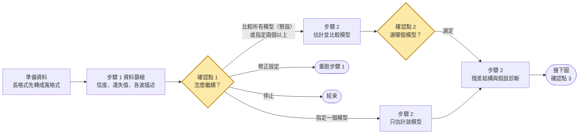

分析流程（二）：從預測變數到報告

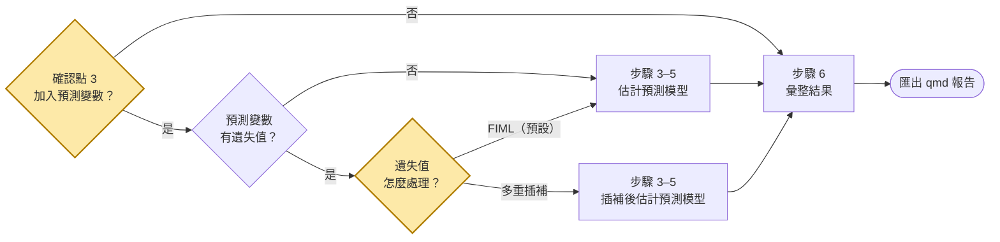

確認點 1 預設比較所有模型；使用者也可以直接指定成長模型（`--forms`）：指定一個時只估計該模型、略過確認點 2（有配適問題時先提醒，見 SKILL.md），指定兩個以上時只比較指定的模型。步驟 2 依序是估計並比較模型 → 確認點 2 → 殘差結構 → 假設診斷 → 時間編碼敏感度，一律用 FIML。確認點 3 決定是否加入預測模型（下面的決策樹）；加入的預測變數有遺失值時，才問用 FIML（預設）或多重插補（`--missing fiml|mi`）。修正設定之後，從步驟 1 再走一次。

確認點 3：依想回答的問題選預測模型（可以複選）：

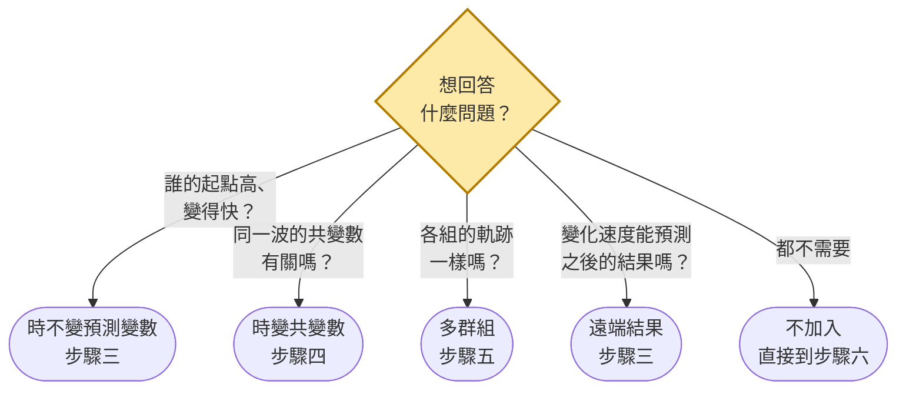

步驟 1、2 一律執行；步驟 3、4、5 由確認點 3 的選擇決定（`--covs`、`--tvc`、`--group` 或 `--split`），可以複選、同時做。遠端結果在步驟三估計，需要同時有時不變預測變數。

每個確認點要呈現什麼、問什麼，見 SKILL.md「確認點」；確認點 1 的判讀規則見 `02-preliminaries.md` 第 7 節，確認點 2 的建議規則見第 3 節。分段執行用 `run_pipeline.R --stage screen／model／predictors`；使用者說「不用問我，直接跑完」或無人值守時用 `--auto` 一次跑完，確認點採用系統建議並在分析決定紀錄中註明。範例資料：`run_all_demos.R`。

## 2. 路徑圖

線性 LGM（圓形 = 潛在變項，方形 = 觀察變項；箭頭上的數字是固定負荷）：

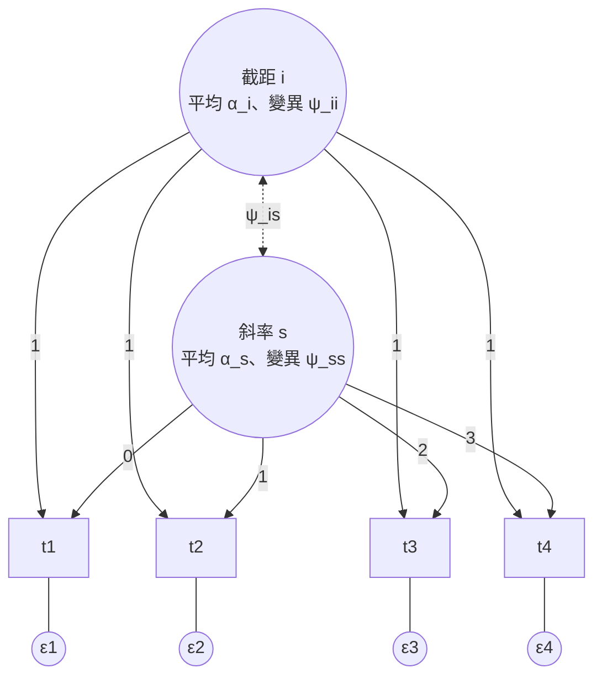

條件模型（TIC 預測成長因子；TVC 影響同一波的結果）：

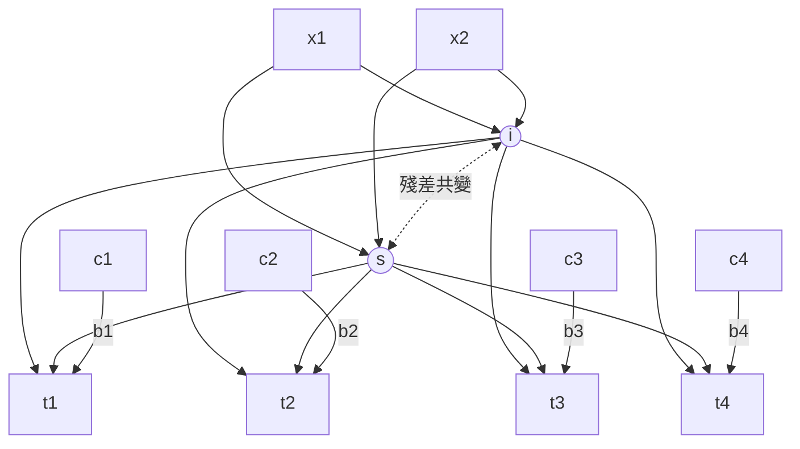

## 3. 步驟二：軌跡形式與殘差結構

建議的形式（和使用手冊「軌跡形式」的決策樹相同）：

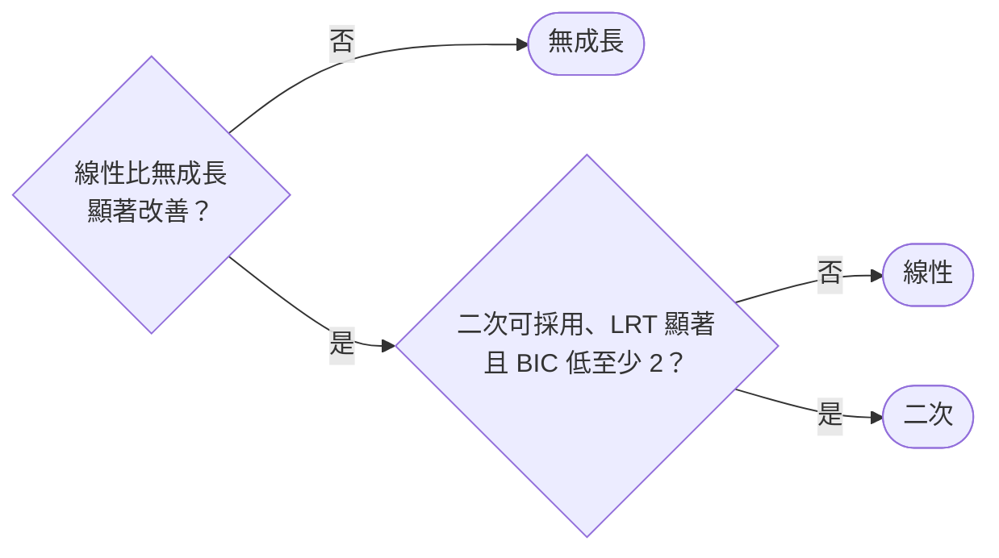

潛在基底只作參考，用來判斷線性是否足夠；只有 3 波時不估計二次。門檻與出處見 `09-fit-criteria.md`（BIC 低至少 2 是 Raftery 的「有證據」）。確認點 1 指定兩個以上的形式時，只在指定的形式中依同一張圖建議。這是**建議**；在確認點 2 由使用者選定。使用者選了「可採用 = 否」的模型（負變異數、未收斂、標準化負荷 > 1）時，說明問題並請他再確認一次。

選定形式之後（自動執行，不另外詢問）：

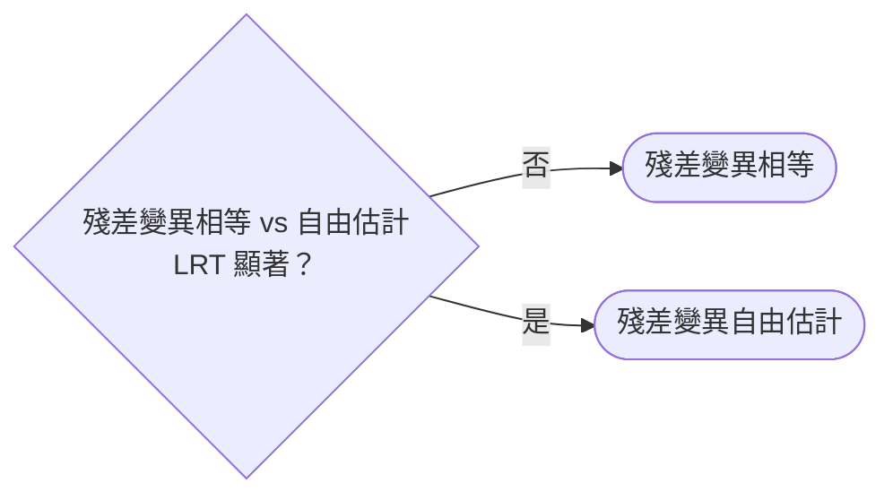

接著做假設診斷（殘差平均無趨勢？殘差 SD 相近？因子分數常態？）與時間編碼敏感度（截距移到另一端，配適不變、截距參數改變），記錄採用的設定供後續步驟沿用。殘差平均有規律的趨勢時，回到確認點 2 改選形式。

`step2_unconditional.R` 依上圖產生建議（寫在 `recommendation.txt`），在確認點 2 讓使用者選；使用者的選擇用 `--choose` 傳入（`run_pipeline.R --stage predictors --choose ...` 會在選擇和目前不同時自動重跑步驟二）。潛在基底不列為選項：它的負荷接近線性時間時，代表線性已足夠；使用者主動要求時才用 `--choose basis`。殘差結構依 LRT 自動決定，必要時以 `--residuals` 覆寫。採用的設定寫在 `chosen.txt`。

## 4. 步驟三：時不變預測變數

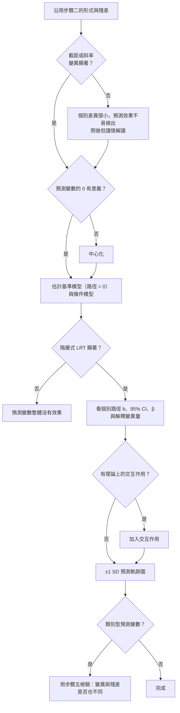

## 5. 步驟四：時變共變數

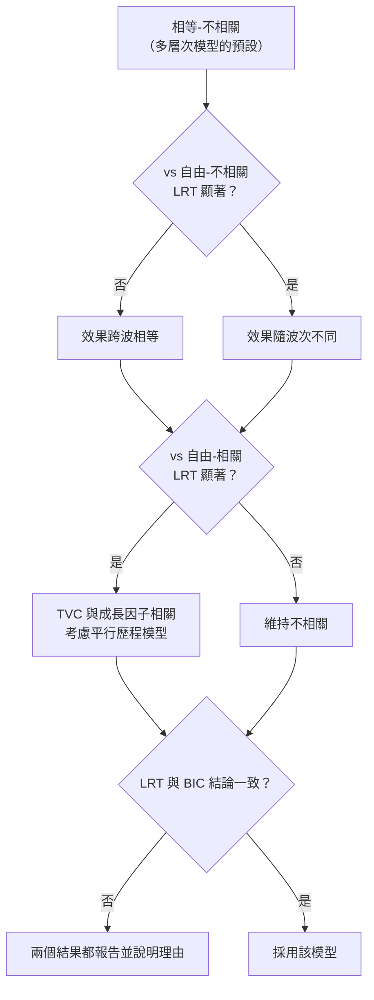

## 6. 步驟五：多群組

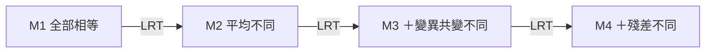

M1→M2 顯著：平均軌跡不同。M2→M3、M3→M4 不顯著：支持步驟三「預測變數不改變個別差異與殘差」的假設。

## 7. 估計問題排除

和使用手冊的問題排除決策樹相同：五個判斷由左到右，處理方式掛在各自下方。估計結果看每個模型的 `diagnostics.txt`；每次修正後重新估計，從最左邊再判斷一次。

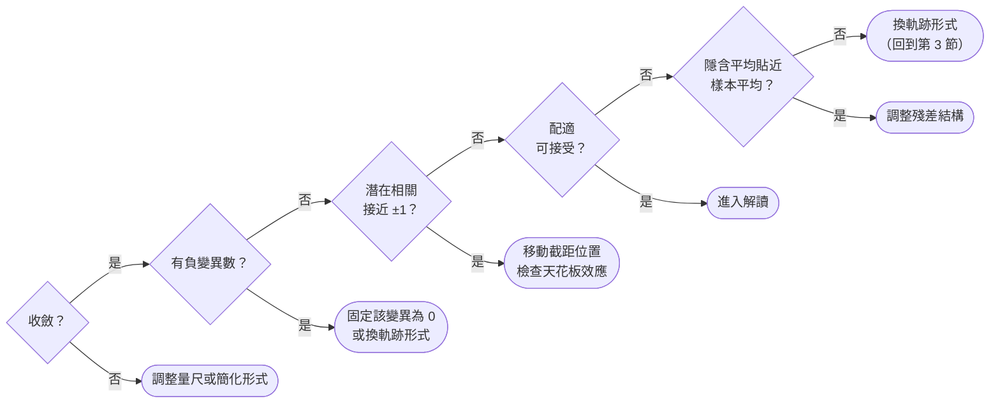

處理方式的細節：

| 判斷 | 處理 |
|---|---|
| 不收斂 | 重新量尺化（分數除以 10）、時間單位改成年或月；簡化形式 |
| 負變異數 | 殘差：CI 含 0 時固定為 0，或改用殘差變異相等。斜率：固定斜率變異與共變為 0，與自由模型比較。二次項：固定 q 的變異為 0，或改用線性／潛在基底。無成長模型出現負變異數是正常的（資料明顯在變） |
| 潛在相關接近 ±1 | 用 `--anchor` 改變截距位置；檢查天花板效應；簡化形式 |
| 隱含平均偏離樣本平均 | 形式錯誤：回到第 3 節 |
| 隱含平均貼近但配適差 | 殘差結構問題：殘差變異自由估計；有理論時加入相鄰波殘差相關 |
